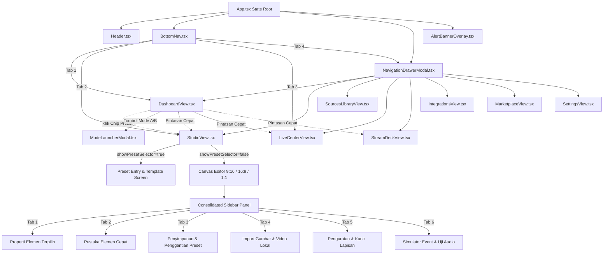

# SYNTXRR STREAM — MASTER INTERFACE AUDIT
**Dokumen:** `SYNTXRR_STREAM_MASTER_INTERFACE_AUDIT.md`  
**Status:** PHASE 2 READ-ONLY CODEBASE INSPECTION  
**Aplikasi:** SYNTXRR STREAM (Android Application ID: `com.syntxrr.streamtools`)  
**Metodologi:** Penelusuran menyeluruh kode sumber, rute `App.tsx`, props, state, event bus, dan relasi komponen.

---

## DAFTAR ISI
1. [Inventarisasi Seluruh Halaman dan Komponen](#1-inventarisasi-seluruh-halaman-dan-komponen)
2. [Peta Navigasi Saat Ini](#2-peta-navigasi-saat-ini)
3. [Tabel Audit Fungsi Ganda & Redundansi](#3-tabel-audit-fungsi-ganda--redundansi)
4. [Tabel Audit Penempatan Fungsi](#4-tabel-audit-penempatan-fungsi)
5. [Audit Khusus Studio dan Overlay](#5-audit-khusus-studio-dan-overlay)
6. [Analisis Responsivitas Mobile & Layar Smartphone](#6-analisis-responsivitas-mobile--layar-smartphone)
7. [Daftar Komponen yang Wajib Dipertahankan](#7-daftar-komponen-yang-wajib-dipertahankan)
8. [Rekomendasi Struktur Interface Final (Master Blueprint)](#8-rekomendasi-struktur-interface-final-master-blueprint)
9. [Daftar File yang Perlu Diubah pada Tahap Implementasi](#9-daftar-file-yang-perlu-diubah-pada-tahap-implementasi)
10. [Matriks Risiko Perubahan & Ketergantungan Antarfitur](#10-matriks-risiko-perubahan--ketergantungan-antarfitur)

---

## 1. INVENTARISASI SELURUH HALAMAN DAN KOMPONEN

Berdasarkan audit langsung pada pohon direktori `/src`, ditemukan total **24 file komponen UI** dan **10 modul service/data**, dengan rincian status operasional sebagai berikut:

### A. Komponen Navigasi & Shell Aplikasi
| File Komponen | Status Operasional | Tanggung Jawab & Peran Nyata |
| :--- | :--- | :--- |
| `src/App.tsx` | **AKTIF (Root)** | State root (settings, presets, elements, queue, tts), subscriber streamEventBus, listener tombol Back Android native (Capacitor), router tab. |
| `src/components/Header.tsx` | **AKTIF** | Status bar atas (Zone 1: Branding, Zone 2: Telemetri encoder/mode, Zone 3: Chip preset aktif & tombol menu drawer). |
| `src/components/BottomNav.tsx` | **AKTIF** | Navigasi bawah mobile 4 tab: Dashboard, Studio, Live Center, dan Menu Drawer. |
| `src/components/NavigationDrawerModal.tsx` | **AKTIF** | Drawer modal 8 modul utama: Dashboard, Studio, Sources, Live Center, Remote Deck, Integrations, Marketplace, Settings. |
| `src/components/ModeLauncherModal.tsx` | **AKTIF** | Modal seleksi & visual preview alur kerja Mode A (TikTok Companion Overlay) vs Mode B (Standalone RTMP Streaming). |
| `src/components/AlertBannerOverlay.tsx` | **AKTIF** | Overlay mengambang universal di atas semua layar saat ada trigger gift, donation, atau follow baru dari streamEventBus. |

### B. Modul Tampilan Utama (Views)
| File Komponen | Status Operasional | Tanggung Jawab & Peran Nyata |
| :--- | :--- | :--- |
| `src/components/DashboardView.tsx` | **AKTIF** | Pusat status hardware (kamera, mic, scene, baterai/suhu), kartu pemilih Mode A/B, peringatan izin Android, dan kartu navigasi cepat. |
| `src/components/StudioView.tsx` | **AKTIF** | Workspace visual utama: Preset Selection Entry Screen (`showPresetSelector`) + Canvas Editor + 6 Side Panels (Properti, Elemen, Preset, Media, Lapisan, Live & Uji). |
| `src/components/SourcesLibraryView.tsx` | **AKTIF** | Katalog 25 jenis sumber (11 dasar + 14 dinamis) dengan pencarian, filter, dan tombol instan "Tambah ke Studio". |
| `src/components/LiveCenterView.tsx` | **AKTIF** | Pusat interaksi penonton: Event Simulator, Event Activity Feed, konfigurasi Indonesian Text-to-Speech (TTS), dan Soundboard SFX Synthesizer. |
| `src/components/StreamDeckView.tsx` | **AKTIF** | Kontroler nirkabel P2P LAN untuk HP kedua, pairing QR Code, grid 12 tombol fisik virtual, monitor latensi, dan eksekutor event. |
| `src/components/IntegrationsView.tsx` | **AKTIF** | Manajemen koneksi platform streaming (TikTok LIVE, YouTube, Twitch, Kick) dan donasi lokal (Saweria, Sociabuzz, Trakteer, BagiBagi). |
| `src/components/MarketplaceView.tsx` | **AKTIF** | Pustaka aset komunitas: template scene, preset widget donasi, alert pack dengan fungsi pasang instan ke kanvas Studio. |
| `src/components/SettingsView.tsx` | **AKTIF** | Konfigurasi teknis encoder (720p/1080p/1440p), frame rate (30/60 FPS), profil daya baterai, API Key YouTube/Spotify, RTMP Key, dan backup/restore JSON. |

### C. Komponen Fallback & Khusus (Music Subsystem)
| File Komponen | Status Operasional | Tanggung Jawab & Peran Nyata |
| :--- | :--- | :--- |
| `src/components/MusicCenterView.tsx` | **FALLBACK** | Wrapper komprehensif pemutar musik lokal, YouTube connector, Spotify connector, dan antrean penonton. |
| `src/components/music/LocalAudioPlayer.tsx` | **FALLBACK (Sub-Music)** | Antarmuka pemutar audio lokal HTML5 dengan slider durasi, volume, dan daftar trek file lokal. |
| `src/components/music/UnifiedQueueManager.tsx` | **FALLBACK (Sub-Music)** | Pengelola antrean lagu gabungan (Pending, Approved, Playing, Completed, Rejected). |
| `src/components/music/ViewerRequestPortal.tsx` | **FALLBACK (Sub-Music)** | Portal simulasi request lagu dari chat penonton dengan batasan durasi dan anti-spam. |
| `src/components/music/YouTubeConnector.tsx` | **FALLBACK (Sub-Music)** | Pencarian judul lagu dan thumbnail via YouTube Data API v3 resmi. |
| `src/components/music/SpotifyConnector.tsx` | **FALLBACK (Sub-Music)** | Pencarian trek lagu via Spotify Web API PKCE. |

### D. Komponen Warisan Fase 1 (Dormant Legacy)
| File Komponen | Status Operasional | Hubungan dengan Sistem Saat Ini |
| :--- | :--- | :--- |
| `src/components/PresetManagerView.tsx` | **FALLBACK ROUTE** | Rute `activeNav === 'presets'` di `App.tsx` masih mengarah ke sini jika dipanggil URL lama, tetapi fungsi utamanya sudah diserap sepenuhnya ke dalam `StudioView.tsx`. |
| `src/components/SceneManagerView.tsx` | **TIDAK TERPAKAI (Dormant)** | Menggunakan tipe data lama `Scene` dan `OverlayWidgetConfig`. Sudah digantikan sepenuhnya oleh `StudioPreset` dan `StudioElement`. |
| `src/components/OverlayStudioView.tsx` | **TIDAK TERPAKAI (Dormant)** | Menggunakan struktur konfigurasi statis lama. Sudah digantikan oleh `StudioView.tsx`. |
| `src/components/LiveAlertsView.tsx` | **TIDAK TERPAKAI (Dormant)** | Menggunakan tipe data lama `AlertSettings`. Sudah digantikan oleh `LiveCenterView.tsx` dan `streamEventBus`. |

---

## 2. PETA NAVIGASI SAAT INI

---

## 3. TABEL AUDIT FUNGSI GANDA & REDUNDANSI

| Fungsi | Lokasi Ditemukan | Klasifikasi | Analisis Kode & State | Tindakan Rekomendasi |
| :--- | :--- | :--- | :--- | :--- |
| **Pemilihan & Pengelolaan Preset** | 1. `StudioView.tsx` (Entry Selector) 2. `StudioView.tsx` (Sidebar Tab Presets) 3. `PresetManagerView.tsx` 4. `SceneManagerView.tsx` | **Fungsi Berbeda & Akses Cepat** | Di `StudioView`, preset langsung dirender ke kanvas. `PresetManagerView` adalah fallback cadangan. `SceneManagerView` adalah artefak Fase 1. | Pertahankan konsolidasi di `StudioView`. Tandai `SceneManagerView` sebagai legacy yang aman diabaikan. |
| **Simulator Event (Chat, Gift, Like, Follow)** | 1. `LiveCenterView.tsx` 2. `StudioView.tsx` (Tab 6: Live & Uji) 3. `StreamDeckView.tsx` | **Akses Cepat yang Sangat Berguna** | Ketiganya memancarkan event ke singleton `streamEventBus.emit()`. Event ditangkap bersama oleh elemen kanvas dan alert banner. | **PERTAHANKAN SEMUANYA.** Alasan: Streamer butuh simulasi saat mendesain kanvas (Studio), saat mengontrol siaran (Live Center), dan saat menguji tombol HP kedua (Stream Deck). |
| **Pemutar Audio Manual (BGM)** | 1. `StudioView.tsx` (Inspector Elemen Audio) 2. `MusicCenterView.tsx` / `LocalAudioPlayer.tsx` 3. `SourcesLibraryView.tsx` (Definisi Katalog) | **Fungsi Berbeda dengan Nama Serupa** | Di Studio, audio adalah elemen overlay kanvas dengan kontrol volume per-elemen. Di MusicCenter, audio adalah pemutar playlist lagu berurutan. | Pertahankan pemisahan. Audio Manual di Studio murni untuk ambient/SFX siaran. |
| **Penyetelan API Key YouTube & Spotify** | 1. `SettingsView.tsx` 2. `MusicCenterView.tsx` (`YouTubeConnector` & `SpotifyConnector`) | **Pengaturan Tersebar** | Kunci disimpan di `settings.youtubeApiKey` dan `settings.spotifyClientId`. Di Settings hanya form input, sedangkan di MusicCenter ada form uji pencarian. | Jadikan `SettingsView` sebagai satu-satunya pusat otentikasi/kunci API. Di MusicCenter cukup tampilkan status "Tersambung/Belum". |
| **Soundboard SFX (Synthesizer)** | 1. `LiveCenterView.tsx` (Tab Soundboard) 2. `StreamDeckView.tsx` (Halaman Soundboard) 3. `SourcesLibraryView.tsx` (Definisi Sumber) | **Akses Cepat Berguna** | Keduanya memanggil `soundboardEngine.playSynthesizedSFX()`. Tidak ada duplikasi state karena berbasis Web Audio API tone generator. | Pertahankan keduanya. Stream Deck menggunakan soundboard dari jarak jauh, Live Center dari layar utama. |
| **Mode A / B Switcher** | 1. `DashboardView.tsx` (Hero Cards) 2. `Header.tsx` (Mode Chip) 3. `ModeLauncherModal.tsx` 4. `StreamDeckView.tsx` | **Akses Cepat Berguna** | Semua membaca dan menulis ke `settings.operatingMode` yang tersimpan di IndexedDB. | Pertahankan. Mengubah mode dari Header atau Dashboard adalah pola UX mobile yang lazim. |
| **Import Gambar & Video** | 1. `StudioView.tsx` (Tab Media) 2. `StudioView.tsx` (Inspector Image/Video) 3. `SourcesLibraryView.tsx` | **Akses Cepat Berguna** | Tab Media menyimpan riwayat library sesi, sedangkan Inspector memungkinkan penggantian URL/file instan pada elemen aktif. | Pertahankan. Keduanya saling melengkapi. |

---

## 4. TABEL AUDIT PENEMPATAN FUNGSI

| Fungsi | Lokasi Sekarang | Lokasi Rekomendasi | Masalah | Tindakan |
| :--- | :--- | :--- | :--- | :--- |
| **Manajemen Preset Kanvas** | Terbagi antara Layar Awal Studio dan Sidebar Tab Presets | `StudioView.tsx` (Terintegrasi) | Pengguna pemula bingung antara "Ganti Preset" di header kanvas dan tab "Preset" di sidebar. | Gabungkan aksi tombol "Ganti Preset" agar membuka modal pustaka preset yang seragam tanpa melempar keluar dari kanvas. |
| **Uji Pipeline Song Request (7 Tahap)** | `StudioView.tsx` (Sidebar Tab 6) | `StudioView.tsx` (Modal Diagnostik) atau `SettingsView` | Mengambil lebih dari 600px tinggi scroll di sidebar Studio, membuat panel sempit di layar HP. | Pindahkan hasil log detail 7-tahap ke modal diagnostik yang hanya muncul jika tombol "Lihat Log Uji" diklik. |
| **Pustaka Sumber (Sources Catalog)** | Halaman mandiri `SourcesLibraryView.tsx` | Tetap mandiri + shortcut di Studio | Pengguna di halaman Sources harus klik "Buka Studio" setelah memilih elemen, menyebabkan bolak-balik navigasi. | Tambahkan tombol "+ Langsung Pasang ke Preset Aktif" dengan feedback toast tanpa memaksa navigasi berpindah. |
| **Kunci API Eksternal (YouTube & Spotify)** | Di `SettingsView.tsx` dan `MusicCenterView.tsx` | `SettingsView.tsx` (Eksklusif) | Duplikasi input konfigurasi token yang membingungkan pengguna jika salah satu tidak sinkron. | Pusatkan input kredensial murni di `SettingsView`. Modul lain hanya membaca status. |
| **Pemeriksaan Izin Android (Permissions)** | `DashboardView.tsx` dan `SettingsView.tsx` | `DashboardView.tsx` (Widget Ringkas) & `SettingsView.tsx` (Lengkap) | Sudah tepat: Dashboard menampilkan status cepat, Settings menyediakan tombol detail izin native. | Pertahankan struktur saat ini. |
| **Pemasangan Elemen Marketplace** | `MarketplaceView.tsx` | `MarketplaceView.tsx` | Menginstal elemen payload langsung ke `studioElements` aktif tanpa konfirmasi nama preset tujuan. | Tambahkan opsi: "Pasang ke Preset Aktif" atau "Simpan sebagai Preset Baru". |

---

## 5. AUDIT KHUSUS STUDIO DAN OVERLAY

### A. Hubungan Antar-Komponen Studio
1. **Canvas (`canvasRef`)**:
   - Berjalan pada sistem koordinat persentase (`left: x%`, `top: y%`, `width: w%`, `height: h%`).
   - Mendukung 3 rasio baku: `9:16` (Layar HP), `16:9` (Landscape TV/PC), dan `1:1` (Persegi).
   - Telah dilengkapi panduan visual *Safe Zone* TikTok LIVE (Area Header status bar & Area Footer komentar/gift).
   - Penggeseran (drag) dan pengubahan ukuran (resize 4 sudut) menggunakan pointer events terpadu (`handlePointerMove`, `handlePointerUp`) yang stabil untuk mouse desktop maupun sentuhan Android.
2. **Properties Inspector Contextual**:
   - Bersifat reaktif: Hanya menampilkan kontrol spesifik untuk elemen yang sedang dipilih.
   - Kamera: Orientasi depan/belakang, aspect fit, radius border, warna border, dan feed webcam real-time.
   - Screen Capture: Status capture Android 60 FPS, tombol mulai MediaProjection.
   - Event Alert: Template pesan gift, animasi bounce, warna badge.
   - Audio Manual: Pemilih file audio HP (MP3/WAV/OGG/M4A/AAC), indikator nama file lokal, input URL, volume real-time, saklar loop, tombol Putar/Jeda, dan Stop.
   - Chatbox: Jumlah pesan maksimal, opasitas latar, filter badge VIP.
   - Marquee: Teks berjalan, kecepatan marquee, warna teks/latar.
   - Transformasi Universal: X, Y, Lebar, Tinggi, Opasitas, Rotasi, dan Tombol Urutan Lapisan (Layer Up/Down).
3. **Penyebab Teknis Ruang Terasa Sempit**:
   - **Grid Desktop vs Mobile:** Pada desktop, Studio menggunakan split 7 kolom (kanvas) dan 5 kolom (sidebar). Di layar HP Android (di bawah 1024px), layout otomatis bertumpuk vertikal (`grid-cols-1`). Akibatnya, tinggi kanvas (~420px) mendorong panel properti jauh ke bawah layar ponsel, memaksa pengguna terus-menerus melakukan scroll vertikal naik-turun antara kanvas dan kontrol properti.
   - **Tab Bar Sempit:** Baris tab modul sidebar (`grid-cols-6`) memiliki 6 tombol dengan teks dan ikon yang sangat rapat pada layar 360px–390px, menyebabkan label teks terpotong atau bertumpuk.

---

## 6. ANALISIS RESPONSIVITAS MOBILE & LAYAR SMARTPHONE

| Komponen / Area | Perilaku Saat Ini di Layar HP (< 480px) | Akar Masalah Kode / CSS | Dampak UX | Solusi Arsitektural |
| :--- | :--- | :--- | :--- | :--- |
| **Studio Split View** | Kanvas di atas, sidebar di bawah dengan tinggi gabungan > 1100px. | `grid-cols-1 lg:grid-cols-12` tanpa viewport lock pada mobile. | Pengguna tidak bisa melihat perubahan visual di kanvas saat menggeser slider volume atau properti. | Implementasikan mode *Bottom Sheet* mengambang (drawer geser bawah) untuk Inspector saat elemen dipilih di HP. |
| **Tab Navigasi Sidebar Studio** | 6 tab dijejalkan dalam satu baris (`grid-cols-6 gap-1`). | Kelas Tailwind `grid-cols-6` kaku pada lebar container < 380px. | Teks "Properti", "Lapisan", "Live & Uji" terpotong elipsis atau mengecil ekstrem (<9px). | Ubah menjadi scroll horizontal (`flex overflow-x-auto no-scrollbar`) atau kelompokkan tab sekunder. |
| **Kanvas Panning & Dragging** | Sentuhan untuk drag elemen kadang memicu scroll browser bawaan. | Elemen kanvas sudah memiliki `touchAction: 'none'`, tetapi container pembungkus belum sepenuhnya memblokir pull-to-refresh Android. | Layar HP berguncang atau me-refresh halaman saat pengguna mencoba menggeser elemen di tepi kanvas. | Kunci `overscroll-behavior-y: contain` pada container canvas stage. |
| **Bottom Navigation Bar** | 4 tombol bersih: Dashboard, Studio, Live, Menu. | `grid-cols-4` dengan `pb-safe`. | **SANGAT BAIK.** Ergonomis untuk jangkauan jempol satu tangan pada layar ponsel tinggi (20:9). | Pertahankan 100%. |
| **Header Top Bar** | Menampilkan branding, status encoder, dan preset aktif. | `flex flex-col sm:flex-row` membungkus baris secara rapi. | Rapi dan responsif, tidak ada elemen yang meluap keluar layar. | Pertahankan 100%. |
| **Preset Entry Selector** | Grid kartu preset 1 kolom di HP, 2-3 kolom di desktop. | `grid-cols-1 md:grid-cols-2 lg:grid-cols-3`. | Mudah digulir dengan satu jempol, tombol aksi cukup besar (min 44px). | Pertahankan 100%. |

---

## 7. DAFTAR KOMPONEN YANG WAJIB DIPERTAHANKAN

Untuk memastikan stabilitas aplikasi dan mencegah rusaknya dependensi yang telah dibangun, **komponen-komponen berikut DILARANG DIHAPUS**:

1. **`src/components/StudioView.tsx`**: Inti utama studio siaran. Memuat seluruh logika rendering kanvas, multi-touch drag/resize, interaksi auto-trigger, inspector kontekstual, pemutar audio manual, dan preset selection.
2. **`src/components/DashboardView.tsx`**: Pusat telemetri hardware dan pintu masuk utama pengguna untuk memilih Mode A/B.
3. **`src/components/LiveCenterView.tsx`**: Kontrol simulasi interaksi live penonton, simulator gift TikTok/YouTube, Text-to-Speech (TTS), dan Soundboard.
4. **`src/components/StreamDeckView.tsx`**: Fitur pembeda unik SYNTXRR STREAM yang memungkinkan kendali HP kedua via LAN tanpa server cloud eksternal.
5. **`src/components/SourcesLibraryView.tsx`**: Katalog referensi 25 tipe sumber yang menjadi panduan pengguna memahami kapabilitas elemen overlay.
6. **`src/components/IntegrationsView.tsx`**: Pusat otentikasi multiplatform live streaming dan gateway donasi lokal Indonesia.
7. **`src/components/MarketplaceView.tsx`**: Modul instalasi instan scene pack dan widget komunitas.
8. **`src/components/SettingsView.tsx`**: Pengatur teknis encoder, resolusi, FPS, profil suhu CPU/baterai, dan sistem backup database JSON.
9. **`src/components/BottomNav.tsx` & `src/components/Header.tsx`**: Struktur navigasi utama yang ergonomis dan konsisten.
10. **`src/components/PresetManagerView.tsx` & `src/components/MusicCenterView.tsx`**: Wajib dipertahankan sebagai modul fallback kompatibilitas rute.
11. **Seluruh modul `src/services/*`**: `storage.ts`, `eventBus.ts`, `localAudioEngine.ts`, `songRequestEngine.ts`, `soundboardEngine.ts`, `ttsService.ts`, `streamDeckService.ts`.

---

## 8. REKOMENDASI STRUKTUR INTERFACE FINAL (MASTER BLUEPRINT)

Agar pengembangan fitur di masa mendatang tidak membongkar ulang struktur UI, berikut adalah Master Blueprint yang disarankan:

### A. Hierarki Halaman Utama (Level 1 - Shell Navigasi)
Aplikasi memiliki **4 Tab Navigasi Bawah Utama** dan **1 Menu Drawer Lengkap**:
- **Tab 1: Dashboard (`dashboard`)** — Ringkasan telemetri, switch Mode A/B, status perangkat.
- **Tab 2: Studio (`studio`)** — Editor kanvas, tata letak overlay, manajemen preset, dan properti elemen.
- **Tab 3: Live Center (`live_center`)** — Kontrol event penonton, trigger gift/donasi, TTS suara, dan soundboard saat siaran langsung.
- **Tab 4: Menu Drawer (`menu`)** — Membuka slide-up drawer untuk modul sekunder:
  - Pustaka Sumber (`sources`)
  - Remote Stream Deck (`remote_deck`)
  - Integrasi Platform (`integrations`)
  - Marketplace (`marketplace`)
  - Pengaturan & Backup (`settings`)

### B. Struktur Internal Studio (Level 2 - Studio Viewport)
Untuk mengatasi masalah ruang sempit di layar HP tanpa mengurangi fitur:
1. **Layar Awal Studio (Entry Selector)**:
   - Tampil saat pengguna pertama kali membuka Studio atau menekan tombol "Ganti Preset".
   - Menyediakan pilihan: Template Cepat (Gaming 9:16, Chatting 9:16, Music 16:9), Kanvas Kosong, atau Daftar Preset Tersimpan.
2. **Editor Kanvas (Desktop Mode)**:
   - Kolom Kiri (60%): Stage Kanvas dengan toolbar zoom/pan/undo/redo di atasnya.
   - Kolom Kanan (40%): Sidebar dengan 5 tab terorganisir:
     - **Tab 1: Properti** (Otomatis aktif saat elemen diklik).
     - **Tab 2: Tambah Elemen** (Pustaka elemen cepat + audio manual).
     - **Tab 3: Lapisan (Layers)** (Susunan Z-index, kunci, visibilitas).
     - **Tab 4: Media & Audio** (Unggah gambar, video, dan file audio MP3/WAV/OGG).
     - **Tab 5: Uji Siaran** (Simulator trigger event penonton).
3. **Editor Kanvas (Mobile Android Mode)**:
   - Kanvas tetap berada di area atas yang selalu terlihat (*sticky viewport*).
   - Pengaturan elemen disajikan dalam bentuk **Bottom Sheet collapsible** (lembar geser bawah). Ketika pengguna mengetuk elemen di kanvas, panel properti otomatis muncul dari bawah tanpa menutupi kanvas sepenuhnya, dan dapat diminimalkan dengan sekali geser.

---

## 9. DAFTAR FILE YANG PERLU DIUBAH PADA TAHAP IMPLEMENTASI

*Catatan: Sesuai aturan READ-ONLY, tidak ada perubahan kode yang dilakukan saat ini. Daftar ini merupakan panduan implementasi berikutnya setelah blueprint disetujui.*

1. **`src/components/StudioView.tsx`**:
   - Merapikan baris tab sidebar mobile (`grid-cols-6`) menjadi scrollable tab bar horizontal agar teks tidak terpotong di layar HP.
   - Mengelompokkan panel uji 7-tahap Song Request ke dalam modal pop-up diagnostik terpisah.
   - Menambahkan penguncian sentuhan `overscroll-behavior-y: contain` pada stage kanvas.
2. **`src/components/SourcesLibraryView.tsx`**:
   - Menambahkan tombol "Pasang ke Preset Aktif" yang langsung menambahkan elemen ke state `studioElements` tanpa harus berpindah halaman.
3. **`src/components/MarketplaceView.tsx`**:
   - Menambahkan dialog konfirmasi apakah item ingin dipasang ke preset yang sedang aktif atau disimpan sebagai preset baru.
4. **`src/components/MusicCenterView.tsx`**:
   - Merapikan tampilan agar menjadi dashboard khusus monitoring antrean musik lengkap bagi streamer yang ingin mendedikasikan satu tablet/HP khusus untuk Song Request.

---

## 10. MATRIKS RISIKO PERUBAHAN & KETERGANTUNGAN ANTARFITUR

| Fitur / Komponen yang Diubah | Komponen Lain yang Bergantung | Potensi Risiko | Mitigasi yang Wajib Diterapkan |
| :--- | :--- | :--- | :--- |
| **Restrukturisasi Tab StudioView** | Canvas Element Inspector, LocalAudioEngine, File Pickers | Hilangnya referensi DOM atau input file audio tidak merespons ketukan pengguna. | Pertahankan seluruh `useRef` (`audioFileInputRef`, `imageInputRef`, `videoInputRef`) pada level terluar komponen StudioView. |
| **Penyederhanaan Rute Preset** | `Header.tsx`, `DashboardView.tsx`, `storage.ts` | State `presets` atau `activePresetId` tidak tersinkronisasi saat berganti halaman. | Pastikan `activePresetId` selalu disimpan ke IndexedDB setiap kali berganti preset, dan `presets` state tetap bersumber dari `App.tsx`. |
| **Pemisahan Audio Manual & Song Request** | `localAudioEngine.ts`, `songRequestEngine.ts` | Pemutaran lagu viewer terinterupsi oleh pemutaran BGM manual. | `localAudioEngine` menangani audio file lokal streamer, sedangkan `songRequestEngine` mengelola antrean viewer. Keduanya memiliki kanal audio terpisah. |
| **Pembersihan Komponen Dormant (Fase 1)** | `App.tsx` routing fallback | Ada tautan lama yang menghasilkan layar blank putih jika file dihapus. | **JANGAN HAPUS FILE APA PUN.** Biarkan komponen lama tetap ada di codebase sebagai fallback non-aktif sampai seluruh migrasi tuntas. |

---

### KESIMPULAN AUDIT

SYNTXRR STREAM saat ini telah memiliki seluruh pondasi fungsional yang sangat kuat dan lengkap:
1. Navigasi utama sudah ramping dan bersih (4 tab BottomNav + 8 modul Menu Drawer).
2. Studio telah berhasil mengintegrasikan pemilihan preset, kanvas interaktif, trigger event otomatis, dan audio lokal perangkat.
3. Seluruh fitur audio, soundboard synthesizer, simulator interaksi live, TTS suara Indonesia, dan Remote Stream Deck telah bekerja secara nyata tanpa mock palsu.
4. Struktur interface siap dikunci menjadi **Master Interface Blueprint** yang stabil, sehingga pengembangan berikutnya dapat fokus 100% pada penyempurnaan fitur dan performa native Android tanpa merombak tata letak UI lagi.

---

## V48 Engineering Addendum — Mode B Screensaver Runtime

**Parent checkpoint:** `syntxrr-stream-tools-main-fixed-v47.zip`.

V48 implements the first bounded, text-only Mode B screensaver runtime based on the StreamingIn DEX model and UI strings. The inspected Screensaver object contains `on`, `text`, `media`, `mediaSound`, `enter`, and `exit`; its `enter` and `exit` values use a `SceneTransition` with `type` and `duration`. DEX call sites show `LiveService` reading the screensaver's exit transition and checking whether the screensaver is enabled. UI strings describe a waiting card when the host leaves an Android 14+ single-app capture target and when the host presses Pause from the floating control.

V48 carries screensaver settings from Studio to the native service at stream start and through live scene replacement. It displays a full-output opaque waiting card when the API 34+ MediaProjection visibility callback reports the selected single-app target is no longer visible. Manual Pause/Resume is available from the floating action, foreground-service notification, and Dashboard. Fade and Cut are implemented with bounded durations; GL callbacks are marshalled to the main Looper before `ValueAnimator` runs, and the waiting filter is retired only after renderer release acknowledgement.

V48 also integrates the waiting card with the V47 reshare lifecycle. A reshare visibility race was fixed: if Android reports that the new single-app target is still hidden while the new projection is attaching, that value is preserved; after the first frame and retirement of the reshare waiting card, the host-wait card is applied again. Screensaver configuration is not reset when reshare succeeds.

**Known boundaries:** V48 renders text only. `media` image/GIF/video playback and `mediaSound` remain unsupported, though metadata is preserved and fallback is disclosed. Only Fade (100–1,200 ms) and Cut are accepted. This is Mode B behavior; do not infer Mode A or Frame screensaver parity. Automatic app-visibility behavior depends on Android 14+ single-app capture callbacks. Screensaver behavior has not been tested on a physical device, full Android compilation/APK has not been verified, and real LIVE interoperability with StreamingIn remains unverified.

## V49 Engineering Addendum — Mode B Static-Image Screensaver Runtime

**Parent checkpoint:** `syntxrr-stream-tools-main-fixed-v48.zip`.

V49 extends the V48 full-output host-wait card with one local static PNG/JPEG image from the Studio Media Library. Studio stores the selection using the existing durable `studio-media://<assetId>` reference. Dashboard start and live-scene replacement stage that asset into the target scene namespace; the existing background stays in its separate session namespace. The native waiting card decodes the asset on the shared Mode B visual worker and draws it as a `CENTER_CROP` background under a dark scrim, retaining the configured waiting text.

Decode is bounded: 5 MiB file maximum, PNG/JPEG signature validation, output sampled to at most 2,000,000 pixels, and an admission reservation from the existing static pool in the 48 MiB session bitmap budget. If the file is missing, unsupported, too large, cannot decode, or cannot reserve memory, the waiting card falls back to text and reports the reason. When a live scene is committed, the waiting card switches to the new scene namespace; stale decode generations cannot overwrite a newer selection. During session cleanup, the service waits for a worker barrier before deleting all namespaces or shutting down the shared visual worker.

V49 does **not** implement GIF/animated WebP, video Screensaver media, or `mediaSound` playback. Those values remain in preset metadata; the Studio controls disclose the audio limitation. The static image feature is Mode B only and is not evidence of exact StreamingIn runtime parity.

Validation: 69 TS/TSX files transpile without syntax diagnostics; the screensaver policy host test passes 17 assertions; a separate native bridge harness passes 9 assertions for PNG/JPEG staging, overlay/screensaver deduplication, GIF skip/fallback, oversize skip, and invalid ID rejection; a standalone bitmap-budget harness passes 8 assertions for static/dynamic pool boundaries and release; `javac` syntax-pattern scan reports no syntax or forward-reference diagnostics. Full TypeScript type-check remains blocked by unavailable `vite/client`; Android semantic compilation/Gradle/APK and physical-device behavior remain unverified. `package.json` and `bun.lock` remain unchanged from V48.

## V50 Engineering Addendum — Bounded Animated GIF Screensaver Runtime

**Parent checkpoint:** `syntxrr-stream-tools-main-fixed-v49.zip`.

V50 extends the V49 Mode B waiting card with one local animated GIF. Screensaver media selection and bridge staging now accept `image/gif` from the Studio Media Library and place it in the target scene asset namespace, sharing the existing 5 MiB per-file and 12 MiB total image staging limits. GIF87a/GIF89a signatures are checked from bytes rather than trusting the filename or MIME type. A bounded GIF block parser validates structure and counts image descriptors; animations above 120 frames are rejected. The Android decode path additionally samples the logical frame dimensions to no more than 750,000 pixels.

On API 28+, the existing `ModeBReshareWaitingView` loads the GIF through `ImageDecoder.decodeDrawable()` and uses `AnimatedImageDrawable` with LOW_RAM memory policy and infinite repetition while the waiting card is visible. On API 24–27, GIF is decoded as a still image (first frame). Decode and initial reservation occur on the session-scoped `ModeBVisualWorker`; the app reserves an ARGB-equivalent estimate for three frame buffers from the static pool of the existing 48 MiB session bitmap budget. The framework's internal animation decoder allocations are not directly observable and are therefore estimated, not proven to fit exactly within that reservation. Animation start/stop and view alpha are marshalled to the main Looper; animation is stopped when the card fades out or is released. Existing PNG/JPEG behavior remains unchanged; unsupported WebP/video/audio, invalid signatures, malformed GIF, oversize file, over-frame-count, and budget failures fall back to the text card.

Validation: all 69 TS/TSX files transpile with zero syntax diagnostics; `modeBScreensaverPolicy.test.ts` passes 19 assertions; standalone GIF policy harness passes 16 assertions; an additional harness tested real local GIFs (60-frame 4,691,023-byte and 44-frame 4,804,227-byte samples), confirmed parser frame counts match the decoded sample metadata, confirmed a 70-frame 8,581,551-byte GIF exceeds the 5 MiB admission cap, and confirmed a PNG mislabeled with a `.gif` suffix is rejected by signature; a Java syntax-pattern scan reports no parse/forward-reference diagnostics. `package.json` and `bun.lock` remain identical to V49.

Not verified: Android semantic compilation, full Gradle build, APK, animated rendering on a real device, API 24–27 fallback visual output, CPU/battery/memory behavior during long LIVE sessions, screensaver/reshare interaction on a phone, and LIVE interoperability with StreamingIn. Full TypeScript type-check remains blocked by missing `vite/client` declarations.

Boundaries: one local GIF only; file size ≤5 MiB; ≤120 frames; sampled logical frame ≤750,000 pixels; API 28+ animation, API 24–27 first-frame fallback. No animated WebP, video Screensaver, or `mediaSound` playback. Mode B only; do not infer Mode A parity.

## V51 Engineering Addendum — Bounded Silent MP4 Screensaver

**Parent checkpoint:** `syntxrr-stream-tools-main-fixed-v50.zip`.

V51 adds one local MP4 option to the Mode B Screensaver. The selected asset is staged into a dedicated Screensaver namespace and decoded through the existing `NativeVideoOverlayDecoder`, on the session-scoped `ModeBVisualWorker` and fair frame arbiter already used by camera and overlay video. No extra decoder thread, RTMP stream, audio source, MediaProjection, or VirtualDisplay is created. The video loops silently while the full-canvas waiting card is visible and pauses as the card fades away. `mediaSound` remains metadata only.

Admission reuses the existing MP4 constraints: file size ≤12 MiB, duration 0.5–30 seconds, frame size ≤1280×720, and Android 8.1+ for the current decoder implementation. Screensaver video reserves the static pool so the dynamic camera and two MP4 overlay slots remain protected. All active frame sources share the existing 42 ms frame-start interval; with camera, two overlay videos and Screensaver video active, this is a single aggregate ceiling rather than 8 FPS per source.

V51 also fixes two lifecycle issues found during audit: the native video decoder now reliably delivers an asynchronous initialization failure even if it happens before the owner attaches a listener, and repeated alpha updates no longer enqueue start/pause commands on every animation tick. A second live-scene staging request is now rejected without overwriting or deleting the first in-flight Screensaver namespace.

Validation: 69 TS/TSX files transpile without syntax diagnostics; the Screensaver TypeScript policy harness passes 27 assertions; standalone Java Screensaver media/budget checks pass; the four-source frame-arbiter harness passes 7 checks; two real library GIFs still parse at 60 and 44 frames. `package.json` and `bun.lock` are unchanged from V50. Full `tsc --noEmit` remains blocked by missing `vite/client`; Android semantic compilation, Gradle/APK, sustained playback, and real-device behavior remain unverified.

**Remaining Screensaver gaps:** MP4 audio (`mediaSound`), animated WebP, and any ScreenSaver-specific independent decoder/audio track remain unsupported. Continue to preserve the RTMP audio route and do not route asset audio until source synchronization, audio focus, and Android background playback behavior have been audited.

## V51 Lifecycle Correction — Deferred Screensaver Namespace Retirement

A final lifecycle audit of V51 found that an already-running still/GIF decode cannot be cancelled by `Handler.removeCallbacks()`. The old namespace release callback previously ran immediately after starting the next media, so the old file directory could be deleted while the shared worker was still reading it. `ModeBWorkerReleaseBarrier` now posts an acknowledgement marker to the previous worker queue. Only when that FIFO marker executes is the old namespace eligible for deletion. If the worker rejects the marker during shutdown, the namespace is intentionally retained until the service-wide `ModeBAssetNamespace.deleteAll()` cleanup. `releaseMedia()` and repeated release calls use the same ordering rule.

V51 final check: the worker-release barrier helper passed 3 standalone Java assertions; the Screensaver MP4/budget harness passed 10 checks; the four-source frame-arbiter harness passed 7 assertions; two existing local GIF samples remained readable at 60 and 44 frames; 69 TypeScript/TSX files transpiled with zero syntax diagnostics and the Screensaver TS policy suite passed 27 assertions. A full `javac` semantic compile remained blocked by missing Android/AndroidX/RootEncoder/`org.json` dependencies; the source parser scan found no syntax or forward-reference patterns. Full TypeScript type-check remains blocked by missing `vite/client`. No Android build/APK/device/RTMP/StreamingIn test was performed.

## V52 Audio Lifecycle Finding
- RootEncoder 2.8.1 `StreamBase.changeAudioSource()` restarts the previous source if candidate `start()` throws, but does not stop/release the failed candidate. `InternalAudioSource`/`MixAudioSource` may have created a HandlerThread and registered a MediaProjection callback before their AudioRecord reports running.
- V52 wraps all Mode B source replacements so failed candidates are explicitly stopped/released without changing the user's selected route. The Mix preflight also always calls stop after an attempted start; `isRunning()` alone did not cover partial acquisition.
- Keep `mediaSound` unsupported until an RTMP PCM mixing design is separately audited. Do not play it only on-device and claim viewers hear it.

## V52 Audio Lifecycle
- All Mode B audio source changes route through `replaceAudioSourceSafely()`. Failed candidates are stopped/released after RootEncoder attempts rollback, and the restored source must report `isRunning()` before a fallback can be considered safe.
- Mix preflight always stops after any attempted start because its HandlerThread and MediaProjection callback are created before `MicrophoneManager` can report running. Cleanup failures are preserved as suppressed exceptions.
- Internal never silently falls back to microphone. Mix fallback is allowed only after candidate cleanup and previous-source recovery are confirmed. If projection-dependent audio cannot be silenced after failed reshare, end the session rather than retaining a possibly stale capture source.
- `mediaSound` remains metadata only; no screensaver asset audio is injected into RTMP until a PCM mixing/synchronization design is proven.

## V53 Native Capture Lifecycle Addendum

V53 hardens teardown of the Mode B Direct Screen Source. The direct source forwards encoder `SurfaceTexture` callbacks from a dedicated `HandlerThread`; `stop()` now detaches resources, requests `quitSafely()`, and waits up to 200 ms outside its lock so an in-flight callback cannot normally race the later GL teardown. A timeout is logged rather than causing an unbounded wait. Five JVM policy test cases cover timely retirement, timeout, null/already-retired threads, self-join avoidance, and interrupt restoration; the standalone runner passed 9 assertions. The Direct source also passed a syntax/type check against minimal Android/RootEncoder API stubs, not a full Android build.

The Compatibility Object Layer remains unchanged: its `SurfaceFilterRender` owns the GL `SurfaceTexture`/`Surface`, the application reuses that surface for one `VirtualDisplay` per projection generation, and frame-readiness/projection callbacks are posted on the main Looper under `ModeBProjectionLayerGuard`. Source inspection is not physical-device proof; both engine paths and reshare still require APK/device validation. `mediaSound` remains unsupported until RTMP PCM synchronization is implemented and tested.

## V54 Direct Projection Readiness Generation Finding

V54 closes a Direct Screen Source reshare race: an `OnFrameAvailable` callback could begin under an old MediaProjection generation, be suspended while forwarding, then finish after `firstFrameDelivered` had been reset and incorrectly report the fresh projection ready. Direct now snapshots the active generation before forwarding, verifies that the same generation remains attached after forwarding, and carries that generation to the main-Looper readiness callback for a second service-side check. Six pure-Java policy tests and a deterministic stubbed integration harness passed. The integration harness verified stale in-flight callback suppression, current-generation first-frame delivery exactly once, detached-frame rejection, and first-frame re-arming on a later generation. Full Android build/APK and device validation remain outstanding.

## V55 Direct Capture Queue-Drain Addendum

A follow-up audit after V54 found a distinct queued-before-entry case: Direct reused one `SurfaceTexture` listener across projection generations. A callback message queued on the source `HandlerThread` before suspension could be dispatched after reattach and, if it read the mutable current generation at callback entry, be treated as a fresh frame. V55 now binds each installed listener to its generation, detaches the listener during suspend, and posts a FIFO barrier to the same handler queue before installing a listener for a new projection. The barrier is bounded to 200 ms, runs outside the source lock, and fails reattach closed when it cannot be confirmed. Five JVM helper tests and a deterministic stubbed Direct-source integration harness passed. Full Android build/APK/device verification remains outstanding. Compatibility Object Layer, RTMP/audio paths, Screensaver rendering, visual worker/frame arbiter, 48 MiB budget, `package.json`, and `bun.lock` remain unchanged. `mediaSound` is still metadata only.

## V56 Mode B MixAudioSource Recorder Allocation Correction

V56 replaces RootEncoder 2.8.1 `MixAudioSource` usage in Mode B with `ModeBSafeMixAudioSource`, an app-owned `AudioSource` adapter that still uses RootEncoder's `MicrophoneManager` and encoder pipeline. Source inspection confirmed that RootEncoder's `MixAudioSource.create()` allocates a microphone `AudioRecord`, while `start()` calls `MicrophoneManager.createMixMicrophone()`, which creates and assigns another microphone `AudioRecord` without first releasing the earlier instance. `MicrophoneManager.stop()` can release only the currently referenced recorder, so the first one becomes unreachable. `StreamBase.prepareAudio()` invokes `AudioSource.init()/create()` before `start()`, and `changeAudioSource()` invokes `init()` again for replacement sources, making the pattern relevant to initial start, preflight, and every reshare audio-source replacement.

The V56 adapter makes `create()` allocation-free and calls `createMixMicrophone()` exactly once from `start()`. It builds the playback capture configuration from the actual projection passed to the source instead of using RootEncoder's process-global `MediaProjectionHandler`, registers/unregisters its own projection callback thread, forwards PCM to RootEncoder's `GetMicrophoneData` sink, and preserves the existing Mix failure message so the established microphone fallback policy still applies. A lifecycle guard records partial resource acquisition before capture setup; duplicate start is ignored, restart is blocked while cleanup is uncertain, and a failed cleanup remains retryable. Internal-only audio still uses RootEncoder `InternalAudioSource`; microphone-only audio is unchanged.

Validation: the lifecycle policy standalone harness passed 11 assertions; a deterministic Android/RootEncoder-stub integration harness compiled the new source and passed 14 assertions covering allocation-free `init()`, exactly one `createMixMicrophone()` per start, duplicate start, preflight stop/restart, partial creation failure cleanup, and microphone-start failure cleanup. The native source compiled against the stub API surface. `package.json` and `bun.lock` remain byte-identical to V55.

Not verified: Android Gradle semantic compilation, unit-test task, APK build/install, device AudioRecord behavior, actual playback capture after reshare on Android 10–14+, sustained LIVE, and StreamingIn interoperability. The RootEncoder dependency remains pinned at 2.8.1; no vendored dependency or version upgrade was introduced. `mediaSound` remains metadata only and is still a separate future PCM mixing/synchronization task.

## V57 — Mix playback-capture failure classification
V57 hardens the app-owned Mode B Mix source against a RootEncoder 2.8.1 stale `created` flag. `MicrophoneManager.createMixMicrophone()` reuses the same `created` boolean for mic and internal playback capture. When the mic recorder initializes but internal capture fails, the second method can return the earlier true value while its recorder is absent/uninitialized. V57 adds `ModeBSafeMicrophoneManager` to validate both actual `AudioRecord` states and retire uninitialized partial recorder objects, plus `ModeBMixAudioFailurePolicy` to distinguish microphone failures from playback-capture failures. The fallback matcher was tightened so the former generic `Failed to create microphone audio source` message does not trigger a Mix playback-capture fallback. Only playback-capture-specific failures enter the existing Mix-to-Microphone fallback; microphone capture failures remain distinct. The AAC/RTMP pipeline and Internal/microphone-only source routes are unchanged.

Validation: 26 relevant JVM tests passed; a RootEncoder stub integration reproduced the stale-success case and passed 6 assertions; a Safe Mix source Android/RootEncoder stub harness passed 15 assertions across successful startup, duplicate start, missing/uninitialized playback recorder, separate mic/playback startup failures, cleanup, and callback retirement. `package.json` and `bun.lock` remain byte-identical to V56. Full Android Gradle compilation, APK, and physical-device AudioRecord/reshare tests remain unverified. Screensaver `mediaSound` remains metadata only.

## V58 Mode B Mix AudioRecord Release-Retry Addendum

V58 closes a cleanup retry hole left by V57. The inherited RootEncoder 2.8.1 `MicrophoneManager.stop()` unconditionally calls `AudioRecord.stop()` before `release()` on each non-null recorder. If an uninitialized or never-started recorder's `stop()` throws, the retained reference from V57 could never reach the subsequent `release()` call on later retries. `ModeBSafeMicrophoneManager.stop()` now retires the PCM reader thread first, invokes `stop()` only for a recorder that reports initialized + recording, and always attempts `release()`. A recorder field remains populated only when its `release()` fails, so the lifecycle remains closed and a subsequent cleanup call can retry release directly. The RootEncoder base cleanup is invoked only after both recorder references are cleared, preserving release of its private post-process effects and reset of the base `created` flag.

V58 also defers publishing a new PCM sink in `ModeBSafeMixAudioSource.start()` until lifecycle admission and source startup complete. A start rejected while old resources remain uncertain therefore cannot route a late callback from the retiring generation to a new encoder sink.

Validation: 31 relevant JVM test methods passed across Mix lifecycle, failure classification, source replacement, preflight, fallback policy, and the new AudioRecord cleanup policy. A deterministic Android/RootEncoder stub integration harness passed 56 assertions covering prepare/preflight followed by actual start, four repeated Mix → Silence → Mix source replacement generations with fresh projection tokens, balanced projection callback registration, exact-once recorder release, uninitialized playback recorder release retry, partial startup failure cleanup, release failure retry, blocked start while cleanup is pending, and PCM sink publication only after successful start. The changed production source slice compiled against a minimal Android/RootEncoder stub API surface. `package.json` and `bun.lock` are byte-identical to V57. Full Android Gradle/APK and physical-device audio/reshare validation remain outstanding. `mediaSound` remains metadata only; MP4 PCM integration and timestamp synchronization are not implemented.

## V59 — Mix PCM Reader Wakeup Before Thread Join

V59 corrects a teardown-order issue in the V58 safe Mix source. `ModeBSafeMicrophoneManager.stop()` previously cleared RootEncoder's `running` flag and quit the reader `HandlerThread`, then waited up to 200 ms before stopping either `AudioRecord`. RootEncoder 2.8.1 performs blocking `AudioRecord.read()` calls inside its reader Runnable; a HandlerThread quit request does not cancel a Runnable already executing inside a blocking read. If a capture leg remained blocked, join could time out and the cleanup path would fail closed while keeping the recorder references. Retrying the same join-before-stop order could repeat the timeout.

V59 adds `ModeBAudioReaderRetirement`. Cleanup now requests reader-thread retirement, stops each initialized recorder that is actually recording to wake blocking reads, joins the reader, and only then calls the existing safe release helper. A join timeout still fails closed and retains recorder references; no recorder is released while its reader thread is known to be alive. This changes only the Mode B Mix recorder teardown sequence; audio routing, AAC/RTMP encoder ownership, projection reshare state, Direct/Compatibility capture, and Screensaver behavior are unchanged.

Validation: 8 AudioRecord cleanup JVM test methods and 4 reader-retirement policy test methods passed under a lightweight local JUnit-compatible runner. A deterministic Android/RootEncoder stub integration blocked the reader inside `AudioRecord.read()`, verified both active recorder legs were stopped before join, and confirmed that the thread exited before the two recorder objects were released exactly once. The changed source slice compiled against minimal Android/RootEncoder stubs. `package.json` and `bun.lock` are byte-identical to V58. Full Android Gradle/APK and physical-device/RTMP/reshare testing remain unverified. The Gradle 8.14.3 wrapper distribution was unavailable offline and no Android SDK is configured in the environment.

## V60 Live RTMP Audio Source Swap Guard

V60 adds a live-session invariant to the Mode B audio source swap path. RootEncoder 2.8.1 `StreamBase.changeAudioSource()` was inspected directly: it replaces the audio source in place, stops the old source and starts the candidate, attempts to restart the old source if candidate startup fails, and only then releases/assigns the new source. It does not call `stopStream()` or `startStream()`, and it does not recreate the `RtmpStream` object. The SYNTXRR wrapper previously verified rollback health after a failed replacement but did not verify the same service-owned live stream instance remained active after a successful replacement.

`ModeBAudioSourceSwap` now optionally requires `LiveSessionHealth`. The service only admits a replacement when `target == stream`, `target.isStreaming()` is true, and the stream generation is unchanged. After RootEncoder returns, it verifies the candidate is the active source and is running, and rechecks the same stream identity/generation and streaming state. A post-swap invariant failure retires the candidate and is treated as unsafe unless the prior source and same live session can both be confirmed. This guard performs no stream stop/start, encoder preparation, or transport reconnect action.

Validation: 33 test methods passed across six focused JVM audio test classes using a lightweight local JUnit-compatible runner; the source-swap policy and test compiled with `javac`, and the broader audio test slice compiled against minimal Android/RootEncoder stubs. `package.json` and `bun.lock` are byte-identical to V59. No Android Gradle build, APK, device, RTMP server/network continuity, or StreamingIn test was performed. The runtime guard proves service-level stream object/generation/`isStreaming` invariants only; real transport continuity still requires device validation. Screensaver `mediaSound` remains metadata only.

## V61 — Safe microphone-only recorder allocation and preflight

A V61 source audit found that the remaining RootEncoder 2.8.1 microphone-only route repeated the same allocation pattern that V56 had already corrected for Mix: `MicrophoneSource.create()` calls `MicrophoneManager.createMicrophone()` during `prepareAudio()`, then `MicrophoneSource.start()` calls it again on the same manager. `MicrophoneManager.createMicrophone()` overwrites its `audioRecord` field without releasing a prior object, so the preflight recorder created during `create()` can become unreachable when streaming starts. This affected initial microphone-only mode and all Mix-to-microphone fallback paths.

V61 adds `ModeBSafeMicrophoneSource`, which leaves `create()` allocation-free and creates one microphone recorder per admitted `start()` generation. It uses `ModeBSafeMicrophoneManager` for actual recorder-state validation, blocking-read wakeup and join, release retry, and cleanup. Its PCM output sink is installed only after successful startup and cleared before stop; start/stop transitions are serialized so a concurrent stop cannot be overtaken by late sink publication. The existing safe Mix source receives the same start/stop serialization. The Mode B service now uses this source for every microphone-only route and runs the existing discard-sink preflight before `startStream()` so an unavailable microphone fails before RTMP startup. Internal mode continues to use `InternalAudioSource`; Mix continues to use `ModeBSafeMixAudioSource`.

Validation: seven focused JVM audio test classes passed 37 methods; a deterministic Android/RootEncoder stub integration passed 9 assertions for allocation-free prepare, exactly one AudioRecord for preflight, release before the real stream start, exactly one new recorder for the real start, duplicate-start idempotence, active PCM forwarding, and late PCM drop after stop. The safe source/manager slice compiled with `javac` against minimal Android/RootEncoder stubs. A source scan confirms there are no remaining `new MicrophoneSource()` calls or RootEncoder MicrophoneSource imports in Android app production source. `package.json` and `bun.lock` remain byte-identical to V60. Full Android Gradle/APK, physical-device AudioRecord/reshare, RTMP network continuity, and StreamingIn tests remain unverified. Screensaver `mediaSound` remains metadata only.

## V62 — Safe Internal Playback-Capture Source and PCM Retirement

V62 closes the remaining explicit Internal-audio lifecycle gap. RootEncoder 2.8.1 `InternalAudioSource.create()` creates a microphone `AudioRecord` even though Internal mode consumes `audioRecordDevice`; `start()` then creates the actual playback-capture recorder. RootEncoder's generic manager teardown does not provide the same strict blocking-reader retirement and release-retry behavior used by the SYNTXRR safe Mix and microphone-only routes. This left Internal → Silence transitions during reshare dependent on the generic 200 ms reader join.

V62 adds `ModeBSafeInternalAudioSource`: `create()` is allocation-free; `start()` creates and verifies only the playback-capture recorder; a source-owned `MediaProjection.Callback` thread is registered and retired with bounded join; and `ModeBSafeMicrophoneManager` handles blocking-read wakeup, reader join, recorder release, and retryable cleanup. The service now uses this source both for the initial Internal route and after a fresh projection token is accepted during reshare. It also preflights Internal playback capture before opening RTMP. Internal remains a strict route and never falls back to microphone.

Validation: the changed production source slice compiled against minimal Android/RootEncoder stubs. A deterministic stub integration harness passed 17 assertions covering allocation-free prepare, no microphone recorder creation, single playback-capture recorder per generation, callback balance, active PCM forwarding, stale PCM rejection after stop, restart, partial creation failure cleanup, invalid recorder state cleanup, and sink suppression after failed startup. Service source review confirmed initial and reshare Internal routes use `ModeBSafeInternalAudioSource`, and only Mix is eligible for microphone fallback. `package.json` and `bun.lock` are byte-identical to V61. ZIP integrity/CRC verified. Full Android Gradle/APK, physical-device playback-capture, RTMP network continuity, and StreamingIn comparison remain unverified.

## V63 — Mode B audio reshare route policy

V63 extracts the projection dependency rules used during screen loss and reshare into `ModeBAudioResharePolicy`, then applies that policy in `ModeBStreamService`. Internal and Mix routes are projection-dependent and are silenced while waiting for a fresh consent token; Internal is restored only as Internal, while Mix retains its previously documented microphone fallback after a clean capture failure. Microphone-only mode is explicitly not projection-dependent, so it remains active during a screen-projection loss and does not enter a redundant Silence → Microphone cycle. Repeated loss handling also avoids inserting a second silence source when the route is already silenced.

Audio source changes still act on the same live service-owned `RtmpStream`; the `ModeBAudioSourceSwap` checks continue to enforce stream identity, generation, and live state. This is a source-level invariant, not proof of real RTMP network continuity.

## V64 — Screensaver MP4 audio timing/mixing foundation

V64 adds a media-PTS mapper tied to the existing video playback clock and an allocation-free PCM16 sample mixer. The mapper uses Android elapsed realtime, matching RootEncoder 2.8.1's `TimeUtils` clock source, handles nearest-loop-boundary mapping, and drops paused/stale samples. The PCM helper mixes two time-aligned inputs with per-input gain and clipping protection. This is not an end-to-end audio path: MP4 audio decoding, bounded PCM buffering, composite audio-source integration, AAC injection, reshare/host-wait lifecycle wiring, and physical-device sync verification remain open. See `docs/MODE_B_V64_SCREENSAVER_AUDIO_FOUNDATION.md`.

## V65 — Screensaver MP4 audio decode and Mode B AAC injection

V65 connects the V64 timestamp/mixing helpers to a real source-level MP4 audio path. `ModeBScreensaverAudioDecoder` selects the first audio track with `MediaExtractor`, decodes it with `MediaCodec` on a dedicated HandlerThread, waits until the existing video playback clock is ready and running, converts signed PCM16/float mono/stereo output to 44.1 kHz stereo PCM16, and maps each decoded buffer's PTS into the shared elapsed-realtime timeline. A bounded queue rejects stale/future or old-generation samples and is flushed at playback pause/resume boundaries.

The session queue is now injected into all safe Mode B microphone/Internal/Mix sources. Their PCM callbacks use `ModeBAudioPcmFrameForwarder` to keep frames aligned and within RootEncoder 2.8.1's 8,192-byte AAC input size, then add Screensaver PCM only over timestamp overlap. This avoids RootEncoder's silent truncation of any oversized AudioRecord frame. A separate `ModeBScreensaverAudioSource` consumes bounded queue chunks when Internal/Mix must be silenced after projection loss; the existing audio-source swap guard still keeps the same service-owned live `RtmpStream` and does not call RTMP stop/start.

Resource retirement was also tightened: repeated audio-decoder release requests queue their acknowledgements until its worker has retired the active MediaCodec/MediaExtractor session. Video-failure, prepare-failure, and media-replacement paths retain decoder references until retirement acknowledgement; a concurrent service cleanup can therefore still discover and await both retiring decoders before deleting the Screensaver asset namespace.

Validation: 29 focused JVM tests passed (PCM converter 4, mixer 6, timeline 8, queue 8, frame forwarder 3). The decoder/source/PCM helper slice and safe Microphone/Internal/Mix source slice compiled with `javac` against minimal Android/RootEncoder stubs; the safe-source check modeled RootEncoder 2.8.1 Kotlin `AudioSource` property getters. A separate decoder release harness confirmed both queued release acknowledgements occur after worker retirement. Service/view wiring was source-audited; `package.json` and `bun.lock` are identical to V64; no files were deleted. Full Gradle/Android compilation, APK, physical-device MediaCodec output, actual A/V sync, AAC mux, RTMP viewer audio, and transport continuity remain unverified. Screensaver audio must not be described as device-validated or viewer-confirmed until those tests pass. See `docs/MODE_B_V65_SCREENSAVER_AUDIO_INTEGRATION.md`.

## V66 — Screensaver PCM resampling continuity and asynchronous decoder failure

V66 addresses two long-playback/recovery gaps in the V65 audio path. First, the PCM converter previously rounded every MediaCodec output buffer independently. At 48 kHz input and 44.1 kHz output, a 1,024-frame decoder buffer represents 940.8 output frames; rounding each buffer to 941 accumulates an excess of 0.2 frames per buffer. `ModeBScreensaverPcmConverter.ResampleState` now carries the fractional frame remainder across buffers, resetting only when the decoder output format changes. The audio decoder owns a new state for each playback/decode epoch.

Second, asynchronous audio decode failures were retained in the decoder's `failure` string but were not guaranteed to reach the waiting-card UI. The decoder now publishes terminal failures through a listener, stops the failed generation, flushes the session PCM queue, and wakes consumers. `ModeBReshareWaitingView` presents a nonfatal “video continues without audio” notice. It latches failure before posting the UI update so ongoing opacity animation ticks cannot repeatedly restart the failed audio decoder; the latch is cleared when another media asset is selected.

Validation: all six methods in `ModeBScreensaverPcmConverterTest` passed with a local JVM runner; the two new tests cover cumulative multi-buffer resampling and fractional carry/reset. A separate deterministic converter harness passed 13 assertions, including exact output of 940,800 frames over 1,000 × 1,024 input frames at 48 kHz (rather than 941,000 from independent per-buffer rounding). The modified audio decoder/timeline/converter source slice compiled against minimal Android/RootEncoder stubs. `package.json` and `bun.lock` are byte-identical to V65; no files were deleted.

Not verified: Gradle/Android compilation or APK. The project wrapper exists, but its Gradle 8.14.3 distribution download failed with `UnknownHostException: services.gradle.org`, and no installed Gradle executable was available. Physical-device MediaCodec behavior, long-run A/V sync measurement, audible output, AAC mux/RTMP viewer playback, and network continuity also remain unverified. V66 is a source/test improvement, not device validation.

## V67 — Screensaver Media Retirement Idempotency

V67 closes a duplicate-release race in `ModeBReshareWaitingView`. A projection-loss path could call `releaseMedia()` and begin asynchronous video/audio decoder retirement; a later service-teardown call could previously treat the already-set `released` flag as completion and acknowledge after only a visual-worker barrier. Decoder fields were also cleared before their native workers acknowledged retirement. V67 introduces `ModeBMediaReleaseCoordinator` so all callers join one retirement and `ModeBAsyncReleaseBarrier` so the exact video decoder, audio decoder, and visual-worker FIFO barrier must all complete before decoder references are cleared and callbacks are acknowledged. `releaseMedia()` is marshalled to the main Looper. The coordinator and barrier are JVM tested for duplicate, post-completion, and concurrent calls.

Validation: 35 focused JVM tests passed across the release-coordinator, async-barrier, timestamp timeline, PCM mixer, PCM converter, and PCM queue suites. The new helpers/tests compiled with `javac`; 16 concurrent release callers elected exactly one retirement owner, and 32 cleanup participants triggered exactly one completion. Source audit confirmed all duplicate `releaseMedia()` callers join the same coordinator and decoder references are cleared only after video/audio retirement plus the visual-worker queue barrier.

Not verified: Android Gradle semantic compilation of the view integration, APK, real Android view lifecycle, MediaCodec teardown under projection revocation, device pause/resume/loop, A/V sync, RTMP output, or physical-device viewer playback. Existing configured Gradle 8.14.3 distribution remains unavailable in this environment following DNS resolution failure. `package.json` and `bun.lock` are unchanged.

## V68 — Screensaver audio loop boundary (17 Nov 2026)

- Replaced modulo-position-based loop detection after audio EOS with an absolute cumulative active-playback deadline captured at the start of each audio decode epoch.
- Added `ModeBVideoPlaybackClock.elapsedPlaybackMs(now)`; the clock does not advance while paused and preserves elapsed active-playback time across resume.
- Added `ModeBScreensaverLoopBoundary` to compute and compare the next absolute video loop boundary with validation and overflow saturation.
- `NativeVideoOverlayDecoder.playbackSnapshot()` pairs media seek position and next loop deadline from one elapsed-realtime snapshot; `ModeBScreensaverAudioDecoder` uses the pair for seek/restart and restarts as soon as the boundary is reached, including when EOS is delivered after the video has already wrapped.
- Added focused tests for late EOS, short audio tracks, cumulative loop time, pause/resume, invalid snapshots and overflow.
- Targeted JVM harness: 11/11 tests passed. Full Gradle/APK, MediaCodec device playback, A/V hardware synchronization and RTMP output remain unverified because the Gradle distribution cannot be downloaded in the current environment.

## V69 — Screensaver queue handoff after repeated projection loss

V69 closes a stale-PCM replay gap across repeated projection revoke/re-share attempts. When the session switches away from `ModeBScreensaverAudioSource` to Internal/Mix, the Screensaver MP4 decoder can remain active while the waiting card fades or a re-share attempt is still pending. PCM may therefore accumulate in the shared bounded queue without a Screensaver-only consumer. If a later projection attempt fails before the waiting card pauses the decoder, a newly created Screensaver audio source could otherwise read those buffered chunks before current audio.

`ModeBScreensaverAudioPcmQueue.discardPendingFramesPreservingEpoch()` now clears only the pending chunks when a new `ModeBScreensaverAudioSource` starts. It deliberately does not increment the decoder generation and does not reset `lastAcceptedTimestampUs`: the still-running decoder can continue to enqueue current PCM, while late/out-of-order callbacks remain rejected by the existing generation and timestamp fences. Both projection-loss entry paths continue to use the same Screensaver source and queue.

Validation: 51 focused JVM tests passed across PCM queue, mixer, converter, audio timeline, loop boundary, video playback clock, media-release coordinator, async barrier, and worker-release barrier suites. The changed Screensaver source/queue slice compiled with `javac` against minimal Android/RootEncoder API stubs. Seven source integration checks passed for both projection-loss routes, queue discard ordering, generation preservation, timestamp-fence preservation, and continued stale-callback rejection. No files were deleted; `package.json` and `bun.lock` remain byte-identical to V68.

Not verified: full Gradle/Android compilation, APK, Android AudioSource runtime, real projection revoke/re-share behavior, actual MediaCodec audio playback, A/V sync on hardware, RTMP viewer audio, or transport continuity. The V69 change is a queue-handoff correction, not device validation.

## V70 — Screensaver AAC Consumer Failure Recovery

V70 fixes a recovery bug in `ModeBScreensaverAudioSource.readLoop()`. If forwarding one dequeued PCM frame into RootEncoder's AAC sink threw a `RuntimeException`, the source previously called `ModeBScreensaverAudioPcmQueue.flush()`. That operation increments the queue's decoder generation and resets its timestamp fence. The MP4 audio decoder continues running with the old captured queue generation, so every subsequent PCM buffer would be rejected even after the transient sink failure had gone away. The reader loop now calls `discardPendingFramesPreservingEpoch()` instead: pending backlog is dropped, but the producer generation and monotonic PTS fence remain intact. Fresh current-generation PCM can therefore reach AAC after a transient callback failure, while old/out-of-order callbacks remain rejected.

V70 adds a focused asynchronous `ModeBScreensaverAudioSourceTest` that deliberately throws on the first AAC callback, verifies pending backlog retirement, rejects a timestamp regression, and confirms a later PCM frame from the same decoder epoch is forwarded with its original timestamp and payload. PCM queue tests now cover repeated Internal/Mix → Screensaver → Internal/Mix → Screensaver handoffs, proving consumed chunks are not replayed and pending chunks are discarded on each new Screensaver-only consumer. Projection audio policy tests additionally exercise four consecutive loss/recovery attempts for both Internal and Mix while keeping microphone fallback scoped to Mix.

Validation: 20 focused JVM test methods passed across the Screensaver PCM queue, projection audio reshare policy, and Screensaver audio source suites. A separate deterministic production-source harness passed 20 assertions, including an injected AAC sink exception followed by successful forwarding from the same decoder epoch, repeated source-consumer handoffs, and no duplicate PCM playback. `ModeBScreensaverAudioSource`/queue/mixer compiled with `javac` against minimal Android/RootEncoder API stubs. Source audit checked both projection-loss entry paths, both restore routes, Mix-only microphone fallback, same-session live stream replacement, pre-consumer queue discard ordering, preservation of the decoder epoch and timestamp fence, and absence of `flush()` in the Screensaver source exception path. No project files are deleted; `package.json` and `bun.lock` are unchanged from V69.

Not verified: full Gradle/Android compilation, APK, device AudioSource/MediaCodec behavior, physical projection revoke/re-share cycles, actual A/V synchronization, RTMP viewer audio, or network transport continuity. The V70 patch is a source-level transient consumer-failure recovery correction, not device validation.

## V71 — Screensaver PCM overlap and duplicate-PTS fence

V71 strengthens `ModeBScreensaverAudioPcmQueue` from a monotonic chunk-start check to an end-exclusive accepted-sample fence. The V70 queue rejected timestamp regressions but still accepted an equal PTS or a new output buffer whose sample range partially overlapped the previous accepted PCM. If a decoder or codec callback repeated an output buffer, those samples could be mixed twice. V71 now tracks the end time of the last accepted PCM range across queue drains and consumer handoffs. Fully duplicated/covered chunks are rejected; partially overlapping chunks are trimmed to the first sample not already covered. The fence resets only for a new playback epoch or full flush/close, not for a consumer handoff or backlog discard.

Validation: the production queue and mixer compiled with `javac` against minimal RootEncoder frame/encoder stubs. All 15 `ModeBScreensaverAudioPcmQueueTest` methods passed, including exact duplicate PTS rejection, partial overlap trimming at 44.1 kHz, and 100 repeated audio-only/Internal-Mix handoff cycles with duplicate replays rejected. The asynchronous `ModeBScreensaverAudioSourceTest` also passed (1/1), confirming V70 callback-failure recovery remains valid with the stronger timestamp fence. Source ZIP is derived from V70; no project file deletions. `package.json` and `bun.lock` are unchanged.

Not verified: full Gradle/Android compilation, APK, on-device MediaCodec timestamp patterns, real projection re-share cycles, physical-device A/V sync, or RTMP viewer audio. In particular, this source-level guard assumes the MP4 decoder's accepted PCM timeline should be non-overlapping; device codecs that emit multiple legitimate partial PCM buffers with overlapping/equal PTS still require validation against actual MediaCodec output.

## V72 — Atomic Screensaver audio pause/resume epochs

V72 closes a race in `ModeBScreensaverAudioDecoder` lifecycle transitions. Previously `pausePlayback()` changed the decoder's `playing` flag/generation while holding the decoder monitor, then called `outputQueue.flush()` after releasing that monitor. A concurrent `startPlayback()` could therefore install a fresh decoder/queue epoch in between; the delayed flush from the earlier pause would invalidate the new queue generation while leaving the decoder's new `playing` state active. The decoder could then appear to be playing while every fresh PCM buffer was rejected as belonging to a stale queue epoch. The terminal decode-failure path had the same split state/queue mutation pattern.

V72 introduces `ModeBScreensaverAudioPlaybackEpoch`, which owns the decoder playback generation and performs queue `resetForPlayback()`/`flush()` inside the same synchronized transition. `start`, `pause`, terminal `fail`, and `release` are now serialized as complete state-plus-queue operations. `ModeBScreensaverAudioDecoder` captures the paired decoder and queue generations from a returned session token and validates callbacks through the coordinator. This prevents a late pause/failure flush from invalidating a later resume, while preserving stale callback rejection and allowing PTS to restart only on a genuine new playback epoch. `startPlayback()` also revalidates its returned session token under the decoder monitor before clearing the failure notice or posting decode work, so an immediate pause/release cannot enqueue a stale worker or erase a later terminal failure.

Validation: 20 focused JVM tests passed across `ModeBScreensaverAudioPcmQueueTest` (15), `ModeBScreensaverAudioPlaybackEpochTest` (4), and `ModeBScreensaverAudioSourceTest` (1). The new concurrency test races 5,000 pause transitions against 5,000 start attempts and verifies any remaining active decoder session still matches an accepting PCM queue generation. Separate tests cover pause/resume with a lower fresh PTS, terminal failure recovery, and release winning over later starts. `ModeBScreensaverAudioDecoder` plus the queue/epoch/timeline/converter source slice compiled with `javac` against minimal Android MediaCodec/MediaExtractor and RootEncoder stubs. `ModeBScreensaverAudioSource`/queue and the focused source tests also compiled and passed. No source files were removed; `package.json` and `bun.lock` remain byte-identical to V71.

Not verified: full Gradle/Android build, APK, runtime MediaCodec decoding, real Android pause/resume races, projection re-share on hardware, physical A/V synchronization, AAC/RTMP viewer playback, or network transport continuity. The Gradle 8.14.3 distribution remains unavailable in this environment because `services.gradle.org` DNS resolution previously failed. V72 is a source-level lifecycle race fix with deterministic JVM validation, not device validation.

## V73 — Cumulative PCM sample cursor for long-running AAC frame slices

V73 removes cumulative microsecond rounding from `ModeBScreensaverAudioPcmQueue.Chunk`. Previously, every partial `takeNextFrame()` or `mixInto()` operation advanced the mutable chunk timestamp by adding `floor(consumedSamples * 1,000,000 / 44,100)`. Repeating this per AAC slice discarded the fractional sample-time remainder at each slice boundary. The queue now keeps the original chunk PTS immutable and derives the current cursor from the total sample offset within that chunk. The chunk end time is also derived from its original total sample count, rather than from the remaining duration after each partial consumption. This keeps split AAC frame timestamps on the cumulative sample timeline without repeatedly rounding each slice independently.

Validation: all 17 `ModeBScreensaverAudioPcmQueueTest` methods passed with a local JVM runner. New regressions split a maximum-size 16,384-sample chunk into eight AAC frames and verify each PTS against the cumulative sample count; a second test mixes seven irregular frame sizes against one long chunk and verifies every slice receives the overlay exactly once. A separate production-queue harness passed 37 assertions, covering eight AAC timestamp slices, payload preservation, overlap trimming, and discard/handoff duplicate rejection. The queue compiled with `javac` against minimal RootEncoder/Frame/mixer stubs. Only the queue implementation, its queue test, and this audit were changed; no files were deleted; `package.json` and `bun.lock` remain byte-identical to V72.

Not verified: full Gradle/Android build, APK, physical-device MediaCodec timestamp patterns, long-run hardware A/V drift, AAC mux/RTMP viewer playback, or actual projection re-share timing. This is a deterministic sample-cursor accuracy correction, not device validation.

## V74 — Long-run PCM queue bounds and partial-tail retention

V74 tightens the bounded Screensaver PCM queue under sustained producer pressure. `trimLocked()` previously measured the oldest queued chunk from its immutable origin timestamp even when `mixInto()` or `takeNextFrame()` had already consumed part of that chunk. When the producer later filled the queue, this overstated the remaining backlog age and could evict a still-valid tail up to one chunk early. The duration limit now measures from `oldest.currentTimestampUs()`, the exact cumulative sample cursor of the unconsumed PCM.

Queue diagnostics used by the JVM regressions expose queued byte count and the timestamp span between the current oldest cursor and newest chunk end. New tests cover: a partially consumed oldest chunk that remains within the two-second window; 20,000 producer offers under the 96-chunk/byte budget; duration trimming below the chunk-count ceiling; 10,000 new playback epochs reusing the same PTS safely; and a concurrent 15,000-chunk producer/consumer run that verifies strictly increasing consumed timestamps, intact PCM payloads, bounded queue size, and complete consumer drain.

Validation: all 22 `ModeBScreensaverAudioPcmQueueTest` methods passed with a local JVM runner and were repeated three times (66 total successful test-method executions). The queue and mixer compiled with `javac` against minimal RootEncoder `Frame`/`AudioEncoder` stubs. The project `package.json` and `bun.lock` are unchanged from V73; no source files or directories were deleted.

Not verified: full Gradle/Android build, APK, physical-device MediaCodec buffer patterns, long-run device A/V sync, AAC mux/RTMP viewer playback, and actual projection re-share timing. The queue stress tests validate bounded memory/latency metadata and consumer ordering at the JVM level, not real-time performance on Android hardware.

## V75 — Screensaver audio reader retirement ownership

V75 closes a worker-overlap and cleanup-ownership gap in `ModeBScreensaverAudioSource`. Previously `stop()` nulled `readerThread` before the bounded 500 ms join completed. If the AAC sink callback remained blocked beyond that deadline, `stop()` correctly threw, but the source had already lost its only reference to the still-live worker. A later `start()` could therefore create a second PCM consumer while the old callback was still in flight, and a repeated `stop()` could not retry joining the original worker.

The source now retains `readerThread` when join times out. `start()` refuses to launch while that retained worker is alive; once it has terminated, the next start/stop safely reaps the stale reference. `stop()` clears ownership only after the join policy confirms the previous reader has exited. This keeps the failure closed: a blocked AAC callback can delay restart, but cannot silently create duplicate consumers.

Validation: the focused queue suite (22 tests), playback-epoch suite (4 tests), and audio-source suite (2 tests) were run using a local JVM runner against the production queue/source with minimal Android/RootEncoder/JUnit stubs. The new regression deliberately blocks the AAC callback beyond the 500 ms join timeout, confirms stop reports the timeout and retains the live worker, verifies a second start is rejected, releases the callback, retries stop to reap the original reader, and then confirms a fresh consumer starts successfully. All 28 test methods passed in the combined local JVM run; the changed audio-source/test slice compiles with `javac`. No files or directories were deleted; `package.json` and `bun.lock` remain unchanged from V74.

Not verified: Android Gradle compilation, APK, real device audio callback blocking/MediaCodec behavior, physical projection re-share, actual A/V sync, AAC/RTMP viewer playback, and RTMP transport continuity. The test proves worker ownership and single-consumer restart safety under a controlled JVM callback stall; it does not establish device-level latency or audio output.

## V76 — MP4 retriever cleanup waits for visual-worker quiescence

V76 closes a file-reader retirement race in the Screensaver/video compositor. `NativeVideoOverlayDecoder.release()` previously called `releaseRetrieverOnWorker()` directly when the visual worker rejected a cleanup post. A post may be rejected after `ModeBVisualWorker.shutdownRequested` becomes true even while its HandlerThread is still executing an in-flight `MediaMetadataRetriever.getFrameAtTime()` call. Releasing the retriever from the caller thread in that interval could race the active read, and the waiting-view release acknowledgement could then allow the Screensaver asset namespace to be deleted too early.

Added `ModeBWorkerQuiescenceBarrier`. It first attempts a FIFO cleanup marker; if the worker no longer accepts the marker, it schedules an asynchronous join of the actual worker thread and runs cleanup only after that thread has terminated. The callback is guarded for exactly-once delivery, and failure to schedule the fallback deliberately withholds acknowledgement rather than allowing unsafe file deletion. `ModeBVisualWorker.postAfterQuiescence()` exposes the safe operation. Both first and repeated `NativeVideoOverlayDecoder.release()` paths use it, and `ModeBReshareWaitingView.acknowledgeAfterPreviousMediaReads()` now uses the same operation before acknowledging a previous Screensaver namespace.

Validation: all five `ModeBWorkerQuiescenceBarrierTest` methods passed with a local JVM runner. Tests cover the normal FIFO path, rejected-post deferral, actual worker-thread termination before cleanup, exactly-once cleanup under duplicate signals, and fail-closed behavior when neither scheduling path can be established. `ModeBVisualWorker`, its frame arbiter/budget, and the new barrier compiled with `javac` against minimal Android `Handler`/`HandlerThread`/`SystemClock` stubs. Source integration checks confirmed both native decoder release paths and the waiting-view namespace acknowledgement use `postAfterQuiescence`; no direct concurrent retriever cleanup remains in those paths. The source archive is derived from V75; no existing file or directory is removed, and `package.json`/`bun.lock` remain byte-identical.

Not verified: full Gradle/Android compilation, APK, on-device `MediaMetadataRetriever` concurrency, file deletion under actual Android service shutdown, MediaCodec teardown, physical-device A/V sync, AAC/RTMP viewer playback, or transport continuity. The change prevents cleanup acknowledgement before visual-worker quiescence in the modeled paths; it is not device validation.

## V77 — Background bitmap and Screensaver audio worker retirement

V77 closes two resource-retirement races found during the Mode B teardown audit. `StudioBackgroundView` is drawn by RootEncoder `ViewFilterRender` on an independent IO coroutine, but its old `releaseBitmap()` recycled the bitmap and closed its memory reservation immediately. RootEncoder 2.8.1 `ViewFilterRender.stopRender()` cancels its coroutine without joining it, so a draw already in progress could still access a bitmap being recycled. The background view now uses `ModeBOverlayRenderGuard` around its complete draw pass, and `releaseBitmap()` retires the guard before recycling the bitmap or releasing its reservation. This is idempotent and prevents later draws.

The Screensaver audio decoder had a parallel fallback gap: when its worker rejected the FIFO retirement task, `release()` called `completeRetirement()` immediately after requesting `quitSafely()`. A rejected post does not prove the HandlerThread has exited or that its active MediaExtractor/MediaCodec call has completed. V77 now uses `ModeBWorkerQuiescenceBarrier.awaitThreadTermination()` on that fallback path. The release callback is withheld until the decoder worker is actually dead; if a termination waiter cannot be scheduled, cleanup acknowledgement remains withheld (fail closed). In addition, `ModeBScreensaverAudioPlaybackEpoch.postIfCurrent()` now serializes decode-task insertion with pause/release under the playback-epoch lock. This prevents a release marker from being queued ahead of a decode task that passed an earlier generation check but was delayed before `Handler.post()`.

Validation: 35 focused JVM tests passed across `ModeBOverlayRenderGuardTest` (3), `ModeBWorkerQuiescenceBarrierTest` (5), `ModeBScreensaverAudioPcmQueueTest` (22), and `ModeBScreensaverAudioPlaybackEpochTest` (5). These verify disposal waits for an in-flight draw, runs once, blocks future draws, audio worker cleanup waits for actual thread termination, duplicate completion remains guarded, queue limits/monotonic timestamps remain stable, and a concurrent decode-post/release race keeps a valid task ahead of the retirement marker. `ModeBScreensaverAudioDecoder` plus its queue, epoch, timeline, converter, loop-boundary, and barrier dependencies compiled with `javac` against minimal Android MediaCodec/MediaExtractor/Handler and RootEncoder stubs. Source-integration checks verify `StudioBackgroundView.onDraw()` is guarded, `releaseBitmap()` performs recycling and reservation release only inside the guard disposer, and the audio decoder's rejected-post path waits for worker termination rather than acknowledging immediately. `package.json` and `bun.lock` remain byte-identical to V76; no existing files are removed.

Not verified: full Gradle/Android compilation, APK, actual RootEncoder GL coroutine teardown, on-device bitmap recycling races, Android MediaCodec/MediaExtractor shutdown behavior, physical-device A/V sync, or RTMP viewer playback.

## V78 — Verify Mode B namespace deletion before cleanup acknowledgement

V78 fixes a teardown completion-reporting gap in `ModeBStreamService.cleanupResources()`. Previously the service called `ModeBAssetNamespace.deleteAll()` and unconditionally set `assetCleanupCompleted = true`, even when recursive deletion returned `false` (for example, when a cache directory remained non-empty after a filesystem error). That could allow a subsequent start request on the same service instance to pass `resetAfterCompletedSession()` while stale session assets remained.

The cleanup finalizer now acknowledges completion only when `deleteAll()` returns `true`. A failed or throwing deletion keeps `assetCleanupCompleted` false and schedules up to three bounded retries at 250 ms, 500 ms, and 1,000 ms. If all retries fail, or the main Handler rejects a retry, the service remains fail-closed and refuses to treat the previous session as fully cleaned. Media decoders and workers are still retired before any namespace deletion attempt; this patch does not move deletion ahead of worker quiescence.

Validation: focused JVM policy tests cover the retry limit, negative input handling, and bounded exponential delays. Source integration checks verify the success flag is set only in the confirmed-deletion branch, failed/throwing deletions remain incomplete, retries are bounded, and queue/worker retirement still precedes file deletion. Full Gradle/APK, Android filesystem fault injection, device service restart behavior, projection teardown, MediaCodec, A/V sync, and RTMP output remain unverified.

## V79 — Confirm overlay cache deletion before reporting success

V79 closes an asset-cache API acknowledgement gap found during the Mode B scene/projection teardown audit. `NativeStreamingPlugin.clearOverlayAssets()` previously called a `void` helper that ignored the boolean result of `ModeBAssetNamespace.deleteAll()`, then recreated the root directory and returned `{ success: true }`. A partial recursive-delete failure could therefore be reported to Studio as a successful clear while old files remained.

`ModeBAssetNamespace.clearAll()` now owns the complete delete-then-recreate operation and returns success only when recursive deletion is confirmed and the empty root directory is recreated (or already exists as a directory). `NativeStreamingPlugin.clearOverlayAssets()` rejects the call with a clear error when deletion or recreation fails; it no longer returns a false-positive success. The file-based core is isolated as `clearDirectory(File)` so ordering and failure behavior are directly JVM-testable.

Validation: six focused namespace JVM tests cover malformed namespace validation plus deletion failure (and confirm recreation is not attempted), successful delete/recreate, creation of a missing root, and recursive removal of real nested test assets before an empty root is recreated. Source integration checks verify the Capacitor method rejects a false result and only resolves success after `clearAll()` succeeds. Full Gradle/APK, Android cache filesystem fault injection, device-level scene transitions, actual MediaProjection revoke/re-share, and RTMP playback remain unverified. The V79 source archive is derived from V78; `package.json` and `bun.lock` remain byte-identical; no existing project files are removed.

## V80 — Direct screen-capture callback quiescence before projection and GL teardown

V80 closes a frame-forwarding race in `ModeBScreenCaptureVideoSource`. Previously `stop()` marked the source as stopping, released its producer Surface, and then waited only 200 ms for the callback HandlerThread. If a `SurfaceTexture` callback had already passed its initial state check but was still executing `frameForwarder.onFrameAvailable()`, a slow callback could outlive that bounded join and still touch RootEncoder's GL interface while `RtmpStream.release()` retired it. Projection suspension had a related ordering gap: it released the `VirtualDisplay` before proving that an already-admitted frame callback had finished.

Added `ModeBScreenCaptureCallbackGate`, a lease-counted callback admission gate with pause/resume and permanent-close operations. `handleFrameAvailable()` acquires a lease before examining the projection generation and keeps it through GL forwarding and first-frame dispatch; `finally` always releases the lease, including stale frames and callback exceptions. `suspendProjection()` first detaches/invalidate the old projection, then pauses and drains admitted callbacks before releasing the `VirtualDisplay`. `reattachProjection()` opens the gate only after the new projection generation is assigned, immediately before installing the generation-bound listener and creating its `VirtualDisplay`. `stop()` marks the source stopping, permanently closes and drains the gate, and only then releases the producer Surface and other source resources. The existing 200 ms thread join is now only a bounded HandlerThread retirement attempt; it is no longer relied upon to protect in-flight GL access because closed-gate callbacks cannot forward frames.

Validation: all four `ModeBScreenCaptureCallbackGateTest` methods passed in three consecutive JVM runs (12 test invocations). Tests cover pause draining an admitted callback, rejecting new callbacks while paused, resuming for a fresh projection, permanent close draining multiple callbacks, and preserving interruption after the safety drain. Eight source-integration checks passed for callback lease acquisition/finally release, projection suspension ordering, VirtualDisplay retirement after callback drain, reattach ordering, and source-stop drain before resource release. `ModeBScreenCaptureVideoSource`, the new gate, and its thread/handler policies compiled with `javac` against minimal Android and RootEncoder API stubs. The V80 archive is derived from V79; no existing files are removed, and `package.json`/`bun.lock` remain byte-identical.

Not verified: full Gradle/Android compilation, APK, physical MediaProjection stop/re-share and captured-content visibility changes, actual SurfaceTexture/RootEncoder GL callback timing, device scene switching while LIVE, MediaCodec behavior, physical A/V sync, RTMP viewer playback, or network transport continuity. The JVM gate and stub compilation establish source-level ordering and concurrency behavior, not device-level behavior.

## V81 — Roll back failed direct MediaProjection reattach before returning to waiting

V81 makes `ModeBScreenCaptureVideoSource.reattachProjection()` transactional at the source boundary. A failed frame-listener installation or `MediaProjection.createVirtualDisplay()` call previously left the newly assigned projection/generation and an open callback gate in place until the service-level `ACTION_RESHARE` exception handler subsequently called `returnReshareToWaiting()`. The service already had a recovery path that suspends the failed generation, unregisters/stops its projection token, restores the waiting UI, and re-silences projection-dependent audio; V81 does not duplicate that service recovery. Instead, the direct source now invalidates its own projection reference immediately, detaches the listener, pauses and drains admitted frame callbacks, and only then retires any producer display before rethrowing the original attach failure. Cleanup failures are retained as suppressed exceptions so they do not hide the primary Android attach error. The failed generation remains identifiable so the existing service suspension path can run idempotently and reset the per-token creation guard.

Added `ModeBProjectionAttachFailureBarrier` and four JVM tests for callback drain ordering, detach failure, producer-retirement failure, suppressed exceptions, and invalid arguments. The existing callback-gate suite is also rerun.

Validation: 8 focused JVM tests passed in three consecutive rounds (24 invocations). The modified `ModeBScreenCaptureVideoSource` and helper/policy dependencies compiled with `javac` against minimal Android and RootEncoder stubs. A separate executable stub integration harness instantiated the real source class, forced `createVirtualDisplay()` to throw, verified the failed projection/listener/display were no longer retained and the callback gate remained closed, then suspended the failed generation and successfully reattached a fresh projection token. Source integration checks verified projection invalidation precedes rollback, rollback detaches before gate drain, gate drain precedes display release, original exception is rethrown, and the service catch path remains wired to `returnReshareToWaiting()`. The V81 ZIP is derived from V80; no existing files are removed, and `package.json`/`bun.lock` remain byte-identical.

Not verified: full Gradle/Android compilation, APK, real API 34+ MediaProjection token behavior, Android system refusal/null-return cases on device, physical screen reshare, MediaCodec, A/V sync, RTMP viewer playback, or network transport continuity. Stub integration confirms the source-level rollback sequence only; it is not a physical-device test.

## V82 — Preserve projection recovery state when a live scene transaction commits

V82 fixes a cross-lifecycle UI/state race in `ModeBStreamService`. A live scene replacement can begin while the RTMP session is healthy and remain in its GL fade/retirement phase while Android revokes MediaProjection. In that interval, `onProjectionStopped()` correctly moves the service into `reshare_waiting` and exposes the “Bagikan layar lagi” floating control, but the late scene-commit callback previously unconditionally published `live`, changed the notification to “LIVE · siaran aktif”, and (when the new Screensaver policy was disabled) hid the reshare control. The service could therefore advertise normal LIVE even though screen capture was still detached, and users could lose the direct reshare affordance.

Added `ModeBSceneReplacementCompletionPolicy` to resolve the actual service state at the moment the scene transaction finishes: STOPPED, RESHARE_WAITING, RESHARING, HOST_WAIT, or LIVE. The commit callback now delegates status/notification/floating-control updates to `publishSceneReplacementCompletionState()`. A late scene commit preserves the newer projection-recovery state, keeps the reshare control visible while waiting, keeps the connecting notification while a new projection is attaching, and retains host-wait presentation when appropriate. The normal successful LIVE commit path is unchanged. The policy gives terminal shutdown precedence and recovery states precedence over a stale host-wait flag.

Validation: six focused JVM policy tests cover terminal cleanup, reshare waiting, active re-share, host wait, normal LIVE, and state-priority behavior. Source-integration checks verify the commit callback delegates to the policy-backed publisher and that the `reshare_waiting` branch restores the reshare control and waiting notification rather than publishing `live`. The project `package.json` and `bun.lock` remain byte-identical to V81; no existing files are removed.

Not verified: full Gradle/Android build, APK, device-level simultaneous projection stop and scene fade, real RootEncoder GL timing, physical MediaProjection re-share, MediaCodec, physical A/V sync, RTMP viewer playback, or network transport continuity. This is a deterministic service-state correction validated at JVM/source level, not a hardware test.

## V83 — Bind scene-output fence completion to the GL draw generation

V83 closes a concurrency race in `ModeBSceneReplacementFence`. The previous fence used a shared atomic frame counter and listener. A GL draw could begin while an older fence was armed, pause before reporting completion, and then resume after the main thread disarmed/re-armed the fence for a new scene phase. Because the completion carried no identity for the fence it observed at draw start, that old in-flight draw could increment the new fence's counter. In the narrow timing window, the new scene phase could therefore satisfy its two-output-frame readiness requirement after only one frame actually began under the new fence.

`ModeBSceneReplacementFilter.draw()` now snapshots the active fence generation before calling `super.draw()`. It reports a completed output frame only after `super.draw()` returns successfully, and passes the captured generation to the fence. `ModeBSceneReplacementFence` now serializes arm, disarm, generation capture, and completion accounting under a small lock. Re-arming or disarming advances the generation; completions from an earlier generation (or draws that began while no fence was armed) are ignored. The one-shot listener is detached under the lock and invoked after leaving the lock, preventing duplicate completion without executing service callbacks while holding the fence lock.

Validation: all six `ModeBSceneReplacementFenceTest` methods passed in three consecutive JVM runs (18 test invocations). Coverage includes the two-completed-frame requirement, disarm invalidation, re-arm invalidation, a draw begun before the first arm, a deliberately delayed old-generation completion racing a re-arm, and concurrent duplicate completions firing the listener only once. The production `ModeBSceneReplacementFilter` and fence compiled with `javac` against a minimal RootEncoder `ViewFilterRender` stub. Thirteen source-integration checks passed for draw-start snapshot ordering, post-draw completion reporting, generation invalidation, stale-generation rejection, one-shot listener delivery, and preservation of independent overlay/background fences and scene-retirement readiness gates.

The V83 archive is derived from V82, retains every existing ZIP entry, removes no files, and leaves `package.json` and `bun.lock` byte-identical. This is a source-level concurrency correction; no Gradle build, APK, device GL timing, MediaProjection re-share, MediaCodec, physical A/V sync, or RTMP viewer playback was performed.

## V84 — Attempt paired GL filter retirements independently

V84 closes a paired-filter cleanup gap in the live scene transaction. The old-scene retirement path issued `removeFilter(previousOverlay)` and `removeFilter(previousBackground)` in one `try` block. If the first request threw synchronously, the second request was skipped even though it was an independent retirement target. The staged-scene abort path had the same short-circuit behavior. This could leave an otherwise removable GL filter attached while the scene transaction remained fail-closed.

Added `ModeBFilterRemovalBatch` to attempt every non-null removal request exactly once, retain the first runtime failure, and attach subsequent request failures as suppressed exceptions. Both old-scene retirement and attached staged-scene abort now use the batch. They continue waiting for each filter's RootEncoder `release()` acknowledgement before releasing its associated View/bitmap/assets; attempting a removal is not treated as proof of retirement. The old-scene transaction remains fail-closed on any synchronous uncertainty. The staged-abort result callback is guarded exactly once, so an immediate removal error followed by later successful release acknowledgements cannot call the client twice.

Validation: five focused JVM tests cover continuing after the first failure, suppressed exception aggregation, exactly-once successful calls, null removal slots, empty/null batches. Source integration checks confirm both paired filter paths use the batch, each release acknowledgement remains required before cleanup/commit, removal failure keeps old-scene retirement fail-closed, and staged-abort callback delivery is one-shot. `package.json` and `bun.lock` remain byte-identical to V83; all V83 archive entries are retained and no existing project file is removed.

Not verified: full Gradle/Android build, APK, actual RootEncoder GL queue behavior when `removeFilter()` throws, GL compositor state on physical device, live scene swap under MediaProjection loss, MediaCodec, A/V sync, RTMP viewer playback, or network continuity. JVM tests validate independent invocation and error aggregation; source checks validate acknowledgement ordering, not device GL behavior.

## V85 — Make bounded scene-filter removal retries safe against duplicate GL release

V85 adds a narrowly bounded recovery attempt for synchronous scene-filter removal request failures. Inspection of the pinned RootEncoder 2.8.1 implementation confirms that `GlStreamInterface.removeFilter(BaseFilterRender)` enqueues a REMOVE action; the GL render loop later processes that action in `MainRender.removeFilter(BaseFilterRender)`. That processing calls the filter's `release()` before removing the object by identity. Consequently, a request that was accepted but surfaced as an ambiguous caller-side failure can be duplicated by a retry, and `MainRender` may call `release()` again even when the object is no longer present in the filter list. RootEncoder source references: `library/src/main/java/com/pedro/library/view/GlStreamInterface.kt` and `encoder/src/main/java/com/pedro/encoder/input/gl/render/MainRender.kt`, tag `2.8.1`.

Added `ModeBFilterReleaseGuard` and integrated it into `ModeBSceneReplacementFilter.release()`. The superclass GL/resource release is now admitted only once. The release acknowledgement is dispatched only after `super.release()` returns successfully, and the listener is also dispatched if it is installed just after release completion. If `super.release()` throws, completion is never marked and the listener remains unacknowledged, preserving fail-closed behavior. The atomic listener reference still guarantees a single callback.

Extended `ModeBFilterRemovalBatch` with `attemptAllWithRetry(2, ...)`, preserving independent processing of overlay and background requests. Both old-scene retirement and staged-scene abort use the bounded retry. If retry succeeds, the existing release acknowledgements govern cleanup/commit as before. If both attempts fail, the existing fail-closed behavior remains: do not recycle associated view/bitmap/assets or claim compositor retirement; renderer/session teardown is still required.

Added four JVM tests for release-guard single admission, incomplete release staying unacknowledged, concurrent release requests, and completion visibility. Extended batch tests with transient retry recovery, bounded persistent failure, and null-slot behavior. Validation: 12 focused JVM tests passed in three consecutive rounds (36 invocations). An executable harness compiled the production `ModeBSceneReplacementFilter` with a minimal RootEncoder `ViewFilterRender` stub and exercised duplicate release, late listener installation, failed superclass release, concurrent release, and an ambiguous accepted-then-thrown removal request followed by duplicate queue processing. All five scenarios passed in three runs (15 scenario executions). The filter, release guard, fence, and removal batch compiled with `javac` against the RootEncoder stub. Source-integration checks confirmed both service removal paths use two bounded attempts, listener acknowledgement remains downstream of successful superclass release, failed superclass release stays unacknowledged, and persistent request failure retains the existing fail-closed branches.

The V85 archive is derived from V84, retains all previous entries, adds only the release-guard source and its JVM test, removes no existing files, and leaves `package.json` and `bun.lock` byte-identical.

Not verified: full Gradle/Android build, APK, physical RootEncoder GL queue failure injection, GL driver behavior, compositor output after runtime failure, scene replacement during a real LIVE session, MediaProjection re-share, MediaCodec, physical A/V sync, RTMP viewer playback, or network transport continuity. The pinned RootEncoder source inspection plus JVM/stub harness validate the source-level retry/duplicate-release contract, not device-level compositor recovery.

## V86 — Retry GL release failures on the render thread and fail the active session safely

V86 closes a renderer failure path left open by the V85 request-level retry. Inspection of the pinned RootEncoder 2.8.1 sources shows that `GlStreamInterface.removeFilter(BaseFilterRender)` enqueues a REMOVE action. During a later GL draw, the queue entry is taken and `MainRender.removeFilter(BaseFilterRender)` calls `baseFilterRender.release()` before removing the filter from its collection. If that release throws, the queue entry has already been consumed and the collection removal is not reached. V85 prevented duplicate release after success, but its one-way release guard also blocked a genuine retry after an unsuccessful superclass release. As a result, the filter could remain registered with no retirement acknowledgement, while the queued request itself was already gone.

`ModeBFilterReleaseGuard` is now a synchronized state guard. A successful release remains permanently complete, concurrent/duplicate release calls cannot enter superclass cleanup at the same time, and a failed attempt reopens admission for a bounded retry. `ModeBSceneReplacementFilter.release()` now retries one `RuntimeException` once, inline on the GL render thread while its context is current. The first exception is preserved and a second failure is attached as suppressed. A successful retry emits the normal release acknowledgement exactly once; two failed attempts still emit no acknowledgement and remain fail-closed. Fatal `Error` instances are not retried but leave the guard available for session teardown if the process can continue.

The service now registers RootEncoder's `RenderErrorCallback` on every newly created stream. If a GL render operation still fails after the local retry, the callback posts to the main thread and ends the affected session with an explicit renderer error. `ModeBRenderFailurePolicy` fences that callback by stream generation and ignores errors received after stop/cleanup, so a late failure from an obsolete renderer cannot terminate a newer session. `endSession()` already uses an atomic stop guard, so repeated render-error notifications cannot initiate duplicate teardown.

RootEncoder references inspected at tag `2.8.1`:
- `library/src/main/java/com/pedro/library/view/GlStreamInterface.kt`: REMOVE actions enter the GL filter queue; render exceptions are forwarded through `RenderErrorCallback` when installed.
- `encoder/src/main/java/com/pedro/encoder/input/gl/render/MainRender.kt`: filter release executes before removal by identity; a thrown release interrupts that removal action.
- `encoder/src/main/java/com/pedro/encoder/input/gl/render/filters/ViewFilterRender.kt`: the filter release stops the view renderer and releases its GL program, Surface and SurfaceTexture.

Validation: 17 focused JVM tests (release-guard state, filter-removal batch retry, and generation-fenced render-error policy) passed in three consecutive rounds (51 test invocations). A production-class harness compiled `ModeBSceneReplacementFilter` against a minimal RootEncoder `ViewFilterRender` stub and passed five scenarios in three rounds (15 scenario executions): first-attempt release failure followed by successful inline retry and one acknowledgement; two bounded failures with no premature acknowledgement followed by successful teardown retry; duplicate release after success; concurrent duplicate release calls; and listener installation after release completion. Fourteen source-integration checks passed for the guard state transitions, retry bound, post-success acknowledgement, main-thread render-error delivery, active-generation checking, error shutdown and once-only teardown.

The V86 archive is derived from V85, retains all previous ZIP entries, adds only the render-failure policy and its JVM test, modifies the release guard, scene filter, service, release-guard test and master audit, removes no existing files, and leaves `package.json` and `bun.lock` byte-identical.

Not verified: full Gradle/Android build, APK, actual GL-driver failure injection, RootEncoder renderer-thread survival under a physical GL error, physical compositor recovery/teardown, scene replacement during a real LIVE session, MediaProjection re-share, MediaCodec, physical A/V sync, RTMP viewer playback, or network transport continuity. The retry and failure-routing behavior is validated with JVM tests, a production-filter stub harness, source-integration checks, and pinned RootEncoder 2.8.1 source inspection—not a device test.

## V87 — Preserve RootEncoder stop/release API failures and gate session reuse

V87 addresses an observability gap in `ModeBStreamService.cleanupResources()`. Previously, exceptions from `RtmpStream.stopStream()` and `RtmpStream.release()` were caught and discarded independently. Cleanup continued (which is correct), but `resetAfterCompletedSession()` only checked the media-asset deletion flag. A new RTMP session could therefore be admitted even after one of the stream teardown API calls had failed, and a manual stop could still be published as `stopped` without exposing that failure.

Added `ModeBStreamTeardown` to run the stop and release operations independently, preserve the first `RuntimeException`, and attach a later failure as suppressed. `cleanupResources()` now records the outcome of the stream teardown calls and always attempts `release()` even when `stopStream()` throws. `endSession()` and system-driven `onDestroy()` publish an `error` outcome with diagnostic detail if either API call failed. `resetAfterCompletedSession()` now requires both the media-asset cleanup and the observable stream teardown API calls to have completed without an escaping exception; otherwise it fails closed and does not reuse that service instance for another RTMP session.

Important dependency boundary: this flag records only exceptions that escape the public RootEncoder calls. The pinned RootEncoder 2.8.1 `GlStreamInterface.stop()` uses `executor.secureSubmit(100)`, and `common/Extensions.kt` catches exceptions from the submitted future (including timeout) without rethrowing. Therefore a normal return from `RtmpStream.stopStream()`/`release()` is not an independent acknowledgement that every internal EGL cleanup operation completed. V87 explicitly does not claim that stronger guarantee. RootEncoder references: `library/src/main/java/com/pedro/library/view/GlStreamInterface.kt` and `common/src/main/java/com/pedro/common/Extensions.kt`, tag `2.8.1`.

Added five JVM tests for independent stop/release execution, preserving both failures, no-stream cleanup, and successful operation order.

Validation: all five `ModeBStreamTeardownTest` methods passed in three consecutive JVM rounds (15 invocations). Ten source-integration checks passed for helper wiring, independent release attempt, captured failure state, error publication, fail-closed session reuse, and idempotent cleanup. The helper and its tests compiled and ran with a minimal local JUnit-compatible runner. `package.json` and `bun.lock` are byte-identical to V86. No existing ZIP entries are removed.

Not verified: full Gradle/Android build, APK, actual RootEncoder GL executor exception/timeout injection on a device, EGL resource deletion, real service restart after renderer failure, MediaProjection, MediaCodec, physical A/V sync, RTMP viewer playback, or network continuity. The result validates observable API-boundary cleanup failure handling; it does not override RootEncoder's internal `secureSubmit` exception-swallowing behavior.

## V88 — Avoid duplicate RootEncoder stream release during service cleanup

V88 removes a duplicate `RtmpStream.release()` invocation in `ModeBStreamService.cleanupResources()`. V87 had correctly moved `stopStream()` and `release()` into `ModeBStreamTeardown.run(...)`, which independently attempts both operations and records escaping failures. However, the older direct `currentStream.release()` call remained immediately after that helper. A successful teardown therefore released the same `RtmpStream` twice. RootEncoder 2.8.1 `StreamBase.release()` has no public idempotency contract: it may stop the stream/record/preview, stop sources, release the video/audio sources, and clear the GL input texture. Repeating the full release sequence can re-enter already-retired sources and encoder resources.

The redundant second stream release call is removed. The explicit `ModeBScreenCaptureVideoSource.stop()` fallback remains after the single `RtmpStream.release()` attempt: it protects the case where release exits early before `videoSource.release()` is reached, and the direct source's own stop path is guarded/idempotent (its callback gate permanently closes and its released resource references are nulled). The fallback does not invoke the broader RootEncoder teardown a second time. Stream teardown failure accounting and the fail-closed session-reuse gate remain unchanged.

Validation: the existing five `ModeBStreamTeardownTest` methods pass in three consecutive JVM rounds (15 invocations), including exact stop-then-release ordering, one release attempt after a stop exception, one release attempt on success, and preservation of both failures. Eleven source-integration checks verify that `cleanupResources()` delegates its only `RtmpStream.release()` invocation through `ModeBStreamTeardown`, has no second direct `currentStream.release()` call, retains the direct-source stop fallback, preserves stream teardown failure publication, and continues to gate session reuse on successful teardown. `package.json` and `bun.lock` remain byte-identical to V87; all V87 ZIP entries are retained and no project files are deleted.

Not verified: full Gradle/Android build, APK, physical RootEncoder source double-stop behavior, actual EGL deletion, renderer-thread teardown acknowledgements, MediaProjection, MediaCodec, physical A/V sync, RTMP viewer playback, or network transport continuity. This patch removes an observable duplicate public release call; it does not claim to strengthen RootEncoder's `secureSubmit(100)` acknowledgement boundary.

## V89 — Retain direct-screen callback worker ownership until confirmed termination

V89 fixes a real retirement gap in `ModeBScreenCaptureVideoSource.stop()`. The previous `releaseLocked()` cleared `handlerThread` before the bounded 200 ms join. If the HandlerThread remained alive or the join was interrupted, subsequent `stop()`/`release()` calls had lost the only reference needed to retry joining that same worker. V89 keeps the HandlerThread reference until `ModeBThreadRetirementPolicy.joinThenRetire()` confirms termination; a timeout/interruption now remains visible as a cleanup exception and the owner retains the exact worker reference. The frame callback gate still closes and drains before the encoder producer Surface is released.

`ModeBStreamTeardown.run()` now accepts an optional third, independently attempted direct-source fallback. `ModeBStreamService.cleanupResources()` includes `currentDirectScreenSource.stop()` in the same failure-accounting result instead of swallowing that fallback exception. The fallback is run after RootEncoder `stopStream()` and `release()` and can retry retirement of the same retained HandlerThread. Any earlier stop/release failure remains recorded even when a later attempt completes, preserving fail-closed session reuse.

Validation: six `ModeBThreadRetirementPolicyTest` methods cover timeout retaining ownership, successful join clearing ownership, a later retry on the exact same worker, a real timed-out thread joined successfully on a later pass, compare-and-clear protection for a newer worker, and null/already-retired handling. Eight `ModeBStreamTeardownTest` methods verify the direct-source fallback is attempted after prior failures and all three failure messages are retained. All 14 JVM test methods passed in three consecutive rounds (42 invocations). Eleven source-integration checks verify `handlerThread` is not nulled in `releaseLocked()`, is only cleared in the successful join callback, timeout throws, the callback gate drains before resources are released, the direct-source fallback is included in the teardown result, and no separate swallowed fallback remains. `ModeBScreenCaptureVideoSource` and its lifecycle helpers compile with minimal Android/RootEncoder stubs. `package.json` and `bun.lock` remain byte-identical to V88. No Android Gradle build, APK, physical-device MediaProjection teardown test, or RTMP test is claimed.

## V90 — Retire app-owned audio sources when RootEncoder video teardown aborts

V90 closes a source-order failure path in the pinned RootEncoder 2.8.1 dependency. Its `StreamBase.stopSources()` calls `videoSource.stop()` before `audioSource.stop()`. Its public `release()` calls `stopSources()`, then `videoSource.release()`, then `audioSource.release()`. These operations are sequential and are not individually guarded. If `videoSource.stop()` throws, the audio stop is skipped; the later `release()` calls `stopSources()` again and can abort at the same video stop before it reaches audio. If `videoSource.release()` throws after `stopSources()` succeeds, the later `audioSource.release()` is skipped. This is material for Mode B because several app-owned audio sources can hold an `AudioRecord`, a MediaProjection callback worker, or a Screensaver PCM reader.

`ModeBStreamTeardown` now accepts an independent audio fallback after the existing direct-screen video fallback. It runs that audio fallback only when `RtmpStream.release()` throws, or when there is no `RtmpStream` left to own the source; a successful RootEncoder release therefore does not cause a duplicate audio-source release. The stream teardown result now preserves both `RuntimeException` and `Error` failures, including failures from the new audio fallback, so the existing fail-closed session-reuse gate observes audio cleanup failures too.

`ModeBStreamService` retains identity-based references to audio sources created for each stream and audio-source replacement. A previous source is removed from this registry only after RootEncoder confirms that a replacement transaction completed; a failed candidate and any source from a failed prepared-stream release remain eligible for the final fallback. Cleanup snapshots these references before clearing the stream field. If RootEncoder release fails, `ModeBAudioSourceTeardown` calls `stop()` and `release()` independently for every retained source and continues to later sources even when an earlier stop or release throws. This also covers `SilenceAudioSource`, whose `release()` is empty and therefore specifically needs its explicit `stop()` call to cancel its worker.

Validation: 12 `ModeBStreamTeardownTest` methods, four new `ModeBAudioSourceTeardownTest` methods, and six retained `ModeBThreadRetirementPolicyTest` methods passed in three consecutive rounds (22 test methods per round; 66 total invocations). The new tests cover audio fallback ordering after failures, skipping redundant audio fallback after successful RootEncoder release, operation when the stream object is already absent, independent stop/release attempts, continuation to later retained sources, preservation of multiple failures, and fatal `Error` handling. Fifteen source-integration checks passed for the pinned dependency, identity tracking, both failed-preparation release paths, cleanup snapshot order, conditional audio fallback, independent source retirement, and fail-closed error accounting. `package.json` and `bun.lock` remain byte-identical to V89. The V90 archive retains every V89 ZIP entry, adds only the audio teardown helper and its JVM test, removes no entries, and preserves the existing direct-screen teardown behavior.

Not verified: full Gradle/Android build, APK, physical Android AudioRecord/MediaProjection cleanup, a device-injected RootEncoder `VideoSource.stop()` exception, an actual stream restart after a teardown failure, MediaCodec, physical A/V sync, RTMP viewer playback, or network continuity. RootEncoder call order was inspected at the exact pinned 2.8.1 source; the app-side fallback behavior was exercised with JVM tests and source-integration checks, not on a device.

## V91 — Let RootEncoder retire encoders and GL after the direct-screen worker is quiescent

V91 addresses a second-order consequence of V89's bounded HandlerThread join failure. In RootEncoder 2.8.1, `StreamBase.stopSources()` executes `videoSource.stop()` before `audioSource.stop()`, codec-surface detachment, `VideoEncoder.stop()`, `AudioEncoder.stop()`, and `GlStreamInterface.stop()`. A `VideoSource.stop()` exception therefore exits that sequence early. Although V90 independently retires app-owned audio sources when `RtmpStream.release()` fails, a direct-screen worker join timeout could still short-circuit RootEncoder's video encoder and GL renderer teardown.

The direct-screen source's safety boundary is its callback gate, not the final HandlerThread join: `stop()` first closes and drains all admitted frame callbacks, then detaches the SurfaceTexture listener, releases the VirtualDisplay and producer Surface, and calls `quitSafely()` on the callback Looper. Once the gate has drained, queued callbacks cannot forward into RootEncoder GL; the remaining bounded join only confirms that the already-quiescent worker has fully exited. V91 therefore keeps the exact worker reference after a join timeout but no longer throws from ordinary `VideoSource.stop()` for that timeout. RootEncoder is allowed to continue its audio-source, codec-surface, encoder, and GL stop steps. The service's final direct-source fallback now calls `stopAndRequireWorkerRetired()` after `RtmpStream.release()`; it retries the join and reports a teardown failure if the worker is still alive, keeping session reuse fail-closed. Callback-gate failures and other safety-critical exceptions still propagate normally.

Added strict worker-state checks to `ModeBThreadRetirementPolicy` and two JVM tests: a live worker is rejected by the final check, while an already-terminated worker is accepted. Added a teardown test proving that the strict video-worker check still runs after a successful RootEncoder release and can fail the final result without skipping earlier release work. Existing retry/ownership tests continue to validate that timeout preserves the exact worker reference and only a confirmed join clears it.

Validation: all 25 relevant JVM test methods (`ModeBThreadRetirementPolicyTest`, `ModeBStreamTeardownTest`, and `ModeBAudioSourceTeardownTest`) passed in three consecutive rounds (75 passing invocations). Seventeen source-integration assertions passed for callback-gate ordering, listener/VirtualDisplay/producer-Surface detachment, retained worker ownership, non-throwing ordinary join timeout, strict post-RootEncoder worker verification, fallback order, and unchanged conditional audio fallback. `ModeBScreenCaptureVideoSource` and its lifecycle/policy dependencies compiled with minimal Android and RootEncoder API stubs. The exact RootEncoder 2.8.1 `StreamBase.kt` and `GlStreamInterface.kt` sources were inspected from the pinned tag. `package.json` and `bun.lock` are unchanged from V90; the V91 archive retains every V90 entry, adds no entries, and removes no entries.

Not verified: full Gradle/Android build, APK, Android-device HandlerThread timing, real MediaProjection callback behavior, MediaCodec stop on hardware, or physical RTMP session recovery. The V91 change lets RootEncoder reach its encoder and GL stop calls after a drained direct-screen callback gate; it does not strengthen RootEncoder's internal `GlStreamInterface.stop()` `secureSubmit(100)` behavior into a positive EGL-completion acknowledgement. The final strict check also remains intentionally fail-closed if the callback worker is still alive after RootEncoder release.

## V92 — Observe RootEncoder GL executor retirement and retry renderer cleanup after release failure

V92 closes the service-side observability gap around the pinned RootEncoder 2.8.1 GL renderer. Source inspection of `common/src/main/java/com/pedro/common/Extensions.kt` shows `ExecutorService.secureSubmit(timeout, code)` submits a `Future`, waits with `get(timeout, MILLISECONDS)`, and catches every `Exception` without propagating timeout or task failure. `GlStreamInterface.stop()` calls `secureSubmit(100) { releaseSurfaceManagers() }`, then invokes `shutdownNow()` and immediately clears its private `executor` field without awaiting worker termination. Therefore, a normal return from `RtmpStream.release()` or `GlStreamInterface.stop()` does not by itself prove that the GL executor worker has exited. The dependency is pinned in `android/app/build.gradle` to RootEncoder `2.8.1`; the Android release build has `minifyEnabled false`, so the private member name inspected by the app-side guard is not rewritten by R8.

Added `ModeBGlTeardownGuard`. Before clearing the stream reference, `ModeBStreamService.cleanupResources()` captures the exact `ExecutorService` held by the concrete `GlStreamInterface` through a narrowly scoped reflection check of its private `executor` field. After the RootEncoder stop/release sequence, the guard requires the captured executor to have received shutdown, waits up to 2.5 seconds for actual worker termination, verifies the executor field was cleared, restores interruption if the wait is interrupted, and fails closed on an unavailable field, a live worker, a stale executor reference, or timeout. If `RtmpStream.release()` throws, the independent GL fallback is still attempted after the direct-video and audio source fallbacks. When the captured worker is still active, the fallback requests the normal RootEncoder stop, waits for that worker to terminate, and only then issues a synchronous stop retry; it never races `releaseSurfaceManagers()` against the original executor thread. If the executor was already shut down but its field had not yet been cleared, the guard first clears that stale state and then enters the synchronous retry path.

`ModeBStreamTeardown` now accepts separate GL fallback and final worker-check stages. The fallback runs only when the RootEncoder release stage is absent or throws; the final worker check runs after the release/fallback sequence regardless of earlier failures. All exceptions and `Error` instances remain aggregated, so inability to inspect or retire the GL worker keeps `streamTeardownApiCompleted` false and prevents reuse of the session.

Validation: nine `ModeBGlTeardownGuardTest` methods cover executor snapshot ownership, active-worker rejection, stale field rejection, unknown implementation fail-closed behavior, bounded wait, retry only after worker termination, retry timeout, already-shutdown worker ordering, and the no-executor direct path. Eighteen `ModeBStreamTeardownTest` methods cover GL fallback ordering, mandatory post-release worker verification, conditional retry, and aggregation with existing source/stream failures. Eight `ModeBThreadRetirementPolicyTest` methods and four `ModeBAudioSourceTeardownTest` methods were rerun as regression coverage. All 39 methods passed in three consecutive rounds (117 invocations). Eighteen source-integration checks passed, and `ModeBScreenCaptureVideoSource` compiled again against the existing minimal Android/RootEncoder API stubs.

Important boundary: the guard proves shutdown and termination of the captured GL executor worker, and the failed-release path retries RootEncoder's synchronous `stop()` only after the old worker is gone. It does not independently query every EGL driver return value or turn RootEncoder's swallowed `secureSubmit` result into an internal completion acknowledgement. RootEncoder 2.8.1's `secureSubmit`, `GlStreamInterface.stop`, and `SurfaceManager.release` were inspected at the pinned tag; app tests exercise the guard and teardown orchestration with JVM executor doubles, not a physical EGL driver.

The V92 archive is derived from V91, retains every previous ZIP entry, adds only `ModeBGlTeardownGuard.java` and its JVM test, modifies `ModeBStreamService.java`, `ModeBStreamTeardown.java`, `ModeBStreamTeardownTest.java`, and this master audit, removes no existing project files, and leaves `package.json` and `bun.lock` byte-identical.

Not verified: full Gradle/Android build, APK creation, real Android GL executor timing, EGL driver teardown, actual renderer restart after injected release failures, MediaCodec hardware cleanup, MediaProjection device teardown, RTMP playback, physical A/V sync, or network continuity.

## V93 — Verify Java-side retirement of every RootEncoder EGL SurfaceManager

V93 adds a second, distinct final check after V92's GL executor retirement guard. The pinned RootEncoder 2.8.1 `GlStreamInterface` owns five standard `SurfaceManager` instances (`surfaceManager`, encoder, record encoder, photo, preview) plus a map of additional multi-preview managers. Before `ModeBStreamService.cleanupResources()` clears its stream reference, `ModeBGlEglStateGuard` snapshots every one of those manager objects, including the `surfaceManager` held by each `PreviewSurfaceInfo`. After the RootEncoder stop/release attempt and after the captured GL executor is confirmed terminated, the final teardown check requires every captured manager's `eglDisplay`, `eglContext`, and `eglSurface` fields to equal the platform `EGL14.EGL_NO_*` sentinels, its `isReady` flag to be false, and the live multi-preview map to be empty. Any reflection mismatch, unrecognized structure, retained handle reference, ready manager, or uncleared multi-preview entry is reported as cleanup failure and keeps session reuse fail-closed.

Android's EGL14 sentinel fields are nullable references: `EGL_NO_DISPLAY`, `EGL_NO_CONTEXT`, and `EGL_NO_SURFACE` are represented as `null` in Android's generated EGL14 source. V93 therefore compares the captured sentinel identities without rejecting null. The Android API reference lists all three sentinel fields; the AOSP generated source shows their null initialization. The implementation remains pinned to RootEncoder 2.8.1 and Android release minification remains disabled, matching the reflection-based field inspection contract.

Important limitation: this is an explicit verification of Java-side EGL handle retirement and renderer bookkeeping, not proof that the EGL driver accepted every destruction request. RootEncoder 2.8.1 `SurfaceManager.release()` calls `eglMakeCurrent`, `eglDestroySurface`, `eglDestroyContext`, `eglReleaseThread`, and `eglTerminate` but does not propagate/check their boolean return values before resetting Java fields. App-side reflection cannot recover those discarded driver results. A true driver-level acknowledgement would require an upstream/local RootEncoder patch that checks and propagates EGL results on the correct GL thread; V93 deliberately does not fake that guarantee or replace the pinned dependency with an unverified fork.

Validation: ten `ModeBGlEglStateGuardTest` methods cover all-standard and multi-preview state retirement, retained display/context/surface rejection, ready-flag rejection, multi-preview map retention, unknown layout/null entry fail-closed behavior, and Android's valid null EGL sentinels. The nine retained `ModeBGlTeardownGuardTest` methods, eighteen `ModeBStreamTeardownTest` methods, eight `ModeBThreadRetirementPolicyTest` methods, and four `ModeBAudioSourceTeardownTest` methods were rerun as regression coverage. All 49 focused JVM test methods passed in each of three consecutive rounds (147 passing invocations). The production EGL state guard and its JVM tests compiled with `javac`; twenty source-integration checks passed for the pinned version, pre-release snapshot, standard/multi-preview manager coverage, Android sentinel handling, all three handle fields, readiness/map checks, final check ordering, failure aggregation, and unchanged minification configuration.

Not verified: full Gradle/Android build, APK creation, actual Android reflection against the device's EGL implementation, EGL driver return values, GL context/resource deletion on a physical GPU, surface/preview output after teardown, MediaCodec hardware cleanup, MediaProjection device cleanup, RTMP playback, physical A/V sync, or network continuity.

The V93 archive is derived from V92, retains every V92 ZIP entry, adds only `ModeBGlEglStateGuard.java` and its JVM test, modifies only `ModeBStreamService.java` and this master audit, removes no existing project files, and leaves `package.json` and `bun.lock` byte-identical.

## V94 — Retry GL cleanup when post-release verification fails despite a normal RootEncoder return

V94 closes a retry gap in the V93 teardown orchestration. Before this change, `ModeBStreamTeardown.run()` invoked the independent GL fallback only when `RtmpStream.release()` was unavailable or threw. The mandatory `glWorkerCheck` then ran after release, but if it discovered a still-live GL executor, a stale executor reference, retained Java-side EGL handles, a ready SurfaceManager, or a non-empty multi-preview map despite a normal return from `release()`, teardown failed closed without trying the already-available guarded GL recovery path.

The helper now records whether the GL fallback has already been attempted. If RootEncoder release failed or was unavailable, the existing fallback runs once before the final check. Otherwise the first post-release worker/EGL check runs; when it fails, V94 invokes the same guarded GL fallback once and then repeats the complete postcondition check. `ModeBGlTeardownGuard.stopAndRetry()` remains responsible for waiting until the captured GL executor has terminated before making a synchronous RootEncoder `GlStreamInterface.stop()` retry, so the fallback does not race GL resource cleanup against the original worker. A retry is considered recovered only when the fallback itself returns normally and the second postcondition check succeeds. If recovery or re-verification fails, the initial check failure, recovery failure, and final check failure are preserved in the teardown result. If the fallback was already attempted after a failed `RtmpStream.release()`, it is not run a second time by the postcondition path.

This is an app-side recovery improvement only. It does not patch RootEncoder or turn its swallowed `secureSubmit(100)` / EGL boolean results into a driver-level acknowledgement. V93's boundary remains unchanged: the final guard can prove the captured GL worker is terminated and all inspected Java-side `SurfaceManager` references/readiness/map state are retired; it cannot prove that the EGL driver accepted each destroy/terminate operation. The dependency remains pinned to RootEncoder 2.8.1, and no new fork or replacement dependency is introduced.

Validation: 21 `ModeBStreamTeardownTest` methods passed in three consecutive rounds. The focused regression set also reran ten `ModeBGlEglStateGuardTest` methods, nine `ModeBGlTeardownGuardTest` methods, eight `ModeBThreadRetirementPolicyTest` methods, and four `ModeBAudioSourceTeardownTest` methods. All 52 focused JVM test methods passed in each of three rounds (156 passing invocations). The three new teardown tests prove that a failed post-release check triggers one GL retry and a second complete check, recovery plus final verification can clear a transient postcondition failure, recovery and final-check failures remain visible, and a fallback already used after release failure is not repeated. The modified teardown helper and test compiled with `javac` using the existing minimal local JUnit-compatible harness. Twenty source-integration assertions passed for retry ordering, single-retry behavior, guard usage, final re-check, failure aggregation, preservation of the V93 service wiring, pinned RootEncoder 2.8.1 dependency, and unchanged Gradle minification configuration.

Not verified: full Gradle/Android build, APK creation, actual Android GL executor timing, EGL driver return values, GPU-level context/resource destruction, physical renderer restart following injected failures, MediaCodec hardware cleanup, MediaProjection device teardown, RTMP playback, physical A/V sync, or network continuity.

The V94 archive is derived from V93, retains every V93 ZIP entry, adds no files, modifies only `ModeBStreamTeardown.java`, `ModeBStreamTeardownTest.java`, and this master audit, removes no project files, and leaves `package.json` and `bun.lock` byte-identical.

## V95 — Continue independent EGL SurfaceManager cleanup when one release() fails

V95 addresses a partial-cleanup path in the pinned RootEncoder 2.8.1 `GlStreamInterface.releaseSurfaceManagers()`. Its implementation invokes `SurfaceManager.release()` sequentially (photo, encoder, record encoder, each multi-preview manager, preview, then the root surface manager) and only then calls `mainRender.release()`. If a Java exception escapes one manager's `release()`, the remaining managers and the later renderer release step are skipped. The previous service fallback could retry the whole RootEncoder `stop()` sequence, but a persistent exception from the first manager could prevent every later `SurfaceManager` from receiving a release attempt.

V95 extends `ModeBGlEglStateGuard` with a bounded independent recovery pass over the exact manager objects captured before stream teardown. The order matches RootEncoder 2.8.1. Already-retired wrappers are skipped; a wrapper that still holds a Java-side EGL handle receives at most two `release()` calls in that recovery pass. Exceptions are collected while later manager releases continue. The multi-preview map is cleared after all captured managers have been attempted, but the captured object references remain available to the final state check, so clearing the map cannot conceal a manager that still retains handles. A later recovery pass touches only managers whose Java fields/readiness flag remain outstanding.

Added `ModeBGlResourceRecovery` to make the sequencing independently testable. It always records a RootEncoder GL stop exception, then still performs the worker-retirement check. It invokes independent SurfaceManager recovery only if the captured GL executor is confirmed terminated; if the worker is live, interrupted, or cannot be verified, no EGL manager is touched. `ModeBStreamService` now uses this helper in the guarded fallback, preserving the fail-closed result even if cleanup threw during the earlier RootEncoder sequence. `ModeBGlResourceRecoveryTest` covers stop failure with continued worker/manager checks, the no-EGL-on-live-worker barrier, multiple-failure aggregation, ordered success, and missing callback rejection.

Validation: thirteen `ModeBGlEglStateGuardTest` methods and five `ModeBGlResourceRecoveryTest` methods passed, including tests that inject one transient manager exception, persistent exceptions across multiple managers, verify RootEncoder release order, prove successful managers are not released again on later retries, and ensure the preview map is cleared without hiding failed captured references. The focused regression set also reran nine `ModeBGlTeardownGuardTest`, twenty-one `ModeBStreamTeardownTest`, eight `ModeBThreadRetirementPolicyTest`, and four `ModeBAudioSourceTeardownTest` methods. All 60 focused JVM test methods passed in each of three consecutive rounds (180 passing invocations). The guard, recovery helper and their tests compiled with `javac` using the existing minimal JUnit-compatible harness. All 41 source-integration assertions passed for the pinned RootEncoder version, upstream manager order, bounded per-manager retry, captured-reference postconditions, map cleanup after attempted releases, worker-before-EGL sequencing, error aggregation, unchanged dependency pin and unchanged `package.json` / `bun.lock`.

Important boundary: V95 recovers Java exceptions from individual `SurfaceManager.release()` calls and checks that the wrappers drop their Java handles. It still cannot observe the boolean results returned by `eglMakeCurrent`, `eglDestroySurface`, `eglDestroyContext`, or `eglTerminate` because RootEncoder 2.8.1 discards them before clearing its Java fields. This is not EGL driver-level proof. The fallback also does not duplicate `MainRender.release()` after a partial failure: that method has no completion acknowledgement and includes GL-object operations, so invoking it reflectively a second time from the service thread would be unsafe to claim idempotent. That renderer-object cleanup boundary remains for a later targeted audit.

Not verified: full Gradle/Android build, APK creation, actual Android reflection against the device's EGL implementation, EGL driver return values, injected native EGL failures on GPU hardware, MainRender/filter GL-object release after an interrupted RootEncoder teardown, MediaCodec hardware cleanup, MediaProjection device teardown, RTMP playback, physical A/V sync, or network continuity.

The V95 archive is derived from V94, retains every V94 ZIP entry, adds only `ModeBGlResourceRecovery.java` and `ModeBGlResourceRecoveryTest.java`, modifies only `ModeBGlEglStateGuard.java`, `ModeBGlEglStateGuardTest.java`, `ModeBStreamService.java`, and this master audit, removes no existing project files, and leaves `package.json` and `bun.lock` byte-identical.

## V96 — Recover pending MainRender resources before RootEncoder retires the root EGL context

V96 closes the specific cleanup gap left by V95: RootEncoder 2.8.1 `GlStreamInterface.releaseSurfaceManagers()` releases the photo, encoder, record-encoder, multi-preview, preview, and root `SurfaceManager` objects before it calls `mainRender.release()`. The sequence is not protected by a `finally` block. If a manager release throws, `MainRender.release()` is skipped entirely. `MainRender.release()` is also sequential: it clears its running flag, releases `CameraRender`, releases each filter, clears the filter list, and finally releases `ScreenRender`; an exception from an earlier resource prevents the later calls.

V96 adds `ModeBMainRenderRecovery` and connects it to the existing captured `ModeBGlEglStateGuard`. The guard retains the exact `MainRender` object and the root `SurfaceManager` from the pre-teardown snapshot. After `ModeBGlResourceRecovery` confirms that the original GL executor worker is terminated, and immediately before the root manager's release-order slot, recovery checks `MainRender.isReady()` and verifies that the root manager still has live Java EGL handles and reports ready. It then calls the root manager's own `makeCurrent()` and proceeds only when it returns `true`. No EGL context is created, recreated, or resurrected by this patch.

With the original root context current on the now-quiescent cleanup thread, recovery marks `MainRender.running` false and independently attempts `CameraRender.release()`, every filter's `release()`, and `ScreenRender.release()`. A failed camera release does not skip filter or screen cleanup. A failed filter does not skip later filters or the screen. The filter list is cleared only when every captured filter release succeeds; when any filter fails, the list remains intact for diagnostics. Failures are aggregated and flow through the existing GL teardown result, which keeps the Mode B service fail-closed. The ordinary RootEncoder release path is unchanged: if it already entered `MainRender.release()`, `isReady()` is false and this recovery deliberately does not call the render resources a second time.

The safety boundary is strict. Recovery is attempted before the root `SurfaceManager` is released, never after it. If the root manager is already retired, its EGL handles are incomplete, or `makeCurrent()` returns false/throws, no `CameraRender`, filter, or `ScreenRender` GL release is attempted. The root manager cleanup still receives its independent attempt and the overall teardown records the MainRender recovery failure. This is a one-pass best-effort recovery, not a claim that a failed GLES deletion has been reversed or that a native driver has confirmed resource deletion. In particular, this patch does not recover a failure that occurs after RootEncoder has already destroyed the root context and entered `MainRender.release()`; that later failure cannot safely reuse the retired context through this app-side hook.

The Mode B service's pre-teardown path continues to detach app-owned `ViewFilterRender` views before renderer teardown. This is important because RootEncoder's `ViewFilterRender.release()` first stops its view-drawing job, then releases its program and Java `Surface` / `SurfaceTexture` resources. The app's `ModeBSceneReplacementFilter` release guard remains in place, so a successfully released custom filter is not released a second time by the recovery path.

Validation: six `ModeBMainRenderRecoveryTest` methods cover normal resource ordering, skip-after-RootEncoder-release, fail-closed behavior when the root context cannot be made current, continued cleanup after camera failure, continued cleanup after a filter failure, and aggregated independent filter failures. `ModeBGlEglStateGuardTest` now has sixteen methods, including three additional integration cases proving that recovery runs before root-manager release, skips when `MainRender.release()` has already started, and issues no GL calls when root `makeCurrent()` fails. The focused regression set also includes nine `ModeBGlTeardownGuardTest`, five `ModeBGlResourceRecoveryTest`, five `ModeBFilterReleaseGuardTest`, eight `ModeBFilterRemovalBatchTest`, six `ModeBSceneReplacementCompletionPolicyTest`, six `ModeBSceneReplacementFenceTest`, twenty-one `ModeBStreamTeardownTest`, and eight `ModeBThreadRetirementPolicyTest` methods. All 90 focused JVM methods passed in each of three consecutive rounds (270 passing invocations). The changed Java helpers and test slices compiled with `javac` against a minimal local JUnit-compatible runner. Source integration checks also confirmed the cleanup hook is placed before order-5 root manager release, the worker retirement barrier remains ahead of manager recovery, the dependency remains pinned to RootEncoder 2.8.1, and `package.json` / `bun.lock` are unchanged.

Not verified: full Gradle/Android build, APK creation, physical-device reflection against RootEncoder classes, EGL/GLES driver success, injected GL or SurfaceTexture failures on a GPU, actual camera preview or filter compositing after cleanup, MediaCodec hardware cleanup, MediaProjection device teardown, RTMP viewer playback, physical A/V sync, or network continuity. The tests validate ordering, fail-closed gating, exception aggregation, and the app-side recovery seam; they do not substitute for a device-level EGL test.

The V96 archive is derived from V95, retains every V95 ZIP entry, adds only `ModeBMainRenderRecovery.java` and its JVM test, modifies only `ModeBGlEglStateGuard.java`, `ModeBGlEglStateGuardTest.java`, and this master audit, removes no project files, and leaves `package.json` and `bun.lock` byte-identical.

## V97 — Release the Compatibility Object Layer producer before RootEncoder retires its Surface

V97 corrects a teardown ordering gap in Mode B's Compatibility Object Layer screen capture. The service previously retained the layer's `VirtualDisplay` until after `ModeBStreamTeardown.run()` had called `RtmpStream.release()`. In the pinned RootEncoder 2.8.1 implementation, `GlStreamInterface.releaseSurfaceManagers()` eventually invokes `MainRender.release()`, which releases each filter; `SurfaceFilterRender.release()` first calls its superclass release and then releases its owned `SurfaceTexture` and `Surface`. That means the MediaProjection producer could still be attached to a destination Surface while RootEncoder was already retiring that Surface/SurfaceTexture.

The cleanup path now snapshots the exact layer `SurfaceTexture` together with the `VirtualDisplay` before clearing service fields. Before calling `RtmpStream.release()`, it detaches the frame-available listener and releases the `VirtualDisplay`, in that order, while the `SurfaceFilterRender`-owned producer Surface is still available. RootEncoder remains the owner of the filter's `SurfaceTexture` and `Surface`; V97 does not release or duplicate those objects from the service. The Direct Screen Source engine is unaffected because its Compatibility Object Layer display/texture references are null.

Added `ModeBScreenCaptureLayerRetirement` as a small independently testable helper. Listener detachment and display release are attempted independently: a listener-detach exception does not suppress the display-release attempt, and a display-release exception is no longer silently ignored. Any returned failure is merged into `streamTeardownApiFailure` and makes `streamTeardownApiCompleted` false, preserving the existing fail-closed session-reuse behavior. The former post-stream `VirtualDisplay.release()` block was removed so there is one authoritative release point.

Validation: six focused JVM tests cover required listener-before-display order, display release despite listener-detach failure, reporting either individual failure, aggregation of two independent failures, and null/no-layer behavior. The retained V96 focused regression suite (90 methods) plus these six V97 methods compiled with `javac` against the local minimal JUnit-compatible runner and passed in three consecutive rounds: 96 methods per round, 288 passing invocations. Eight source-integration checks passed: the texture is snapshotted before service references are cleared; listener detachment and display release both route through the helper; producer retirement precedes `ModeBStreamTeardown.run()`; the old post-stream release path is absent; and producer failures are included in the teardown result. `package.json` and `bun.lock` remain byte-identical to V96.

Additional audit finding retained for the next pass (not changed in V97): RootEncoder 2.8.1 `ViewFilterRender.stopRender()` cancels its private drawing coroutine and clears its `job` reference, but does not join or acknowledge coroutine completion. Its `release()` then proceeds to delete the GL program and release the Java `Surface` / `SurfaceTexture`. The service's `setView(null)` calls use the same cancellation behavior. This is a potential in-flight Canvas/Surface retirement race without an explicit completion barrier. V97 deliberately does not add a blocking wait or reflection-based coroutine join because the renderer's fallback path can dispatch drawing to the main Looper; blocking teardown on that Looper could deadlock. A safe bounded retirement handshake needs a separate design and validation.

Not verified: full Gradle/Android compilation, APK creation, actual MediaProjection/VirtualDisplay behavior on a device, callback behavior during teardown, Surface/SurfaceTexture native retirement, EGL/GLES driver success, screen-capture output after restart, MediaCodec cleanup, RTMP playback, physical A/V sync, or network continuity. JVM policy tests and source-order checks establish the intended app-side sequence, not device-level producer/consumer behavior.

The V97 archive is derived from V96, retains every V96 ZIP entry, adds only `ModeBScreenCaptureLayerRetirement.java` and its JVM test, modifies only `ModeBStreamService.java` and this master audit, removes no existing project files, and leaves `package.json` and `bun.lock` byte-identical.

## V98 — Establish the safe retirement boundary for RootEncoder ViewFilterRender

V98 completes a source-level audit of the remaining `ViewFilterRender` coroutine/Surface teardown concern recorded in V97. The pinned RootEncoder 2.8.1 implementation keeps its drawing `Job` private. Its `stopRender()` only calls `job?.cancel()`, clears the private job reference, and resets the frame flag; it does not join the job or publish a completion acknowledgement. The coroutine can be inside `Surface.lockCanvas()` / `lockHardwareCanvas()`, `View.draw()`, or its `finally` block calling `unlockCanvasAndPost()` when cancellation is requested. `ViewFilterRender.release()` calls `stopRender()` and then immediately proceeds to GLES program deletion and releases its `Surface` and `SurfaceTexture`.

The SYNTXRR teardown already calls `setView(null)` on the app-owned scene/background filters before `RtmpStream.release()`. It also has an app-side `ModeBOverlayRenderGuard` around `StudioOverlayView.onDraw()` and `StudioBackgroundView.onDraw()`: disposal waits for an active guarded draw to finish, and later draw callbacks are rejected after retirement. This protects the app-owned bitmap/media resources from being recycled during those guarded draw passes. It does not, however, acknowledge completion of RootEncoder's subsequent `Surface.unlockCanvasAndPost()` operation, because that operation executes after `View.draw()` returns to RootEncoder's private coroutine.

V98 intentionally makes no production-code change for this remaining narrow race. A synchronous `Job.join()` from `ModeBSceneReplacementFilter.release()` would execute on RootEncoder's GL cleanup worker; the upstream renderer's exception fallback can use `withContext(Dispatchers.Main)`. Since session cleanup can be initiated from the main service path while it waits for RootEncoder cleanup, joining there can create a main/GL-thread dependency cycle. A timed sleep, polling the private `job` field through reflection, or releasing the Surface after an arbitrary grace period would not provide a reliable completion barrier and would be unsafe to represent as a fix. The current service detachment and view-resource guard remain in place; no additional blocking wait or private-field reflection was added.

A safe full fix requires a renderer-level API change that exposes an explicit asynchronous retirement completion after the rendering coroutine has exited its complete lock/draw/unlock sequence, followed by service teardown that awaits that acknowledgement asynchronously before asking RootEncoder to release the destination Surface/SurfaceTexture. Alternatives include replacing the dependency renderer with a SYNTXRR-owned `BaseFilterRender` implementation that owns and exposes this lifecycle. That is a separate, larger change and must preserve GL-thread ownership, cancellation behavior, media callbacks, scene transitions, and main-thread responsiveness. Until such a change is available, the Surface unlock race remains a documented upstream limitation rather than a claimed resolved issue.

Validation: the retained V97 focused JVM suite (96 methods) compiled with `javac` against the local minimal JUnit-compatible harness and passed in three consecutive rounds: 288 passing invocations. Ten source-integration assertions passed for the two app-owned draw guards, in-flight draw serialization during asset disposal, current and staged filter detachment before stream teardown, successful-release acknowledgement ordering, continued V97 screen-capture producer retirement ordering, and the absence of blocking-sleep or private-job-reflection workarounds. These checks validate the app-owned safeguards and the recorded call sequence; they do not execute RootEncoder's private coroutine or Android's native Surface implementation.

Not verified: full Gradle/Android compilation, APK creation, real `ViewFilterRender` coroutine completion under load, `Surface.unlockCanvasAndPost()` racing with `Surface.release()`, native `SurfaceTexture` retirement on a device, EGL/GLES driver behavior, MediaCodec cleanup, MediaProjection teardown on hardware, RTMP playback, physical A/V synchronization, or network continuity.

The V98 archive is derived from V97, retains every V97 ZIP entry, adds no files, modifies only this master audit, removes no project files, and leaves `package.json` and `bun.lock` byte-identical. V98 is an audit-only checkpoint: it explicitly records why the remaining upstream coroutine/Surface issue was not patched with an unsafe app-side workaround.

## V99 — Replace the app-owned ViewFilter coroutine with an acknowledged render worker

V99 closes the app-owned scene/background filter's `Surface.unlockCanvasAndPost()` retirement gap without reflecting into RootEncoder's private coroutine `Job` and without blocking `setView(null)` callers.

The pinned RootEncoder 2.8.1 `ViewFilterRender.kt` source was rechecked at tag `2.8.1` (upstream blob SHA `fd14999e9627be3636f54f792a66bfd8e3413373`). Its coroutine is private; `stopRender()` only cancels the Job and drops the reference. The coroutine may still be inside `lockHardwareCanvas()` / `lockCanvas()`, `View.draw()`, or `unlockCanvasAndPost()` when `release()` proceeds to GL/Surface cleanup. The library also has an exception fallback through `withContext(Dispatchers.Main)`, which makes a blind synchronous join an unsafe app-side workaround.

Added `ModeBRetirableViewFilterRender`, an app-owned `BaseFilterRender` implementation used by `ModeBSceneReplacementFilter` for SYNTXRR's Studio overlay, background, waiting and scene layers. It preserves the upstream shader inputs, external texture, canvas transforms, sprite positioning/scaling/rotation, hardware/software Canvas selection and configurable frame rate. The app-owned renderer owns a dedicated daemon draw thread rather than a private coroutine. It does not dispatch drawing to the Main Looper; runtime draw/unlock failures are retained for diagnostics rather than silently retrying the same Canvas on another thread.

`setView(null)` is deliberately non-blocking: it clears the view reference, signals the worker to stop, and interrupts its frame sleep. The worker's `finally` block clears the exact owner reference only when its thread has exited. If a view is reattached while that worker is retiring, the completed worker starts a fresh one; it never starts a second worker while the old one is alive. During final release, `ModeBRenderWorkerRetirement.requireRetired()` interrupts and performs a bounded `Thread.join(2,500 ms)`. Surface and SurfaceTexture release is not reached unless the same worker is confirmed no longer alive. A timeout or interrupted join throws and retains the worker/Surface references for a later retry. `ModeBSceneReplacementFilter` only publishes its release acknowledgement after superclass release has completed; a failed attempt remains eligible for one bounded retry and later teardown retry.

The V99 audit also tightens `ModeBMainRenderRecovery.releaseIfPending()`. RootEncoder `MainRender.release()` sets its readiness flag false before it releases the camera/filter/screen resources, and the filter list is cleared only after the sequential filter-release loop returns. A false readiness flag alone therefore cannot be treated as proof of completion. Recovery now snapshots the retained filter list: it skips only when the list is empty; a false-ready MainRender with retained filter entries is reported as an interrupted/unfinished release instead of silently returning success. The corresponding `ModeBGlEglStateGuardTest` now models a completed upstream release by clearing the fake filter list before asserting that the fallback skips it.

RootEncoder source references inspected at tag `2.8.1`:
- `encoder/src/main/java/com/pedro/encoder/input/gl/render/filters/ViewFilterRender.kt` (upstream blob SHA `fd14999e9627be3636f54f792a66bfd8e3413373`)
- `encoder/src/main/java/com/pedro/encoder/input/gl/render/MainRender.kt` (upstream blob SHA `0d2ef1ec41191788449ddbea225ec693f83f7e67`)
- `encoder/src/main/java/com/pedro/encoder/input/gl/render/CameraRender.java` (upstream blob SHA `82e5a629ac49625fef33a73aee0a2a5bd71ddd0a`)
- `library/src/main/java/com/pedro/library/view/GlStreamInterface.kt` (upstream blob SHA `fd318e227032683229600203711827309f0d2514`)
- `encoder/src/main/java/com/pedro/encoder/input/gl/SurfaceManager.java` (upstream blob SHA `205196d5b4f44d5170aa06371871611192e5b7a0`)

Validation: 101 focused JVM test methods (including the new bounded render-worker retirement tests and the strengthened MainRender incomplete-release test) passed in three consecutive rounds: 303 passing test invocations. The renderer and scene-filter production sources also compiled against a minimal local Android/RootEncoder API-stub harness. A separate executable lifecycle harness passed checks that the owned worker starts, `setView(null)` retires it without a blocking caller join, reattaching a view starts a different worker, and `release()` returns only after that worker has terminated and the renderer has nulled its Surface/SurfaceTexture references. Twenty source-integration assertions passed for renderer substitution, worker ownership, bounded join, timeout fail-closed behavior, release ordering, detach/re-attach, acknowledgement ordering, MainRender false-ready verification, service detachment, and preservation of overlay/background draw guards.

Archive policy: V99 is derived directly from the verified V98 Library archive. It retains every V98 ZIP entry, adds only the SYNTXRR render-worker retirement helper, its JVM test and the new app-owned retirable view renderer; it modifies the scene filter, stream service, Studio overlay/background comments, MainRender recovery, its EGL state-guard test and this master audit; removes no existing entries; and leaves `package.json` and `bun.lock` byte-identical.

Important boundaries and not verified: this renderer is used for the app-owned Studio view filters; it does not replace RootEncoder's unrelated `SurfaceFilterRender` or all dependency renderers. It uses the same background-thread-first `View.draw(Canvas)` pattern as RootEncoder's primary path, but intentionally omits RootEncoder's Main-Looper exception fallback so the retirement handshake cannot depend on UI-thread progress. Runtime draw exceptions are retained, not recovered by a cross-thread fallback. The Android `View` drawing behavior, GL shader output, Surface/SurfaceTexture native release, EGL driver results, and performance under real-time load still require an Android device test. The strengthened false-ready check detects a retained RootEncoder filter list, but an empty list is not a driver-level acknowledgement that CameraRender/ScreenRender GL deletion succeeded; `SurfaceManager.release()` still ignores EGL14 boolean return values. No full Gradle/Android build or APK was completed in this checkpoint: Gradle 8.14.3 could not be obtained because the wrapper download host `services.gradle.org` was unreachable in this environment. No physical-device EGL, MediaProjection, MediaCodec, A/V synchronization, RTMP playback or LIVE-session test was performed.

## V100 — Bind live-scene readiness to newly latched SurfaceTexture frames

V100 corrects a readiness gap in the app-owned scene/background renderer introduced with the V99 replacement renderer. Before this checkpoint, `ModeBSceneReplacementFence` advanced after two successful calls to `ModeBSceneReplacementFilter.draw()`. RootEncoder can invoke that draw repeatedly while the external `SurfaceTexture` still contains the same previously latched image. Therefore, two compositor redraws did not prove that the staged View had actually posted any new source frames; the scene state machine could begin its fade/retirement sequence while the new filter was still sampling its initial or stale image.

`ModeBRetirableViewFilterRender.drawFilter()` now clears a per-draw marker before sampling. It sets the marker only after `frameAvailable.getAndSet(false)` observes a new notification and `SurfaceTexture.updateTexImage()` returns successfully on RootEncoder's GL draw thread. `consumeFreshInputFrameForOutputFence()` exposes and resets that marker after the enclosing `BaseFilterRender.draw()` has returned successfully. `ModeBSceneReplacementFilter.draw()` now supplies this boolean to `ModeBSceneReplacementFence`; GL redraws that reuse the existing external-texture image are ignored. The fence still requires two distinct successful source-frame latches in the exact armed generation, and retains its existing disarm/re-arm generation checks and one-shot callback behavior.

The change deliberately keeps `updateTexImage()` on RootEncoder's GL draw thread, where the renderer's EGL context is current. It does not move `SurfaceTexture` operations to the View worker or Main Looper, does not add a blocking wait to scene transitions, and does not change the app-owned render worker's bounded termination protocol. Each filter has its own `SurfaceTexture`, so a new-scene fence counts only frames from the staged filter's own source.

Validation: the focused 12-class JVM suite now contains 104 test methods and passed three consecutive rounds (312 passing invocations). `ModeBSceneReplacementFenceTest` has three additional cases proving that repeated compositor redraws without a fresh source frame do not satisfy readiness, only fresh-source completions advance the counter, and old-generation frames cannot satisfy a re-armed fence. The updated production renderer, scene filter, fence, and release helpers compiled with `javac` against the local minimal Android/RootEncoder API-stub harness. The executable renderer lifecycle harness passed the start → detach → reattach → release path and confirmed that release returns only after the current worker has terminated and the Surface/SurfaceTexture references have been cleared. Static source-integration checks also passed for the marker reset/latch ordering, post-draw consumption, fresh-frame fence gating, two-frame threshold, generation isolation, and unchanged service-side scene and teardown call sites.

Important boundary: this acknowledges that two new source images were latched and their filter draw calls returned successfully. It is not a GPU completion fence (`glFinish`/`EGLSync`), does not prove that the encoder consumed or transmitted those exact frames, and does not establish physical display/RTMP presentation timing. `AtomicBoolean` intentionally coalesces multiple frame-available callbacks when GL is slower than the producer; the fence may wait for later distinct callbacks rather than count callbacks that were collapsed. Android device validation is still required for `SurfaceTexture` callbacks, GLES behavior, frame pacing, and the absence of a visible scene gap under real streaming load.

Not verified: full Gradle/Android build, APK creation, real-device GL/EGL execution, physical frame timing or RTMP playback. The Gradle wrapper download limitation recorded in V99 remains; no build or device-test success is claimed here.

Archive policy: V100 is derived directly from the verified V99 Library archive. It retains every V99 ZIP entry, adds no files, modifies only `ModeBRetirableViewFilterRender.java`, `ModeBSceneReplacementFilter.java`, `ModeBSceneReplacementFence.java`, `ModeBSceneReplacementFenceTest.java`, and this master audit, removes no entries, and keeps `package.json` and `bun.lock` byte-identical.

## V101 — Back-pressure the app-owned View renderer to one outstanding Surface frame

V101 audits the producer/consumer boundary in the app-owned `ModeBRetirableViewFilterRender` introduced in V99. Before this checkpoint, the dedicated View worker rendered and posted at its configured FPS independently of how quickly RootEncoder's GL thread called `SurfaceTexture.updateTexImage()`. `AtomicBoolean frameAvailable` intentionally coalesced callbacks, but that alone did not prevent the producer from queueing several BufferQueue frames while GL was slow; the next latch could therefore jump over older frames and add avoidable latency.

The new pure-Java `ModeBFramePacingGate` allows only one posted frame to remain unconsumed. The worker waits for its producer turn before acquiring/drawing the next Canvas. It assigns a monotonically increasing sequence immediately before `unlockCanvasAndPost()` so a fast SurfaceTexture callback cannot race ahead of the pending-frame record. On the GL thread, `drawFilter()` checks the sequence and calls `updateTexImage()`; only after that call returns successfully does it acknowledge the exact pending sequence and wake the producer. A duplicate, stale, zero, or mismatched acknowledgement cannot release the gate. If the outcome of `unlockCanvasAndPost()` is ambiguous because it throws, the pending permit remains occupied instead of risking another post on top of a buffer that may already have entered the queue.

The gate is closed only during final renderer release, not during `setView(null)`. This distinction preserves the existing detach/re-attach lifecycle: a detached worker can exit on interruption, a replacement worker may wait for the still-pending buffer to be consumed when the filter is next drawn, and permanent release wakes any blocked producer before the existing bounded worker join. An already-started Canvas operation can still finish its mandatory `unlockCanvasAndPost()` after close, but the closed gate never grants another producer turn. Surface and SurfaceTexture release remain downstream of the worker-termination acknowledgement.

This is producer back-pressure, not a GPU completion fence. The acknowledgement means the GL thread successfully latched the producer's BufferQueue frame via `updateTexImage()`; it does not assert that GLES sampling has completed, that the encoder consumed the frame, or that RTMP delivered it. Android's BufferQueue/SurfaceTexture synchronization remains responsible for the underlying buffer reuse fences. The existing scene-replacement fence still counts a fresh source latch only when the complete filter `draw()` returns successfully.

Validation: seven new `ModeBFramePacingGateTest` methods cover one-outstanding-frame back-pressure, mismatched-sequence rejection, matching acknowledgement, no lost wakeup when consumption precedes the next wait, close waking a blocked producer, completion of an already-granted Canvas post during close, and interruption of a waiting producer. The prior twelve-class focused JVM suite (104 methods) plus the new gate suite (7 methods) passed three consecutive rounds: 111 methods per round, 333 passing invocations. The updated renderer, scene filter, frame pacing gate, and retirement helpers compiled with `javac` against the local minimal Android/RootEncoder API stubs. An executable renderer harness used the stub SurfaceTexture/Surface path to confirm that the worker posts frame 1, does not post frame 2 until `drawFilter()` successfully calls the GL-side latch/ack path, resumes to frame 2 and 3 only after subsequent latches, and retires its worker before clearing Surface/SurfaceTexture references. Static integration checks covered the gate-before-Canvas ordering, sequence-before-post ordering, acknowledgement-after-updateTexImage ordering, exact-sequence validation, final-close wakeup, restartable detach, and unchanged dependency lockfiles.

Important boundaries: the stub harness proves the Java producer/gate protocol and API-call ordering, not Android BufferQueue internals, callback scheduling on a physical device, Surface native behavior, GPU execution timing, hardware frame drops, or visible scene latency. The single-pending-frame limit can intentionally stall View animation when GL stops consuming frames; detach/release wakeups prevent that back-pressure from blocking teardown. Full Gradle/Android build and APK creation remain unverified because the earlier Gradle wrapper distribution endpoint was unavailable in this environment. No physical-device GLES/EGL, MediaCodec, RTMP playback, or LIVE-session frame-pacing test was performed.

Archive policy: V101 is derived directly from the verified V100 Library archive. It retains every V100 ZIP entry, adds only `ModeBFramePacingGate.java` and `ModeBFramePacingGateTest.java`, modifies only `ModeBRetirableViewFilterRender.java` and this master audit, removes no entries, and keeps `package.json` and `bun.lock` byte-identical.

## V102 — Share one scene/background opacity state and snapshot it per Canvas frame

V102 audits the two independently rendered Studio View layers used by live scene replacement. `ModeBSceneReplacementFilter` instances retain independent SurfaceTexture producer gates and GL-thread latches, while `ModeBStreamService.attachStagedLiveSceneFilter()` coordinates transition readiness and retirement by requiring both overlay and background output fences. The animator, however, runs on the main Looper while each View is drawn by its own renderer worker. Before this checkpoint, `StudioOverlayView` stored one volatile opacity and read it separately inside `drawElement()` for every element. An animator update concurrent with a Canvas pass could therefore make early and late elements in the same overlay frame use different opacity values. `StudioBackgroundView` already sampled opacity once per frame, but maintained an independent field from the paired overlay.

Added the pure-Java `ModeBSceneLayerOpacityState`, which publishes one clamped volatile opacity value. During a scene replacement, the staged overlay and its staged background are bound to the same state object; the previous overlay and previous background are bound to a second shared state when the background is part of the replacement. When only overlay content changes, the unchanged active background is intentionally not rebound or faded. Existing per-layer initial/final output fences and the requirement that both changed layers become ready before the transition/retirement are preserved.

`StudioOverlayView.drawOverlayFrame()` now snapshots the shared opacity exactly once before iterating the elements and passes that immutable frame-local value to each `drawElement()` call. `StudioBackgroundView` samples the same shared state once at the start of its draw. Animator updates through either paired View publish the same state value; the View workers no longer maintain competing opacity fields. Existing fade callbacks still invalidate both Views, but both draw paths resolve their alpha from the shared state.

Validation: five new `ModeBSceneLayerOpacityStateTest` methods cover the default visible value, clamping, rejection of NaN/infinity updates, per-frame snapshot stability, and cross-thread visibility of an animator update. The V101 focused regression set of 111 JVM methods plus these five tests totals 116 methods and was run for three consecutive rounds (348 passing invocations). Updated production helper and tests compile with `javac` against the existing minimal JUnit-compatible harness. Static source-integration checks cover both View bindings to the same staged/previous layer state, single opacity sampling per View frame, one opacity argument for all overlay elements, unchanged separate initial/final fences, and conditional binding when the background changes.

Important boundary: the shared state guarantees one opacity value is visible to both Views and prevents opacity changes from splitting the elements within one overlay Canvas frame. The two independent SurfaceTexture workers can still begin their respective Canvas frames at slightly different instants, so V102 is not a GPU frame-pair barrier and does not claim that both layers were sampled by the encoder in the same physical output frame. It deliberately does not block one renderer waiting for the other, which could turn a slow background into a stalled overlay. Actual Android Canvas/SurfaceTexture timing, visual transition smoothness, GLES/encoder output, and RTMP playback still require device validation.

Archive policy: V102 is derived directly from the verified V101 Library archive. It retains every V101 ZIP entry, adds only `ModeBSceneLayerOpacityState.java` and `ModeBSceneLayerOpacityStateTest.java`, modifies only `StudioOverlayView.java`, `StudioBackgroundView.java`, `ModeBStreamService.java`, and this master audit, removes no entries, and keeps `package.json` and `bun.lock` byte-identical.

Not verified: full Gradle/Android build, APK creation, Android-device animation timing, real Surface/BufferQueue pacing, GLES/EGL execution, hardware MediaCodec behavior, physical A/V synchronization, or RTMP presentation.

## V103 — Apply one scene opacity snapshot to paired background/overlay filters per GL compositor pass

V103 revisits the boundary recorded in V102: a shared volatile opacity prevented inconsistent values among elements in one overlay Canvas frame, but background and overlay producer frames were still drawn independently. The concrete runtime mismatch was stronger for the initial static background: `ModeBStreamService.attachBackgroundLayer()` intentionally configures that View filter at 1 fps, while the aggregate Studio overlay can run at the stream output rate (up to 30 fps). Since V102 baked scene-wide opacity into each independently timed Canvas frame, the background texture could retain an older fade value for much longer than the overlay while a scene transition was running.

The pinned RootEncoder 2.8.1 `MainRender.drawFilters()` source was rechecked. It filters the existing ordered `filterRenders` list and calls `validFilters.forEach { it.draw() }` sequentially during one GL render pass. SYNTXRR attaches the background filter before the MediaProjection compatibility object layer and Studio overlay; during live replacement it inserts the staged background before the staged overlay. This gives each scene's background filter a stable earlier position than its matching overlay filter in the same compositor pass.

`ModeBSceneLayerOpacityState` now provides explicit SINGLE, BACKGROUND, and OVERLAY roles. A background filter captures the latest published opacity when its GL draw begins. The matching overlay filter consumes that exact cached value later in the same ordered GL pass, even if the main-thread animator publishes a new value between the two filter calls. If a previous pass did not reach the overlay, the next background call starts a fresh snapshot rather than reusing a stale pending value. Single-layer scenes continue reading the latest opacity directly.

`ModeBRetirableViewFilterRender` now uses an app-owned ES 2.0 fragment shader based on the pinned RootEncoder `android_view_fragment.glsl`. It preserves the existing external texture sampling, previous-chain alpha composition, and premultiplied view-color behavior, while adding `uSceneOpacity`. Each filter samples its scene-role snapshot and applies the uniform on RootEncoder's GL thread. `StudioBackgroundView` now writes full-opacity static pixels, and `StudioOverlayView` writes element-level opacity only; scene-wide transition opacity is no longer baked into either independently paced Canvas producer. Consequently, the original 1 fps static-background source rate is preserved without making its fade value stale, while both paired filters use one alpha value for every compositor pass.

The service binds the GL roles for the initial background/overlay pair, staged pair, and previous pair before those filters are attached or animated. A scene that has no corresponding background uses SINGLE role; an unchanged background is not rebound or faded during an overlay-only replacement. The existing independent frame producer gates, filter readiness fences, transition animator, and resource-retirement acknowledgements remain in place. This change synchronizes scene opacity at the ordered GL compositor layer; it does not turn the two SurfaceTexture producers into a lockstep pair and does not claim identical producer timestamps or encoder completion.

Validation: five additional `ModeBSceneLayerOpacityStateTest` methods cover background/overlay reuse of one value when the animator changes between filter calls, latest-value capture on the next pass, replacement of an abandoned background snapshot after an interrupted pass, SINGLE-role behavior, and an overlay without a background partner. The retained V102 focused JVM regression set plus these tests totals 121 methods; all 121 passed in three consecutive rounds (363 passing invocations). The changed renderer and state compiled with `javac` against local minimal Android/RootEncoder API stubs. A GL-opacity harness verified that two filter draws receive the same uniform despite an intervening animator update and capture the next value on the following pass; a renderer lifecycle harness also verified start/detach/reattach/release behavior. Both executable harnesses passed three consecutive runs. Thirty source-integration checks passed for shader composition, uniform binding, layer roles, startup and replacement filter order, shared state publication, the unchanged 1 fps static-background producer, and state reset.

Important boundaries: the harness records uniform values through a GLES API stub; it does not compile or execute the shader on a device GPU. The ordered pass pairing is grounded in the pinned RootEncoder 2.8.1 `MainRender.drawFilters()` implementation and SYNTXRR filter insertion order, but no physical-device frame capture was performed. Independent SurfaceTexture producer frames can still have different timestamps; this change guarantees a shared scene-opacity uniform, not an exact source-frame timestamp pair, GPU completion, MediaCodec consumption, RTMP delivery, or visible A/V/frame synchronization.

Not verified: full Gradle/Android build, APK creation, GLSL compilation/execution on the target GPU, Android Canvas/SurfaceTexture scheduling, MediaProjection/VirtualDisplay behavior, MediaCodec output, RTMP playback, scene-transition smoothness on a physical device, or physical A/V synchronization. The environment still does not have a usable cached Gradle 8.14.3 distribution and previous wrapper download attempts were unavailable.

Archive policy: V103 is derived directly from the verified V102 Library archive. It retains every V102 ZIP entry, adds no files, modifies only `ModeBSceneLayerOpacityState.java`, `ModeBRetirableViewFilterRender.java`, `StudioBackgroundView.java`, `StudioOverlayView.java`, `ModeBStreamService.java`, `ModeBSceneLayerOpacityStateTest.java`, and this master audit, removes no project entries, and keeps `package.json` and `bun.lock` byte-identical.

## V104 — Fail closed when the linked scene compositor shader is missing a required GLES symbol

V104 closes a shader-interface verification gap found while auditing the V103 GL compositor path. In the pinned RootEncoder 2.8.1 `GlStreamInterface.draw()` implementation, `mainRender.drawFilters(false)` is called before the encoder and record `drawScreenEncoder()` steps whenever an encoder, record, or photo SurfaceManager is ready. The preview path is later and invokes `mainRender.drawFilters(true)` before preview `drawScreenPreview()`. `MainRender.drawFilters()` processes its eligible filters sequentially in their stored order. This confirms that the background/overlay opacity snapshot is taken separately for each ordered compositor pass (encoder/output and preview), while preserving the existing earlier-background/later-overlay pair ordering. It does not make their independently produced SurfaceTexture source timestamps identical.

The runtime fragment shader introduced in V103 is based on RootEncoder's GLES 2.0 `android_view_fragment.glsl` and adds `uSceneOpacity` while retaining its original premultiplied view-color composition (`color.rgb *= 1.0 - viewColor.a; gl_FragColor = color + viewColor`). The actual GL program is created and linked through `GlUtil.createProgram()`, but V103 queried the attribute/uniform handles without checking whether each required symbol was resolved. GLES reports `-1` for a missing or inactive attribute/uniform; subsequent calls with that location can be silently ignored. A misspelled/optimized-out `uSceneOpacity` could therefore leave a scene fading incorrectly without a useful setup error.

Added the pure-Java `ModeBGlShaderInterfaceGuard`. `ModeBRetirableViewFilterRender.initGlFilter()` now validates all seven required linked-program locations immediately after the GLES queries and before it creates the external texture, `SurfaceTexture`, `Surface`, or producer worker: `aPosition`, `aTextureCoord`, `uMVPMatrix`, `uSTMatrix`, `uSampler`, `uSamplerView`, and `uSceneOpacity`. A missing location throws an actionable `IllegalStateException` naming the shader program and symbol. The just-created GL program is best-effort deleted and its Java handle reset before the failure is propagated. Invalid validation arguments are rejected separately. No shader blend equation, opacity value, layer insertion order, or producer cadence was changed in V104.

Three additional `ModeBSceneLayerOpacityStateTest` cases cover independent old/staged scene-pair snapshots, separate encoder and preview pass snapshots, and ensuring one pair cannot consume another pair's pending value. Five new `ModeBGlShaderInterfaceGuardTest` cases cover valid zero/positive locations, a missing scene-opacity uniform with an actionable error, a missing sampler, mismatched symbol/location arrays, and invalid names.

Validation: all 18 methods in `ModeBGlShaderInterfaceGuardTest` and `ModeBSceneLayerOpacityStateTest` passed in three consecutive rounds (54 passing invocations). `ModeBRetirableViewFilterRender` and its direct pacing/retirement/opacity/shader-guard production dependencies compiled with `javac` against minimal Android/RootEncoder API stubs. An executable shader-initialization probe passed two paths: when the stub GLES API returned `-1` for `uSceneOpacity`, the program was deleted and no external producer texture was created; when all locations resolved, initialization proceeded to external-texture creation. Static source integration checks passed for the seven required symbol/location pairs, validation-before-producer-allocation ordering, failed-program cleanup, preserved shader composition expressions, independent old/staged opacity state, and unchanged service filter ordering. `package.json` and `bun.lock` remain byte-identical to V103.

Important boundary: the stub probe verifies app-side validation wiring and fail-fast behavior, not a real GLSL compiler or GPU driver. The shader is still not compiled/executed on the target Android GPU in this environment. This guard also does not prove pixel color output, GPU fence completion, physical fade smoothness, MediaCodec presentation, or RTMP delivery.

Not verified: full Gradle/Android build, APK creation, actual shader compilation/linking on Android hardware, GLES driver behavior across GPU vendors, pixel-level alpha output, Android Canvas/SurfaceTexture scheduling, MediaProjection/VirtualDisplay behavior, MediaCodec output, RTMP playback, scene-transition smoothness on a physical device, or physical A/V synchronization.

Archive policy: V104 is derived directly from the local, CRC-verified V103 archive (V103 could not be uploaded to Library because its storage limit was reached). It retains every V103 ZIP entry, adds only `ModeBGlShaderInterfaceGuard.java` and `ModeBGlShaderInterfaceGuardTest.java`, modifies only `ModeBRetirableViewFilterRender.java`, `ModeBSceneLayerOpacityStateTest.java`, and this master audit, removes no project entries, and keeps `package.json` and `bun.lock` byte-identical.

## V105 — Make scene-filter GLES and producer-post failures fail closed

V105 closes two runtime-observability gaps in the app-owned `ModeBRetirableViewFilterRender` path. The pinned RootEncoder 2.8.1 `GlUtil.checkGlError()` returns immediately while its global `debugMode` is false (the default), and `BaseFilterRender.draw()` relies on that debug-only check around framebuffer binding, viewport setup, filter drawing, draw-arrays, resource disabling, and framebuffer unbinding. Consequently, GLES can record errors from the SYNTXRR scene filter without a Java exception, while `ModeBSceneReplacementFilter.draw()` could otherwise proceed to its output-fence update after `super.draw()` returns.

Added the bounded pure-Java `ModeBGlErrorGuard`. The app-owned renderer now checks the GLES error queue before and after each filter draw. The post-check runs even when `BaseFilterRender.draw()` throws, and GL errors are attached as suppressed failures instead of hiding the original Java exception. Because `ModeBSceneReplacementFilter` advances its replacement fence only after `super.draw()` returns, a pending GLES error or Java draw exception prevents the scene from being acknowledged as rendered. The renderer also checks GLES errors before and after `initFBOLink()`; RootEncoder's `BaseRenderOffScreen.initFBO()` continues to provide the framebuffer-completeness check, while the additional post-check catches silent GLES allocation/binding errors with debug mode disabled. Each GL error read is bounded to sixteen codes so a pathological driver error queue cannot cause an unbounded loop.

Producer setup now explicitly checks the external-texture allocation result and requires a valid producer `Surface` before starting the draw worker. If texture allocation or partial Surface/SurfaceTexture setup fails, the renderer best-effort releases whichever Java producer objects and GL texture/program were already created, then propagates the failure. The SurfaceTexture reference is published to the renderer before listener registration so that cleanup still owns it if listener setup itself throws.

A second gap was that producer exceptions were stored in `lastDrawFailure` but had no active route to the service. V105 adds a one-shot render-failure listener to the app-owned renderer. Canvas lock, View.draw, Canvas post, and sequence-confirmation failures are retained, stop that producer, and notify the listener; a GL draw also rejects any already-recorded producer failure. The service now creates all six of its `ModeBSceneReplacementFilter` instances through one generation-aware factory. That listener posts to `MAIN`, checks the owning `streamGeneration` through `ModeBRenderFailurePolicy`, and ends only the still-current, not-yet-stopping session. The callback is dispatched once per renderer.

V105 additionally closes a callback/post race in the frame pacing gate. Android may deliver `SurfaceTexture.OnFrameAvailableListener` before `unlockCanvasAndPost()` has returned. A sequence is now first reserved before post, but remains invisible to the GL consumer until `confirmFramePosted(sequence)` is called after `unlockCanvasAndPost()` succeeds. The GL thread retains the callback flag while a post is unconfirmed, may latch only `confirmedPendingFrameSequence()`, and marks a fresh input frame only after `updateTexImage()` succeeds and the exact sequence is successfully acknowledged. A failed/ambiguous post is never confirmed, cannot be latched as a healthy scene frame, and leaves the producer gate fail-closed until teardown closes it. This does not claim GPU completion or encoder consumption.

Validation: the focused JVM regression slice comprises nine `ModeBFramePacingGateTest`, thirteen `ModeBSceneLayerOpacityStateTest`, nine `ModeBSceneReplacementFenceTest`, five `ModeBGlShaderInterfaceGuardTest`, five new `ModeBGlErrorGuardTest`, and four `ModeBRenderFailurePolicyTest` methods. All 45 methods passed in three consecutive rounds (135 passing invocations). A `javac` compile of the changed renderer and its direct production dependencies passed against minimal local Android/RootEncoder API stubs. The executable renderer harness passed five probes: failed external-texture allocation releases partial setup before a `SurfaceTexture` is constructed; an FBO preflight GL error is rejected; a GLES error after a fresh source frame has latched prevents the scene-output fence from completing; a pre-draw GL error prevents texture latching; and a View/Canvas worker failure is delivered exactly once and retained for the GL guard. Twenty-four static integration checks passed, including all six service filters using the generation-aware factory, worker failure reporting before an invalid Canvas post can be counted, and the post-confirmation/sequence-acknowledgement ordering.

Important boundaries: the renderer harness uses Android/RootEncoder API stubs and a GLES error-injection stub. It verifies app-side control flow and failure ordering, not Android native BufferQueue timing, actual GPU driver error queues, visual output, or native Surface/SurfaceTexture behavior. The GL checks wrap the app-owned filter/FBO setup and draw; they do not instrument RootEncoder's downstream `ScreenRender` or prove MediaCodec/RTMP output success. The service wiring was verified by source integration checks, not a full Android compilation of the entire service.

Not verified: full Gradle/Android build, APK creation, GLSL execution on target GPU hardware, GLES driver behavior across vendors, physical-device SurfaceTexture callback ordering, Surface producer/consumer timing, actual framebuffer pixels, MediaProjection/VirtualDisplay, camera output, MediaCodec submission, RTMP playback, scene-transition smoothness on device, physical A/V synchronization, or network continuity. The environment still does not have a usable cached Gradle 8.14.3 distribution; no Gradle/APK build is claimed.

Archive policy: V105 is derived directly from the local CRC-verified V104 ZIP because V104 was not stored in Library due to its storage limit. It retains every V104 ZIP entry, adds only `ModeBGlErrorGuard.java` and `ModeBGlErrorGuardTest.java`, modifies only `ModeBRetirableViewFilterRender.java`, `ModeBFramePacingGate.java`, `ModeBFramePacingGateTest.java`, `ModeBStreamService.java`, and this master audit, removes no project entries, and keeps `package.json` and `bun.lock` byte-identical to V104.

## V106 — Verify RootEncoder timestamp behavior and record the downstream EGL output boundary

V106 audits the downstream output stage after the app-owned scene filters. The pinned dependency remains `com.github.pedroSG94.RootEncoder:library:2.8.1`. The exact upstream source files re-read for this checkpoint are:

- `library/src/main/java/com/pedro/library/view/GlTimestamp.kt` — blob `707bd2e7473e476dffc5e8917e626a1cfac7eba4`
- `library/src/main/java/com/pedro/library/view/GlStreamInterface.kt` — blob `fd318e227032683229600203711827309f0d2514`
- `encoder/src/main/java/com/pedro/encoder/input/gl/SurfaceManager.java` — blob `205196d5b4f44d5170aa06371871611192e5b7a0`
- `encoder/src/main/java/com/pedro/encoder/input/gl/render/ScreenRender.java` — blob `f32516b6fbfc74cb3ef801992847d71a328d8b4c`

The upstream `GlStreamInterface.draw()` obtains one timestamp from `GlTimestamp.getTimestamp(surfaceTexture.timestamp, clockTimestamp)` before output rendering. It runs the encoder filter pass, makes the encoder EGL surface current, draws `ScreenRender.drawEncoder()`, then supplies that same timestamp to `surfaceManagerEncoder.setPresentationTime(timestamp)` before `swapBuffer()`. The dedicated record surface follows the same order and receives the same timestamp value for the same draw invocation. Preview rendering is a separate pass and does not replace the encoder PTS. The encoder's `makeCurrent()` boolean is checked before drawing and submission.

The upstream `GlTimestamp` algorithm is bounded and monotonic for a non-decreasing clock input: it anchors the first frame to the clock; uses source timestamp deltas while source timestamps advance; falls back to clock deltas when source timestamps repeat or regress; and clamps its current timestamp to a drift window of `min(100_000_000 ns, 1_000_000_000 ns / fps)` around the clock. `reset()` clears the prior source, clock, and current timestamp epoch. The app's `createStream()` also passes the configured stream FPS to RootEncoder and enables force-render at that same FPS. No runtime timestamp rewrite was introduced in V106.

Added `RootEncoderGlTimestampContractTest`, which imports and tests the actual `com.pedro.library.view.GlTimestamp` type supplied by the pinned RootEncoder dependency. Ten tests cover first-frame clock anchoring, advancing source deltas, repeated and regressed source fallback, forward and backward drift clamps, dynamic FPS drift updates, non-positive FPS default drift, reset behavior, and non-decreasing PTS across mixed source timestamp behavior. These tests intentionally exercise the dependency implementation rather than copying it into production or substituting a second timestamp implementation.

A critical output observability boundary remains in RootEncoder 2.8.1. `SurfaceManager.setPresentationTime()` calls `EGLExt.eglPresentationTimeANDROID(...)` but ignores its boolean return value; its follow-up `GlUtil.checkEglError()` is inert when the library's global `GlUtil.debugMode` is false (the default). `SurfaceManager.swapBuffer()` checks `EGL14.eglSwapBuffers(...)` only to log an error and returns `void`; it neither propagates failure nor supplies a per-frame result callback. `ScreenRender`'s `GlUtil.checkGlError("drawScreen ...")` calls are likewise conditional on that global debug flag. RootEncoder's render-error callback catches propagated runtime exceptions from its render worker, but it cannot report a failed swap that was only logged. Therefore SYNTXRR cannot reliably acknowledge downstream EGL presentation or MediaCodec surface queue success from its service thread or from the existing public callback.

No unsafe workaround was applied: V106 does not poll EGL error state from the main thread, reflectively call encoder EGL methods outside RootEncoder's render executor, or switch the process-global `GlUtil.debugMode` on for every GL operation. Those approaches would either inspect the wrong thread's EGL error state, race the renderer, or impose unmeasured per-draw overhead across the entire RootEncoder GL pipeline. A true per-frame output acknowledgement requires a RootEncoder API/library change that returns or reports the boolean results of `eglPresentationTimeANDROID` and `eglSwapBuffers` on the render executor, then associates them with the submitted timestamp/frame sequence.

Validation: the focused V105 regression slice of 45 JVM methods plus 10 new RootEncoder timestamp contract tests totals 55 methods. The 10 new tests were compiled against the exact RootEncoder 2.8.1 `GlTimestamp.kt` source and passed three consecutive rounds (30 passing invocations). The V105 JVM slice was also rerun unchanged; the complete 55-method slice passed three rounds (165 passing invocations). Eighteen source-contract checks passed: twelve checks against the exact upstream 2.8.1 source snapshots verified the first-frame anchor, fallback and drift rules, reset behavior, filter-before-screen order, encoder `makeCurrent()` gate, one timestamp reused for stream and record, presentation-time-before-swap order, default-disabled `GlUtil.debugMode`, ignored `eglPresentationTimeANDROID` return, and log-only/void swap failure behavior; six project checks verified the pinned dependency, configured force-render FPS, service render-error callback, direct dependency import in the test, timestamp monotonicity coverage, and absence of a replacement production timestamp implementation.

Important boundary: local `GlTimestamp` regression execution proves the pinned timestamp algorithm's Java/Kotlin behavior under deterministic inputs, not the hardware monotonic clock, EGL driver, SurfaceFlinger, MediaCodec encoder, RTMP transport, or display presentation. It also does not prove that a successful EGL swap means the codec consumed or encoded the frame. Full Gradle/Android build, APK creation, physical EGL/MediaCodec testing, and RTMP playback remain unverified.

Archive policy: V106 is derived directly from the CRC-verified V105 Library archive. It retains every V105 ZIP entry, adds only `android/app/src/test/java/com/syntxrr/streamtools/RootEncoderGlTimestampContractTest.java`, modifies only this master audit, removes no project entries, and keeps `package.json` and `bun.lock` byte-identical to V105.

## V107 — Stage the RootEncoder per-target EGL output acknowledgement integration

V107 re-audits the boundary after V106 and separates three different signals that must not be conflated:

1. **EGL output submission.** `GlStreamInterface.draw()` performs the filter pass, makes the encoder EGL surface current, draws `ScreenRender`, calls `eglPresentationTimeANDROID`, then calls `eglSwapBuffers`. In RootEncoder 2.8.1, `SurfaceManager.setPresentationTime()` returns `void` and discards the boolean returned by `EGLExt.eglPresentationTimeANDROID`. `SurfaceManager.swapBuffer()` also returns `void`; on a false `eglSwapBuffers` result it only logs an error. `ScreenRender` uses `GlUtil.checkGlError()`, but that method immediately returns when the library-wide `GlUtil.debugMode` is false (the default). Therefore the existing service render-error callback cannot observe a failed EGL presentation or failed swap that RootEncoder swallowed.
2. **MediaCodec encoded output.** `StreamBase` receives encoded output in its private `GetVideoData` callback and forwards it to `getVideoDataImp()`. For RTMP, `RtmpStream.getVideoDataImp()` calls `RtmpClient.sendVideo()`. This is downstream of the EGL input-surface submission, but it still does not prove successful RTMP packet transmission.
3. **RTMP transport progress.** `RtmpClient.sendVideo()` and `BaseSender.sendMediaFrame()` return `Unit`. `BaseSender.sendMediaFrame()` copies the encoded frame into a queue; if the queue rejects the frame, it increments `droppedVideoFrames`. In `RtmpSender.onRun()`, `videoFramesSent` is incremented before `commandsManager.sendVideoPacket()` is called. Thus the public `RtmpStreamClient.getSentVideoFrames()` counter is not a per-frame network-success acknowledgement. `bytesSend` is incremented only after `sendVideoPacket()` returns, but it aggregates audio and video bytes and is not tied to a specific EGL sequence. These public counters remain useful aggregate telemetry, but must not be described as per-frame encoded or transmitted acknowledgements.

### V107 staged RootEncoder patch

Added `android/rootencoder-patches/2.8.1/OUTPUT_FRAME_ACKNOWLEDGEMENT.patch`. The patch is deliberately staged rather than wired into `android/app/build.gradle`: the application still uses the Maven/JitPack dependency `com.github.pedroSG94.RootEncoder:library:2.8.1`, and no patched RootEncoder fork or vendored module is currently part of the app source. The app code therefore does not yet call the new callback API; V107 does not claim runtime output acknowledgement is active.

The staged patch makes the narrow upstream API changes required for a trustworthy **EGL submission result**:

- `SurfaceManager.setPresentationTime()` returns the actual `eglPresentationTimeANDROID()` boolean.
- `SurfaceManager.swapBuffer()` returns the actual `eglSwapBuffers()` boolean.
- `ScreenRender` uses an always-on GL error check for its critical output draw pass without turning on process-wide `GlUtil.debugMode`.
- `GlStreamInterface` exposes `setOutputFrameCallback()` and reports a per-target result containing output-cycle sequence, presentation timestamp, `STREAM`/`RECORD` target, `makeCurrent`, draw, presentation-time, and swap outcomes. Stream and recording retain the same timestamp and sequence for the same render cycle. Failed make-current or draw attempts are reported as failures; a presentation-time failure does not suppress the swap attempt, so the result preserves both independent booleans.

The callback is invoked synchronously on RootEncoder's GL render executor and is documented as fast, non-blocking, and non-throwing. SYNTXRR must bridge it with a short `Handler.post` and a stream-generation guard when the dependency patch is adopted. An `eglSubmissionSucceeded` result means only that the GL output pass completed, presentation timestamp was accepted, and EGL swap returned true. It does not prove MediaCodec consumed or encoded the buffer, and it does not prove RTMP sent the resulting packet.

Exact upstream RootEncoder 2.8.1 source snapshots audited for this patch:

- `SurfaceManager.java`: blob `205196d5b4f44d5170aa06371871611192e5b7a0`
- `GlUtil.java`: blob `9278d4d754434a3786c41426e7d793a7f8b45ef3`
- `ScreenRender.java`: blob `f32516b6fbfc74cb3ef801992847d71a328d8b4c`
- `GlStreamInterface.kt`: blob `fd318e227032683229600203711827309f0d2514`
- `StreamBase.kt`: blob `84f6dc8de47e84359e3baad8b5ac3ec310554094`
- `RtmpStream.kt`: blob `67eddec43e269930fbdec0c6370e7f055106a0e8`
- `BaseSender.kt`: blob `7aa44e7e2f4c7f7698d87d1cb046cd8f5f73eab8`
- `RtmpSender.kt`: blob `5e942dd46a988c94bb7b4eba3feb7fe05e7ebb81`
- `RtmpStreamClient.kt`: blob `e36a8e3de2865f3a3bb4e0a5970268a333d80246`

Validation: the V105 regression slice (45 JVM tests) plus the V106 direct RootEncoder `GlTimestamp` contract tests (10 methods) were re-run against the V106 baseline classes. All 55 methods passed in three rounds (165 passing invocations). Eighteen source-contract checks passed against the exact upstream 2.8.1 source snapshots, covering the swallowed EGL booleans, debug-only downstream GL checks, filter-before-screen ordering, shared stream/record timestamp, private encoded-output forwarding, void RTMP send methods, queue-drop counter placement, `sentVideoFrames` being incremented before socket packet submission, and aggregate `bytesSend` being updated afterward. The staged unified patch was parsed successfully by `git apply --numstat`; its file/change summary is 5 additions and 8 deletions in `SurfaceManager`, 8 added lines in `GlUtil`, 4 substitutions in `ScreenRender`, a 45-line new callback/result type, and a 39-line insertion / 8-line removal in `GlStreamInterface`.

Important limitations: the patch was not applied to a complete local RootEncoder checkout and was not compiled against Android SDK/Gradle. It is a source-ready integration patch staged against the exact 2.8.1 blobs, not a runtime modification. Before activation it must be applied to a RootEncoder 2.8.1 fork or vendored project, that patched library must build and pass tests, and the app dependency must be switched to that patched artifact. No per-frame MediaCodec callback or RTMP socket-send acknowledgement is introduced by this patch. Full Gradle build, APK creation, EGL/MediaCodec device tests, RTMP playback, and physical A/V sync remain unverified.

Archive policy: V107 is derived directly from the CRC-verified V106 Library ZIP. It retains every V106 entry, adds only `android/rootencoder-patches/2.8.1/OUTPUT_FRAME_ACKNOWLEDGEMENT.patch`, modifies only this master audit, deletes no project entry, and keeps `package.json` and `bun.lock` byte-identical to V106.

## V108 — Verify RootEncoder fork integration boundary and fail-closed patch application

V108 verifies the exact upstream RootEncoder release metadata and evaluates the two possible ways to activate the V107 EGL output callback: including RootEncoder source modules in the Android app build, or consuming a separately built patched library artifact.

### Exact upstream revision and patch base

The upstream Git tag `2.8.1` resolves to commit `cca548ab7942ab50d34dede272d5da90d46c6b67` (commit date 2026-09-01). The four existing source files changed by `OUTPUT_FRAME_ACKNOWLEDGEMENT.patch` were fetched again at that exact commit. Their Git blob IDs match the V107 audit exactly:

- `encoder/src/main/java/com/pedro/encoder/input/gl/SurfaceManager.java`: `205196d5b4f44d5170aa06371871611192e5b7a0`
- `encoder/src/main/java/com/pedro/encoder/utils/gl/GlUtil.java`: `9278d4d754434a3786c41426e7d793a7f8b45ef3`
- `encoder/src/main/java/com/pedro/encoder/input/gl/render/ScreenRender.java`: `f32516b6fbfc74cb3ef801992847d71a328d8b4c`
- `library/src/main/java/com/pedro/library/view/GlStreamInterface.kt`: `fd318e227032683229600203711827309f0d2514`

The tag resolves to a commit rather than an annotated tag object. GitHub reports the commit signature as unsigned. The helper therefore pins the exact commit and file blob IDs; it does not rely on a movable branch name or tag string alone.

### Source-vendoring feasibility

The RootEncoder 2.8.1 root build is configured with Gradle wrapper `9.7.1`, Android Gradle Plugin `9.3.2`, and Kotlin `2.4.10`. SYNTXRR's checked-in Android build uses Gradle wrapper `8.14.3`, AGP `8.13.0`, and Java 21. Including the upstream RootEncoder root build directly inside the current app build would combine incompatible Gradle/AGP generations and a separate plugin/version-catalog setup; V108 does not add that composite build.

The upstream `library` Android module declares API project dependencies on `:encoder`, `:rtmp`, `:rtsp`, `:srt`, `:udp`, `:whip`, and `:common`. It is not a self-contained single module. The relevant modules in the upstream tree contain 547 Kotlin/Java source files and 261 additional non-Kotlin/Java files combined, before considering the rest of the repository. Copying only `library` or `encoder` would leave unresolved project dependencies; wholesale vendoring would be a broad and difficult-to-maintain build-system change.

The safer integration boundary is therefore a **separately built RootEncoder fork/artifact**: apply the reviewed patch in the exact upstream fork, build and test that fork with its own toolchain, then point SYNTXRR at the published patched artifact. V108 does not create a remote fork, publish an artifact, or change the application's dependency coordinate; those operations require a user-owned publishing destination and successful fork build verification.

### Fail-closed patch helper

Added `android/rootencoder-patches/2.8.1/apply_verified_patch.py`. It is intentionally opt-in and defaults to check-only mode. Before it can apply the patch, it requires:

1. a Git checkout at the exact upstream 2.8.1 commit `cca548ab7942ab50d34dede272d5da90d46c6b67`;
2. a clean working tree;
3. all four reviewed base-file blob IDs to match the values above;
4. the new `OutputFrameResult.kt` destination to be absent; and
5. `git apply --check` to pass.

Only the explicit `--apply` flag performs the change. After application, the helper verifies that exactly the five reviewed paths changed and that the new callback/result API markers exist. It does not fetch dependencies, change remotes, commit, push, publish, or modify SYNTXRR. Usage is `python3 apply_verified_patch.py /path/to/RootEncoder` for validation, or add `--apply` to apply after validation.

### Application boundary and validation

`android/app/build.gradle` remains pinned to `com.github.pedroSG94.RootEncoder:library:2.8.1`. `ModeBStreamService` does not call `setOutputFrameCallback()` because that method is not available in the currently consumed upstream artifact. The V107 patch remains staged; no runtime EGL acknowledgement is claimed.

V108 validation performed: the four upstream blob IDs were independently re-fetched and all four matched; the upstream tag/commit, wrapper, root plugin versions, version catalog, module dependency declarations, and module source/resource counts were inspected; the helper passed Python syntax compilation and CLI help checks; the V107 patch still parses with `git apply --numstat`; archive CRC and checkpoint lineage were checked. The helper was not run against a complete RootEncoder checkout, the patch was not applied to upstream source, and neither RootEncoder nor the SYNTXRR Android app was built. Full Gradle/APK build, physical EGL/MediaCodec tests, RTMP transport tests, and device playback remain unverified.

Archive policy: V108 is derived directly from the CRC-verified V107 Library archive. It retains every V107 ZIP entry, adds only `android/rootencoder-patches/2.8.1/apply_verified_patch.py`, modifies only this master audit, deletes no project entry, and keeps `package.json` and `bun.lock` byte-identical to V107.

## V109 — Prepare an isolated RootEncoder fork build and compiled API verification

V109 turns the V108 fork-build decision into a reproducible, non-invasive build path. It continues from the exact RootEncoder 2.8.1 upstream commit pinned in V108 (`cca548ab7942ab50d34dede272d5da90d46c6b67`) and deliberately leaves the SYNTXRR app dependency unchanged.

### Build graph and toolchain recheck

The RootEncoder 2.8.1 version catalog pins Android Gradle Plugin `9.3.2` and Kotlin Android plugin `2.4.10`; its Gradle wrapper is `9.7.1`. The root build config selects Java/Kotlin toolchain 17, while the project can be executed by the JDK 21 CI runtime prepared here. Its library module declares API project dependencies on all seven modules `:encoder`, `:rtmp`, `:rtsp`, `:srt`, `:udp`, `:whip`, and `:common`. A valid consumer AAR therefore needs the matching module build graph, not a copied `library` directory alone.

SYNTXRR's Android application build continues to use its own Gradle 8.14.3 / AGP 8.13.0 setup. V109 does not combine these Gradle builds, change the app's dependency coordinate, add `mavenLocal()`, vendor RootEncoder, create a remote repository, push a fork, or publish an artifact.

### Isolated build script

Added `android/rootencoder-patches/2.8.1/build_verified_fork.sh`. It accepts a separate, clean RootEncoder checkout. It invokes `apply_verified_patch.py --apply`, then runs `:library:assembleRelease` and the `testDebugUnitTest` tasks for `common`, `encoder`, `rtmp`, `rtsp`, `srt`, `udp`, `whip`, and `library` using RootEncoder's own wrapper. It copies the eight release AARs into a separate output directory and verifies the library artifact contains the four expected public class files. It also invokes `javap` against the built `GlStreamInterface` bytecode and requires the compiled `setOutputFrameCallback` method to exist. A SHA-256/size report is emitted for the library AAR.

The script uses `bash ./gradlew` instead of changing the wrapper's executable bit before the helper's clean-tree check. The fail-closed helper still pins the exact commit and four upstream source blobs; an already patched or dirty checkout is rejected. Run against a fresh isolated checkout for each build attempt.

### GitHub Actions validation workflow

Added `.github/workflows/rootencoder-patch-validation.yml`, manually triggered through `workflow_dispatch`. It checks out the SYNTXRR patch helper and the exact upstream RootEncoder commit separately, prepares JDK 21 and Android SDK platform 35/build-tools 35.0.0, invokes the isolated build script, and uploads the eight AAR outputs plus the build report as a 14-day workflow artifact. This workflow is a verification pipeline only; it does not publish a dependency or activate the callback in SYNTXRR.

For a later Maven/JitPack fork, the publishing coordinates still need an explicit, tested decision. JitPack's current documentation describes module artifacts for multi-module builds as `com.github.User.Repo:Module:Tag` and requires a working `maven-publish` configuration. RootEncoder's own root build currently assigns `com.github.pedroSG94` as the project group. V109 intentionally does not infer how a private user-owned fork will be rewritten/published or invent a dependency coordinate. References: https://docs.jitpack.io/building/ and https://docs.jitpack.io/android/.

### V109 validation and limits

Checks performed against the V108 baseline and newly added files:

- V108 source ZIP SHA-256 reverified as `b4bec7a20c3cd546ec0d80f2f61e228e096472a5ad47ecbd0e4202dd37b382a6`; 457 entries; CRC test clean.
- `build_verified_fork.sh` passed `bash -n` syntax validation.
- The exact upstream commit and RootEncoder Gradle wrapper/version-catalog/module dependency files were re-fetched. The four patch-base blob IDs remain unchanged.
- The patch remains staged and the fail-closed apply helper remains opt-in; the new script is the explicit build action for a separate checkout.

Not run: the new GitHub Actions workflow has not been triggered; there is no complete RootEncoder checkout or Android SDK/Gradle installation in this local validation environment; therefore no patched RootEncoder Gradle build, JUnit suite, AAR generation, or `javap` verification is claimed. No APK was built. SYNTXRR still consumes the official unpatched Maven/JitPack `com.github.pedroSG94.RootEncoder:library:2.8.1`, and `ModeBStreamService` still does not call the proposed callback. Runtime EGL acknowledgement remains inactive.

Archive policy: V109 is derived directly from the CRC-verified V108 Library ZIP. It retains every V108 ZIP entry, adds only `android/rootencoder-patches/2.8.1/build_verified_fork.sh` and `.github/workflows/rootencoder-patch-validation.yml`, modifies only this master audit, removes no entry, and keeps `package.json` and `bun.lock` byte-identical to V108.

---

## Post-V109 RootEncoder Validation Correction — 2026-11-18

Catatan historis di atas tetap dipertahankan sebagaimana status pada saat arsip checkpoint V109 disusun. Sebagai koreksi lanjutan terhadap arsip referensi `syntxrr-stream-tools-main-fixed-v109(4).zip`, arsip tersebut masih menyimpan empat file RootEncoder versi sebelum perbaikan (*pre-fix*). Versi perbaikan yang sekarang berada pada branch `main` cocok dengan arsip `syntxrr-stream-tools-main-merged-v109-rootencoder.zip` dengan perbandingan checksum sebagai berikut:

| File | V109 pre-fix SHA-256 | Corrected SHA-256 (`main`) |
| :--- | :--- | :--- |
| `OUTPUT_FRAME_ACKNOWLEDGEMENT.patch` | `c9c8df2a04752ea3ba3ecab8bbcc772dde598560cba8570d8c7be4e776c5ee2f` | `ba68031393a34cbc971382fe7d8cec7f818768b66bdf7b936b73d34feb6ea87a` |
| `apply_verified_patch.py` | `f48c1a318708cc88a9d5586a959d6a1fa069f00990f5d29d77de7e6ff7863efc` | `1f823ac4bbac59a3b3ebb2592c698e44b45303f9fe28bb22f3d303c8872bb104` |
| `build_verified_fork.sh` | `06022aa72bee4d1292cb5ac43367c95a06ded6f11bbdf8f2ba015d3be2ebd6c5` | `301bf3bd2d1e59315bcefe2ca4fb50b36507d712bd6cd9608f1124631755aa28` |
| `rootencoder-patch-validation.yml` | `d5cc64e088982680113f6915f71a83b7d8594c4c6daa7470ba840b2a9b86f91c` | `8f48cb99e3c862f2da0d620251dd0afaf94d86d326020ab80ae96a8190c109c0` |

### GitHub Actions Validation Evidence

- **Workflow run ID:** `44292298933`
- **Commit yang diuji:** `68df1e61e412187a02e267831e691dbfaad0405d`
- **Job:** `Build and validate patched RootEncoder`
- **Conclusion:** `success`
- **Build:** `BUILD SUCCESSFUL`
- **Output AAR:** Delapan Release AAR dihasilkan
- **Bytecode & API checks:** Empat callback classes terdeteksi; `javap_setOutputFrameCallback=PASS`
- **Artifact:** `SYNTXRR-RootEncoder-2.8.1-patched-AARs`
- **Artifact ID:** `14421119067`
- **Artifact SHA-256:** `98d686f48f3070d61d6a297c6eb6bd641a6e3e734e07727369e99dfd7c84dc92`
- **Referensi:** https://github.com/fachruzi09-star/syntxrr-stream-tools/actions/runs/44292298933

### Validation Boundaries

- Validasi dilakukan pada isolated RootEncoder `2.8.1` fork.
- Patch membuktikan API callback tersedia dalam compiled library.
- Hasil tersebut mengakui keberhasilan EGL submission, bukan bukti MediaCodec telah mengonsumsi frame atau RTMP telah mengirimkannya.
- Dependency aplikasi masih menggunakan RootEncoder resmi `2.8.1` (`com.github.pedroSG94.RootEncoder:library:2.8.1`).
- `ModeBStreamService` belum mengaktifkan callback baru.
