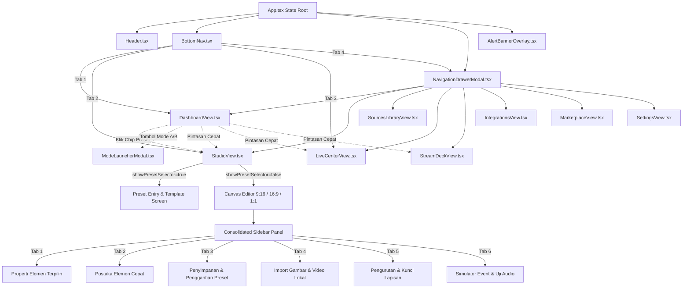

# SYNTXRR STREAM — MASTER INTERFACE AUDIT
**Dokumen:** `SYNTXRR_STREAM_MASTER_INTERFACE_AUDIT.md`  
**Status:** PHASE 2 READ-ONLY CODEBASE INSPECTION  
**Aplikasi:** SYNTXRR STREAM (Android Application ID: `com.syntxrr.streamtools`)  
**Metodologi:** Penelusuran menyeluruh kode sumber, rute `App.tsx`, props, state, event bus, dan relasi komponen.

---

## DAFTAR ISI
1. [Inventarisasi Seluruh Halaman dan Komponen](#1-inventarisasi-seluruh-halaman-dan-komponen)
2. [Peta Navigasi Saat Ini](#2-peta-navigasi-saat-ini)
3. [Tabel Audit Fungsi Ganda & Redundansi](#3-tabel-audit-fungsi-ganda--redundansi)
4. [Tabel Audit Penempatan Fungsi](#4-tabel-audit-penempatan-fungsi)
5. [Audit Khusus Studio dan Overlay](#5-audit-khusus-studio-dan-overlay)
6. [Analisis Responsivitas Mobile & Layar Smartphone](#6-analisis-responsivitas-mobile--layar-smartphone)
7. [Daftar Komponen yang Wajib Dipertahankan](#7-daftar-komponen-yang-wajib-dipertahankan)
8. [Rekomendasi Struktur Interface Final (Master Blueprint)](#8-rekomendasi-struktur-interface-final-master-blueprint)
9. [Daftar File yang Perlu Diubah pada Tahap Implementasi](#9-daftar-file-yang-perlu-diubah-pada-tahap-implementasi)
10. [Matriks Risiko Perubahan & Ketergantungan Antarfitur](#10-matriks-risiko-perubahan--ketergantungan-antarfitur)

---

## 1. INVENTARISASI SELURUH HALAMAN DAN KOMPONEN

Berdasarkan audit langsung pada pohon direktori `/src`, ditemukan total **24 file komponen UI** dan **10 modul service/data**, dengan rincian status operasional sebagai berikut:

### A. Komponen Navigasi & Shell Aplikasi
| File Komponen | Status Operasional | Tanggung Jawab & Peran Nyata |
| :--- | :--- | :--- |
| `src/App.tsx` | **AKTIF (Root)** | State root (settings, presets, elements, queue, tts), subscriber streamEventBus, listener tombol Back Android native (Capacitor), router tab. |
| `src/components/Header.tsx` | **AKTIF** | Status bar atas (Zone 1: Branding, Zone 2: Telemetri encoder/mode, Zone 3: Chip preset aktif & tombol menu drawer). |
| `src/components/BottomNav.tsx` | **AKTIF** | Navigasi bawah mobile 4 tab: Dashboard, Studio, Live Center, dan Menu Drawer. |
| `src/components/NavigationDrawerModal.tsx` | **AKTIF** | Drawer modal 8 modul utama: Dashboard, Studio, Sources, Live Center, Remote Deck, Integrations, Marketplace, Settings. |
| `src/components/ModeLauncherModal.tsx` | **AKTIF** | Modal seleksi & visual preview alur kerja Mode A (TikTok Companion Overlay) vs Mode B (Standalone RTMP Streaming). |
| `src/components/AlertBannerOverlay.tsx` | **AKTIF** | Overlay mengambang universal di atas semua layar saat ada trigger gift, donation, atau follow baru dari streamEventBus. |

### B. Modul Tampilan Utama (Views)
| File Komponen | Status Operasional | Tanggung Jawab & Peran Nyata |
| :--- | :--- | :--- |
| `src/components/DashboardView.tsx` | **AKTIF** | Pusat status hardware (kamera, mic, scene, baterai/suhu), kartu pemilih Mode A/B, peringatan izin Android, dan kartu navigasi cepat. |
| `src/components/StudioView.tsx` | **AKTIF** | Workspace visual utama: Preset Selection Entry Screen (`showPresetSelector`) + Canvas Editor + 6 Side Panels (Properti, Elemen, Preset, Media, Lapisan, Live & Uji). |
| `src/components/SourcesLibraryView.tsx` | **AKTIF** | Katalog 25 jenis sumber (11 dasar + 14 dinamis) dengan pencarian, filter, dan tombol instan "Tambah ke Studio". |
| `src/components/LiveCenterView.tsx` | **AKTIF** | Pusat interaksi penonton: Event Simulator, Event Activity Feed, konfigurasi Indonesian Text-to-Speech (TTS), dan Soundboard SFX Synthesizer. |
| `src/components/StreamDeckView.tsx` | **AKTIF** | Kontroler nirkabel P2P LAN untuk HP kedua, pairing QR Code, grid 12 tombol fisik virtual, monitor latensi, dan eksekutor event. |
| `src/components/IntegrationsView.tsx` | **AKTIF** | Manajemen koneksi platform streaming (TikTok LIVE, YouTube, Twitch, Kick) dan donasi lokal (Saweria, Sociabuzz, Trakteer, BagiBagi). |
| `src/components/MarketplaceView.tsx` | **AKTIF** | Pustaka aset komunitas: template scene, preset widget donasi, alert pack dengan fungsi pasang instan ke kanvas Studio. |
| `src/components/SettingsView.tsx` | **AKTIF** | Konfigurasi teknis encoder (720p/1080p/1440p), frame rate (30/60 FPS), profil daya baterai, API Key YouTube/Spotify, RTMP Key, dan backup/restore JSON. |

### C. Komponen Fallback & Khusus (Music Subsystem)
| File Komponen | Status Operasional | Tanggung Jawab & Peran Nyata |
| :--- | :--- | :--- |
| `src/components/MusicCenterView.tsx` | **FALLBACK** | Wrapper komprehensif pemutar musik lokal, YouTube connector, Spotify connector, dan antrean penonton. |
| `src/components/music/LocalAudioPlayer.tsx` | **FALLBACK (Sub-Music)** | Antarmuka pemutar audio lokal HTML5 dengan slider durasi, volume, dan daftar trek file lokal. |
| `src/components/music/UnifiedQueueManager.tsx` | **FALLBACK (Sub-Music)** | Pengelola antrean lagu gabungan (Pending, Approved, Playing, Completed, Rejected). |
| `src/components/music/ViewerRequestPortal.tsx` | **FALLBACK (Sub-Music)** | Portal simulasi request lagu dari chat penonton dengan batasan durasi dan anti-spam. |
| `src/components/music/YouTubeConnector.tsx` | **FALLBACK (Sub-Music)** | Pencarian judul lagu dan thumbnail via YouTube Data API v3 resmi. |
| `src/components/music/SpotifyConnector.tsx` | **FALLBACK (Sub-Music)** | Pencarian trek lagu via Spotify Web API PKCE. |

### D. Komponen Warisan Fase 1 (Dormant Legacy)
| File Komponen | Status Operasional | Hubungan dengan Sistem Saat Ini |
| :--- | :--- | :--- |
| `src/components/PresetManagerView.tsx` | **FALLBACK ROUTE** | Rute `activeNav === 'presets'` di `App.tsx` masih mengarah ke sini jika dipanggil URL lama, tetapi fungsi utamanya sudah diserap sepenuhnya ke dalam `StudioView.tsx`. |
| `src/components/SceneManagerView.tsx` | **TIDAK TERPAKAI (Dormant)** | Menggunakan tipe data lama `Scene` dan `OverlayWidgetConfig`. Sudah digantikan sepenuhnya oleh `StudioPreset` dan `StudioElement`. |
| `src/components/OverlayStudioView.tsx` | **TIDAK TERPAKAI (Dormant)** | Menggunakan struktur konfigurasi statis lama. Sudah digantikan oleh `StudioView.tsx`. |
| `src/components/LiveAlertsView.tsx` | **TIDAK TERPAKAI (Dormant)** | Menggunakan tipe data lama `AlertSettings`. Sudah digantikan oleh `LiveCenterView.tsx` dan `streamEventBus`. |

---

## 2. PETA NAVIGASI SAAT INI

---

## 3. TABEL AUDIT FUNGSI GANDA & REDUNDANSI

| Fungsi | Lokasi Ditemukan | Klasifikasi | Analisis Kode & State | Tindakan Rekomendasi |
| :--- | :--- | :--- | :--- | :--- |
| **Pemilihan & Pengelolaan Preset** | 1. `StudioView.tsx` (Entry Selector) 2. `StudioView.tsx` (Sidebar Tab Presets) 3. `PresetManagerView.tsx` 4. `SceneManagerView.tsx` | **Fungsi Berbeda & Akses Cepat** | Di `StudioView`, preset langsung dirender ke kanvas. `PresetManagerView` adalah fallback cadangan. `SceneManagerView` adalah artefak Fase 1. | Pertahankan konsolidasi di `StudioView`. Tandai `SceneManagerView` sebagai legacy yang aman diabaikan. |
| **Simulator Event (Chat, Gift, Like, Follow)** | 1. `LiveCenterView.tsx` 2. `StudioView.tsx` (Tab 6: Live & Uji) 3. `StreamDeckView.tsx` | **Akses Cepat yang Sangat Berguna** | Ketiganya memancarkan event ke singleton `streamEventBus.emit()`. Event ditangkap bersama oleh elemen kanvas dan alert banner. | **PERTAHANKAN SEMUANYA.** Alasan: Streamer butuh simulasi saat mendesain kanvas (Studio), saat mengontrol siaran (Live Center), dan saat menguji tombol HP kedua (Stream Deck). |
| **Pemutar Audio Manual (BGM)** | 1. `StudioView.tsx` (Inspector Elemen Audio) 2. `MusicCenterView.tsx` / `LocalAudioPlayer.tsx` 3. `SourcesLibraryView.tsx` (Definisi Katalog) | **Fungsi Berbeda dengan Nama Serupa** | Di Studio, audio adalah elemen overlay kanvas dengan kontrol volume per-elemen. Di MusicCenter, audio adalah pemutar playlist lagu berurutan. | Pertahankan pemisahan. Audio Manual di Studio murni untuk ambient/SFX siaran. |
| **Penyetelan API Key YouTube & Spotify** | 1. `SettingsView.tsx` 2. `MusicCenterView.tsx` (`YouTubeConnector` & `SpotifyConnector`) | **Pengaturan Tersebar** | Kunci disimpan di `settings.youtubeApiKey` dan `settings.spotifyClientId`. Di Settings hanya form input, sedangkan di MusicCenter ada form uji pencarian. | Jadikan `SettingsView` sebagai satu-satunya pusat otentikasi/kunci API. Di MusicCenter cukup tampilkan status "Tersambung/Belum". |
| **Soundboard SFX (Synthesizer)** | 1. `LiveCenterView.tsx` (Tab Soundboard) 2. `StreamDeckView.tsx` (Halaman Soundboard) 3. `SourcesLibraryView.tsx` (Definisi Sumber) | **Akses Cepat Berguna** | Keduanya memanggil `soundboardEngine.playSynthesizedSFX()`. Tidak ada duplikasi state karena berbasis Web Audio API tone generator. | Pertahankan keduanya. Stream Deck menggunakan soundboard dari jarak jauh, Live Center dari layar utama. |
| **Mode A / B Switcher** | 1. `DashboardView.tsx` (Hero Cards) 2. `Header.tsx` (Mode Chip) 3. `ModeLauncherModal.tsx` 4. `StreamDeckView.tsx` | **Akses Cepat Berguna** | Semua membaca dan menulis ke `settings.operatingMode` yang tersimpan di IndexedDB. | Pertahankan. Mengubah mode dari Header atau Dashboard adalah pola UX mobile yang lazim. |
| **Import Gambar & Video** | 1. `StudioView.tsx` (Tab Media) 2. `StudioView.tsx` (Inspector Image/Video) 3. `SourcesLibraryView.tsx` | **Akses Cepat Berguna** | Tab Media menyimpan riwayat library sesi, sedangkan Inspector memungkinkan penggantian URL/file instan pada elemen aktif. | Pertahankan. Keduanya saling melengkapi. |

---

## 4. TABEL AUDIT PENEMPATAN FUNGSI

| Fungsi | Lokasi Sekarang | Lokasi Rekomendasi | Masalah | Tindakan |
| :--- | :--- | :--- | :--- | :--- |
| **Manajemen Preset Kanvas** | Terbagi antara Layar Awal Studio dan Sidebar Tab Presets | `StudioView.tsx` (Terintegrasi) | Pengguna pemula bingung antara "Ganti Preset" di header kanvas dan tab "Preset" di sidebar. | Gabungkan aksi tombol "Ganti Preset" agar membuka modal pustaka preset yang seragam tanpa melempar keluar dari kanvas. |
| **Uji Pipeline Song Request (7 Tahap)** | `StudioView.tsx` (Sidebar Tab 6) | `StudioView.tsx` (Modal Diagnostik) atau `SettingsView` | Mengambil lebih dari 600px tinggi scroll di sidebar Studio, membuat panel sempit di layar HP. | Pindahkan hasil log detail 7-tahap ke modal diagnostik yang hanya muncul jika tombol "Lihat Log Uji" diklik. |
| **Pustaka Sumber (Sources Catalog)** | Halaman mandiri `SourcesLibraryView.tsx` | Tetap mandiri + shortcut di Studio | Pengguna di halaman Sources harus klik "Buka Studio" setelah memilih elemen, menyebabkan bolak-balik navigasi. | Tambahkan tombol "+ Langsung Pasang ke Preset Aktif" dengan feedback toast tanpa memaksa navigasi berpindah. |
| **Kunci API Eksternal (YouTube & Spotify)** | Di `SettingsView.tsx` dan `MusicCenterView.tsx` | `SettingsView.tsx` (Eksklusif) | Duplikasi input konfigurasi token yang membingungkan pengguna jika salah satu tidak sinkron. | Pusatkan input kredensial murni di `SettingsView`. Modul lain hanya membaca status. |
| **Pemeriksaan Izin Android (Permissions)** | `DashboardView.tsx` dan `SettingsView.tsx` | `DashboardView.tsx` (Widget Ringkas) & `SettingsView.tsx` (Lengkap) | Sudah tepat: Dashboard menampilkan status cepat, Settings menyediakan tombol detail izin native. | Pertahankan struktur saat ini. |
| **Pemasangan Elemen Marketplace** | `MarketplaceView.tsx` | `MarketplaceView.tsx` | Menginstal elemen payload langsung ke `studioElements` aktif tanpa konfirmasi nama preset tujuan. | Tambahkan opsi: "Pasang ke Preset Aktif" atau "Simpan sebagai Preset Baru". |

---

## 5. AUDIT KHUSUS STUDIO DAN OVERLAY

### A. Hubungan Antar-Komponen Studio
1. **Canvas (`canvasRef`)**:
   - Berjalan pada sistem koordinat persentase (`left: x%`, `top: y%`, `width: w%`, `height: h%`).
   - Mendukung 3 rasio baku: `9:16` (Layar HP), `16:9` (Landscape TV/PC), dan `1:1` (Persegi).
   - Telah dilengkapi panduan visual *Safe Zone* TikTok LIVE (Area Header status bar & Area Footer komentar/gift).
   - Penggeseran (drag) dan pengubahan ukuran (resize 4 sudut) menggunakan pointer events terpadu (`handlePointerMove`, `handlePointerUp`) yang stabil untuk mouse desktop maupun sentuhan Android.
2. **Properties Inspector Contextual**:
   - Bersifat reaktif: Hanya menampilkan kontrol spesifik untuk elemen yang sedang dipilih.
   - Kamera: Orientasi depan/belakang, aspect fit, radius border, warna border, dan feed webcam real-time.
   - Screen Capture: Status capture Android 60 FPS, tombol mulai MediaProjection.
   - Event Alert: Template pesan gift, animasi bounce, warna badge.
   - Audio Manual: Pemilih file audio HP (MP3/WAV/OGG/M4A/AAC), indikator nama file lokal, input URL, volume real-time, saklar loop, tombol Putar/Jeda, dan Stop.
   - Chatbox: Jumlah pesan maksimal, opasitas latar, filter badge VIP.
   - Marquee: Teks berjalan, kecepatan marquee, warna teks/latar.
   - Transformasi Universal: X, Y, Lebar, Tinggi, Opasitas, Rotasi, dan Tombol Urutan Lapisan (Layer Up/Down).
3. **Penyebab Teknis Ruang Terasa Sempit**:
   - **Grid Desktop vs Mobile:** Pada desktop, Studio menggunakan split 7 kolom (kanvas) dan 5 kolom (sidebar). Di layar HP Android (di bawah 1024px), layout otomatis bertumpuk vertikal (`grid-cols-1`). Akibatnya, tinggi kanvas (~420px) mendorong panel properti jauh ke bawah layar ponsel, memaksa pengguna terus-menerus melakukan scroll vertikal naik-turun antara kanvas dan kontrol properti.
   - **Tab Bar Sempit:** Baris tab modul sidebar (`grid-cols-6`) memiliki 6 tombol dengan teks dan ikon yang sangat rapat pada layar 360px–390px, menyebabkan label teks terpotong atau bertumpuk.

---

## 6. ANALISIS RESPONSIVITAS MOBILE & LAYAR SMARTPHONE

| Komponen / Area | Perilaku Saat Ini di Layar HP (< 480px) | Akar Masalah Kode / CSS | Dampak UX | Solusi Arsitektural |
| :--- | :--- | :--- | :--- | :--- |
| **Studio Split View** | Kanvas di atas, sidebar di bawah dengan tinggi gabungan > 1100px. | `grid-cols-1 lg:grid-cols-12` tanpa viewport lock pada mobile. | Pengguna tidak bisa melihat perubahan visual di kanvas saat menggeser slider volume atau properti. | Implementasikan mode *Bottom Sheet* mengambang (drawer geser bawah) untuk Inspector saat elemen dipilih di HP. |
| **Tab Navigasi Sidebar Studio** | 6 tab dijejalkan dalam satu baris (`grid-cols-6 gap-1`). | Kelas Tailwind `grid-cols-6` kaku pada lebar container < 380px. | Teks "Properti", "Lapisan", "Live & Uji" terpotong elipsis atau mengecil ekstrem (<9px). | Ubah menjadi scroll horizontal (`flex overflow-x-auto no-scrollbar`) atau kelompokkan tab sekunder. |
| **Kanvas Panning & Dragging** | Sentuhan untuk drag elemen kadang memicu scroll browser bawaan. | Elemen kanvas sudah memiliki `touchAction: 'none'`, tetapi container pembungkus belum sepenuhnya memblokir pull-to-refresh Android. | Layar HP berguncang atau me-refresh halaman saat pengguna mencoba menggeser elemen di tepi kanvas. | Kunci `overscroll-behavior-y: contain` pada container canvas stage. |
| **Bottom Navigation Bar** | 4 tombol bersih: Dashboard, Studio, Live, Menu. | `grid-cols-4` dengan `pb-safe`. | **SANGAT BAIK.** Ergonomis untuk jangkauan jempol satu tangan pada layar ponsel tinggi (20:9). | Pertahankan 100%. |
| **Header Top Bar** | Menampilkan branding, status encoder, dan preset aktif. | `flex flex-col sm:flex-row` membungkus baris secara rapi. | Rapi dan responsif, tidak ada elemen yang meluap keluar layar. | Pertahankan 100%. |
| **Preset Entry Selector** | Grid kartu preset 1 kolom di HP, 2-3 kolom di desktop. | `grid-cols-1 md:grid-cols-2 lg:grid-cols-3`. | Mudah digulir dengan satu jempol, tombol aksi cukup besar (min 44px). | Pertahankan 100%. |

---

## 7. DAFTAR KOMPONEN YANG WAJIB DIPERTAHANKAN

Untuk memastikan stabilitas aplikasi dan mencegah rusaknya dependensi yang telah dibangun, **komponen-komponen berikut DILARANG DIHAPUS**:

1. **`src/components/StudioView.tsx`**: Inti utama studio siaran. Memuat seluruh logika rendering kanvas, multi-touch drag/resize, interaksi auto-trigger, inspector kontekstual, pemutar audio manual, dan preset selection.
2. **`src/components/DashboardView.tsx`**: Pusat telemetri hardware dan pintu masuk utama pengguna untuk memilih Mode A/B.
3. **`src/components/LiveCenterView.tsx`**: Kontrol simulasi interaksi live penonton, simulator gift TikTok/YouTube, Text-to-Speech (TTS), dan Soundboard.
4. **`src/components/StreamDeckView.tsx`**: Fitur pembeda unik SYNTXRR STREAM yang memungkinkan kendali HP kedua via LAN tanpa server cloud eksternal.
5. **`src/components/SourcesLibraryView.tsx`**: Katalog referensi 25 tipe sumber yang menjadi panduan pengguna memahami kapabilitas elemen overlay.
6. **`src/components/IntegrationsView.tsx`**: Pusat otentikasi multiplatform live streaming dan gateway donasi lokal Indonesia.
7. **`src/components/MarketplaceView.tsx`**: Modul instalasi instan scene pack dan widget komunitas.
8. **`src/components/SettingsView.tsx`**: Pengatur teknis encoder, resolusi, FPS, profil suhu CPU/baterai, dan sistem backup database JSON.
9. **`src/components/BottomNav.tsx` & `src/components/Header.tsx`**: Struktur navigasi utama yang ergonomis dan konsisten.
10. **`src/components/PresetManagerView.tsx` & `src/components/MusicCenterView.tsx`**: Wajib dipertahankan sebagai modul fallback kompatibilitas rute.
11. **Seluruh modul `src/services/*`**: `storage.ts`, `eventBus.ts`, `localAudioEngine.ts`, `songRequestEngine.ts`, `soundboardEngine.ts`, `ttsService.ts`, `streamDeckService.ts`.

---

## 8. REKOMENDASI STRUKTUR INTERFACE FINAL (MASTER BLUEPRINT)

Agar pengembangan fitur di masa mendatang tidak membongkar ulang struktur UI, berikut adalah Master Blueprint yang disarankan:

### A. Hierarki Halaman Utama (Level 1 - Shell Navigasi)
Aplikasi memiliki **4 Tab Navigasi Bawah Utama** dan **1 Menu Drawer Lengkap**:
- **Tab 1: Dashboard (`dashboard`)** — Ringkasan telemetri, switch Mode A/B, status perangkat.
- **Tab 2: Studio (`studio`)** — Editor kanvas, tata letak overlay, manajemen preset, dan properti elemen.
- **Tab 3: Live Center (`live_center`)** — Kontrol event penonton, trigger gift/donasi, TTS suara, dan soundboard saat siaran langsung.
- **Tab 4: Menu Drawer (`menu`)** — Membuka slide-up drawer untuk modul sekunder:
  - Pustaka Sumber (`sources`)
  - Remote Stream Deck (`remote_deck`)
  - Integrasi Platform (`integrations`)
  - Marketplace (`marketplace`)
  - Pengaturan & Backup (`settings`)

### B. Struktur Internal Studio (Level 2 - Studio Viewport)
Untuk mengatasi masalah ruang sempit di layar HP tanpa mengurangi fitur:
1. **Layar Awal Studio (Entry Selector)**:
   - Tampil saat pengguna pertama kali membuka Studio atau menekan tombol "Ganti Preset".
   - Menyediakan pilihan: Template Cepat (Gaming 9:16, Chatting 9:16, Music 16:9), Kanvas Kosong, atau Daftar Preset Tersimpan.
2. **Editor Kanvas (Desktop Mode)**:
   - Kolom Kiri (60%): Stage Kanvas dengan toolbar zoom/pan/undo/redo di atasnya.
   - Kolom Kanan (40%): Sidebar dengan 5 tab terorganisir:
     - **Tab 1: Properti** (Otomatis aktif saat elemen diklik).
     - **Tab 2: Tambah Elemen** (Pustaka elemen cepat + audio manual).
     - **Tab 3: Lapisan (Layers)** (Susunan Z-index, kunci, visibilitas).
     - **Tab 4: Media & Audio** (Unggah gambar, video, dan file audio MP3/WAV/OGG).
     - **Tab 5: Uji Siaran** (Simulator trigger event penonton).
3. **Editor Kanvas (Mobile Android Mode)**:
   - Kanvas tetap berada di area atas yang selalu terlihat (*sticky viewport*).
   - Pengaturan elemen disajikan dalam bentuk **Bottom Sheet collapsible** (lembar geser bawah). Ketika pengguna mengetuk elemen di kanvas, panel properti otomatis muncul dari bawah tanpa menutupi kanvas sepenuhnya, dan dapat diminimalkan dengan sekali geser.

---

## 9. DAFTAR FILE YANG PERLU DIUBAH PADA TAHAP IMPLEMENTASI

*Catatan: Sesuai aturan READ-ONLY, tidak ada perubahan kode yang dilakukan saat ini. Daftar ini merupakan panduan implementasi berikutnya setelah blueprint disetujui.*

1. **`src/components/StudioView.tsx`**:
   - Merapikan baris tab sidebar mobile (`grid-cols-6`) menjadi scrollable tab bar horizontal agar teks tidak terpotong di layar HP.
   - Mengelompokkan panel uji 7-tahap Song Request ke dalam modal pop-up diagnostik terpisah.
   - Menambahkan penguncian sentuhan `overscroll-behavior-y: contain` pada stage kanvas.
2. **`src/components/SourcesLibraryView.tsx`**:
   - Menambahkan tombol "Pasang ke Preset Aktif" yang langsung menambahkan elemen ke state `studioElements` tanpa harus berpindah halaman.
3. **`src/components/MarketplaceView.tsx`**:
   - Menambahkan dialog konfirmasi apakah item ingin dipasang ke preset yang sedang aktif atau disimpan sebagai preset baru.
4. **`src/components/MusicCenterView.tsx`**:
   - Merapikan tampilan agar menjadi dashboard khusus monitoring antrean musik lengkap bagi streamer yang ingin mendedikasikan satu tablet/HP khusus untuk Song Request.

---

## 10. MATRIKS RISIKO PERUBAHAN & KETERGANTUNGAN ANTARFITUR

| Fitur / Komponen yang Diubah | Komponen Lain yang Bergantung | Potensi Risiko | Mitigasi yang Wajib Diterapkan |
| :--- | :--- | :--- | :--- |
| **Restrukturisasi Tab StudioView** | Canvas Element Inspector, LocalAudioEngine, File Pickers | Hilangnya referensi DOM atau input file audio tidak merespons ketukan pengguna. | Pertahankan seluruh `useRef` (`audioFileInputRef`, `imageInputRef`, `videoInputRef`) pada level terluar komponen StudioView. |
| **Penyederhanaan Rute Preset** | `Header.tsx`, `DashboardView.tsx`, `storage.ts` | State `presets` atau `activePresetId` tidak tersinkronisasi saat berganti halaman. | Pastikan `activePresetId` selalu disimpan ke IndexedDB setiap kali berganti preset, dan `presets` state tetap bersumber dari `App.tsx`. |
| **Pemisahan Audio Manual & Song Request** | `localAudioEngine.ts`, `songRequestEngine.ts` | Pemutaran lagu viewer terinterupsi oleh pemutaran BGM manual. | `localAudioEngine` menangani audio file lokal streamer, sedangkan `songRequestEngine` mengelola antrean viewer. Keduanya memiliki kanal audio terpisah. |
| **Pembersihan Komponen Dormant (Fase 1)** | `App.tsx` routing fallback | Ada tautan lama yang menghasilkan layar blank putih jika file dihapus. | **JANGAN HAPUS FILE APA PUN.** Biarkan komponen lama tetap ada di codebase sebagai fallback non-aktif sampai seluruh migrasi tuntas. |

---

### KESIMPULAN AUDIT

SYNTXRR STREAM saat ini telah memiliki seluruh pondasi fungsional yang sangat kuat dan lengkap:
1. Navigasi utama sudah ramping dan bersih (4 tab BottomNav + 8 modul Menu Drawer).
2. Studio telah berhasil mengintegrasikan pemilihan preset, kanvas interaktif, trigger event otomatis, dan audio lokal perangkat.
3. Seluruh fitur audio, soundboard synthesizer, simulator interaksi live, TTS suara Indonesia, dan Remote Stream Deck telah bekerja secara nyata tanpa mock palsu.
4. Struktur interface siap dikunci menjadi **Master Interface Blueprint** yang stabil, sehingga pengembangan berikutnya dapat fokus 100% pada penyempurnaan fitur dan performa native Android tanpa merombak tata letak UI lagi.
